# Backend End-to-End Documentation: `workflow-poc-agentic/server`

Reverse-engineered from the source on **2026-10-14**, after migrations `0016_minimal_schema.sql` and `0017_draft_and_published.sql`.
It replaces the 2026-10-13 version, which described the removed `workflow_version` table, `agent_map`, and `workflow_run.engine` (see [Appendix A](#appendix-a-changes-since-the-2026-10-13-version)).

**Scope.** `server/` (NestJS 12, Mastra 1.75, `pg`). The Next.js `web/` app is out of scope except where it calls the API.
`server/dist/` and `server/dist-test/` are build output. `dist/` was rebuilt at the same time as `src/` (2026-10-14 11:38), so it matches.

**Conventions**
- `file.ts:12-30` = source path under `server/src/` and line range in the current tree.
- **(unverified)** = depends on third-party library behaviour (Mastra, AI SDK, NestJS, Express, `pg`) or runtime conditions this document could not confirm from the repository.
- **Risk Rn** = a behaviour the code supports that may be unintended. All of them are listed in [§24](#24-observed-risks-and-edge-cases).
- Nothing here was confirmed by running the server. It was all read from source.

---

## Table of contents

1. [System overview](#1-system-overview)
2. [Boot, configuration and shared infrastructure](#2-boot-configuration-and-shared-infrastructure)
3. [Data model](#3-data-model)
4. [Core concepts: graph, flow, facts, step cards](#4-core-concepts-graph-flow-facts-step-cards)
5. [HTTP API inventory](#5-http-api-inventory)
6. [Module: Workflows (canvas CRUD, validation, publish)](#6-module-workflows)
7. [Module: Actions (tool registry, viaSocket flows, execution)](#7-module-actions)
8. [Module: Integrations (viaSocket builder token)](#8-module-integrations)
9. [Module: Conversations (playground, widget, attachments, AI calls)](#9-module-conversations)
10. [Module: Inbox (per-conversation event queue and sweeper)](#10-module-inbox)
11. [Module: Agents (supervisor, workflow agent, delivery)](#11-module-agents)
12. [Module: wf_* tools (guarded moves)](#12-module-wf-tools)
13. [Module: Step engine (pure rules)](#13-module-step-engine)
14. [Module: Workflow map](#14-module-workflow-map)
15. [Module: Runs and approvals API](#15-module-runs-and-approvals-api)
16. [Module: LLM usage and cost](#16-module-llm-usage-and-cost)
17. [Module: Dev endpoints](#17-module-dev-endpoints)
18. [End-to-end scenario traces](#18-end-to-end-scenario-traces)
19. [State machines](#19-state-machines)
20. [run_event catalogue (logging and tracing)](#20-run_event-catalogue)
21. [Cross-feature dependencies and coupling](#21-cross-feature-dependencies-and-coupling)
22. [Error handling, retries, idempotency, concurrency](#22-error-handling-retries-idempotency-concurrency)
23. [Security considerations](#23-security-considerations)
24. [Observed risks and edge cases](#24-observed-risks-and-edge-cases)
25. [Tests](#25-tests)
26. [Completeness checklist](#26-completeness-checklist)
27. [Coverage gaps after cross-check](#27-coverage-gaps-after-cross-check)
- [Appendix A: Changes since the 2026-10-13 version](#appendix-a-changes-since-the-2026-10-13-version)

---

## 1. System overview

The server runs customer chats through **canvas workflows** driven by LLM agents. A **supervisor** agent reads each customer message and routes it. A **workflow agent** (one per published graph) moves through the blocks using `wf_*` tools. A pure **step engine** checks each move.

| Layer | Files | Role |
|---|---|---|
| HTTP | 7 controllers registered in `app.module.ts:10` | CRUD, chat intake, teammate controls, approvals, dev tools |
| Inbox | `agents/inbox.ts` | Every trigger (customer message, approval decision, run control, timer) becomes a `ticket_event` row. Rows are processed one at a time per conversation, in-process |
| Agents | `agents/agents.ts`, `prompts.ts`, `mastra.ts`, `usage.ts` | Supervisor routes. The workflow agent replies. Replies are bubble-checked and dropped if stale |
| Guarded moves | `agents/wf-tools.ts`, `agents/tools.ts` | Load the run, check the move with the engine, persist, and return the next step card or `{ok:false, reason, fix}` |
| Step engine | `engine/engine.ts`, `engine/map.ts` | Pure functions: graph traversal, input formats, rules, loops, idempotency, step cards, map text. No DB, no AI |
| Persistence | `db.ts`, `runner/context.ts`, `runner/events.ts`, `runner/tasks.ts` | Postgres via a `pg` Pool. Run state in `workflow_run`, timeline in `run_event` |
| Actions | `actions/execute.ts`, `integrations/viasocket.ts` | Run viaSocket flow URLs, once per idempotency key |

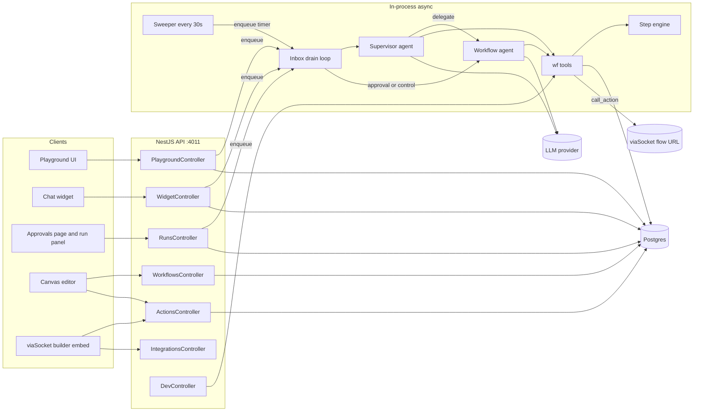

**Synchronous vs asynchronous.** HTTP handlers only validate, write rows, and call `enqueue()` (`inbox.ts:12-15`). All agent work (LLM calls, `wf_*` moves, action execution, replies) runs **asynchronously** in the inbox drain loop, after the HTTP response is sent. Screens see results by **polling** `GET /conversations/:id` or `GET /widget/conversations/:id`. There is no WebSocket or SSE. The only exception is `/dev/*`, which calls `wf_*` functions synchronously inside the request.

---

## 2. Boot, configuration and shared infrastructure

### 2.1 Process start (`main.ts:8-17`)

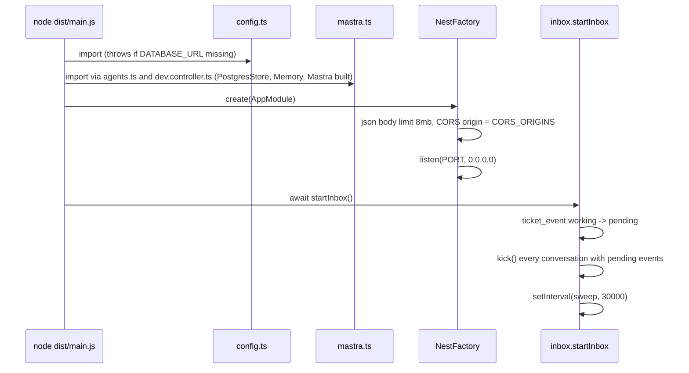

- `AppModule` (`app.module.ts:10`) only registers controllers. There are no providers, guards, interceptors, pipes or exception filters. Errors use NestJS's default exception handling. Thrown `HttpException`s become their status code. Anything else becomes 500 **(unverified: NestJS default filter)**.
- `playground.controller.ts:10-11` creates `UPLOADS_DIR` (default `<cwd>/uploads`) **at import time**.
- `mastra.ts:24-30` builds a `PostgresStore` (schema `mastra`), a `Memory` (last 20 messages) and a `Mastra` instance with one `probe` agent, also at import time. Whether `PostgresStore` connects or creates tables at construction or on first use is **(unverified)**.

### 2.2 Configuration (`config.ts:4-21`)

| Key | Env | Default | Used by |
|---|---|---|---|
| `port` | `PORT` | 4011 | `main.ts` |
| `corsOrigins` | `CORS_ORIGINS` (comma list) | `http://localhost:4010` | `main.ts` |
| `databaseUrl` | `DATABASE_URL` | **required**, boot throws without it | `db.ts`, `mastra.ts` |
| `llm.provider` | `LLM_PROVIDER` | `openai` | `mastra.model()`, `usage.mastraModel()` |
| `llm.model` / `apiKey` / `baseUrl` | `LLM_MODEL` / `LLM_API_KEY` / `LLM_BASE_URL` | empty | `mastra.model()`. It throws on the first agent call if model or key is empty |
| `devEndpoints` | `DEV_ENDPOINTS === '1'` | false | `dev.controller.ts` guard |
| `remindAfterSec` / `expireAfterSec` | `REMIND_AFTER_SEC` / `EXPIRE_AFTER_SEC` | 120 / 600 | `agents.markWaiting` |
| `approvalTimeoutSec` | `APPROVAL_TIMEOUT_SEC` | 1800 | `runner/tasks.openTask` |
| `maxVisits` | constant | 100 | `graph.validateGraph` (loop repeat limit range) |
| `maxGraphSteps` | constant | 50 | `graph.validateGraph` |

Read directly from `process.env` elsewhere: `VIASOCKET_ORG_ID`, `VIASOCKET_PROJECT_ID`, `VIASOCKET_EMBED_SECRET`, `VIASOCKET_UID` (`viasocket.ts:5`), and `UPLOADS_DIR` (`playground.controller.ts:10`).
There are no feature flags apart from `DEV_ENDPOINTS`.

### 2.3 Database helpers (`db.ts`)

| Function | Lines | Behaviour |
|---|---|---|
| `pool` | 4 | `pg.Pool`, `max: 10` |
| `q(sql, params)` | 6-8 | Returns `rows` |
| `one(sql, params)` | 10-12 | First row or `null` |
| `tx(fn)` | 14-27 | `begin` → `fn(client)` → `commit`. On throw: `rollback` and rethrow. Always `release()`. **Only `executeAction` uses it** |

All other writes are single autocommit statements. Multi-statement operations (for example "cancel run, then start new run" in a switch) are **not** atomic.

### 2.4 Migrations (`scripts/setup-db.js:6-40`, `npm run db:setup`)

1. Connect to the `postgres` maintenance DB. Create the target DB if it is missing. Skip with a log line if that fails (managed Postgres).
2. `create table if not exists schema_migrations(name pk, applied_at)`.
3. For each `migrations/*.sql` in lexical order that is not yet in `schema_migrations`: `begin` → run file → insert name → `commit`. On error, it prints the message and exits 1 (the open transaction is dropped with the connection).
4. `render.yaml` runs `npm run db:setup && npm start` on **every** start.

There is no `0008_*.sql` file (the numbering has a gap). This is harmless because names are tracked, not numbers.

### 2.5 Mastra and model (`agents/mastra.ts`)

- `model()` (`:13-22`): builds an AI SDK model on every call.
  - `anthropic` → `createAnthropic({apiKey, baseURL?})(id)`
  - `openai-compatible` → requires `LLM_BASE_URL`, uses `createOpenAI(...).chat(id)` (Chat Completions)
  - otherwise → `createOpenAI({apiKey, baseURL?})(id)`

  Agents pass `model: () => model()`, so the env is read at call time **(unverified: Mastra resolves a function model per call)**.
- `storage` / `memory` (`:24-25`) are used only by the dev `probe` agent. The supervisor and workflow agents have **no Mastra memory**. Chat history is passed explicitly on every call (`agents.ts:29-37`).

### 2.6 Scripts and deployment

| Script | Command |
|---|---|
| `build` | `nest build` → `dist/` |
| `start` | `node --env-file-if-exists=.env dist/main.js` |
| `dev` | build, then start (no watch) |
| `db:setup` | migrations (above) |
| `test` | `tsc -p tsconfig.test.json` → `node --test dist-test/test/**/*.test.js` |

`render.yaml`: free Postgres, API service (`healthCheckPath: /actions`, so the health check hits the DB), and web service (`NEXT_PUBLIC_API_URL=/api`, with Next rewriting `/api/*` to `API_ORIGIN`, see `web/next.config.ts:7`).

---

## 3. Data model

### 3.1 Final schema (after all migrations)

Derived by replaying `migrations/0001`–`0017` by hand. **(unverified against a live database.)**

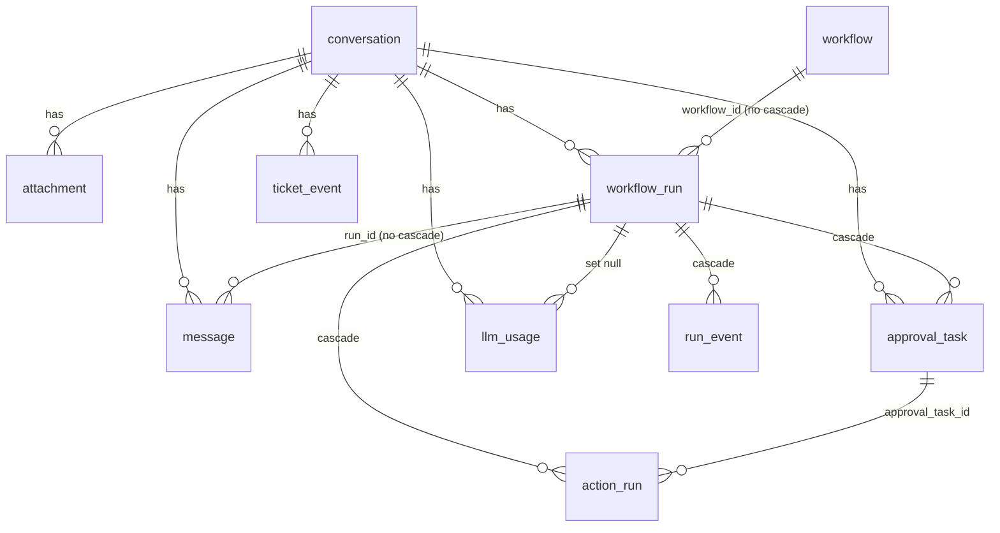

`action` is not linked by foreign key. Workflows reference action keys as plain text in `action_keys`, `published_action_keys`, inside graph JSON, and in `approval_task.action_key` / `action_run.action_key`.

| Table | Columns (final) | Constraints and indexes | Written by | Read by |
|---|---|---|---|---|
| `action` | `key` pk, `name`, `description`, `builtin`, `input_schema` jsonb, `enabled`, `source` (`builtin`\|`viasocket_flow`, default `viasocket_flow`), `via_flow_id` unique, `via_flow_url`, `created_at`, `requires_approval`, `details_edited` | `key ~ '^[a-z][a-z0-9_]{1,47}$'` | `ActionsController` | `execute.getAction`, `workflows.service` (enabled keys, needsApproval), `wf-tools.ok` (arg spec) |
| `workflow` | `id` uuid, `name`, `when_to_use`, `graph` jsonb **not null**, `action_keys text[]`, `step_count`, `enabled`, `has_unpublished_changes`, `archived_at`, `row_version`, `created_at`, `updated_at`, `published_graph`, `published_when_to_use`, `published_action_keys text[]`, `published_at` | unique `name` where `archived_at is null` (`workflow_name_active`) | `workflows.service` | supervisor list, `wfStart`, `wfSwitchWorkflow`, `startAgentRun`, `workflowAgent`, action rename/delete checks, dev map |
| `conversation` | `id`, `customer_name`, `customer_email`, `created_at`, `channel` (`playground`\|`widget`) | — | Playground, Widget, Dev | everywhere |
| `message` | `id`, `conversation_id`, `role` (`customer`\|`bot`\|`team`\|`system`), `text`, `attachment_ids uuid[]`, `run_id`, `created_at` | index `(conversation_id, created_at)` | `postCustomerMessage`, `teamSend`, `agents.send`, `sysNote`, inbox error path | transcript, `newerMessage`, inbox seen-cleanup, screens |
| `attachment` | `id`, `conversation_id`, `file_name`, `mime_type`, `size_bytes`, `sha256`, `path`, `created_at` | — | `POST /attachments` | message joins, `GET /attachments/:id`, approvals list |
| `workflow_run` | `id`, `conversation_id`, `workflow_id` (not null), `workflow_name`, `graph` jsonb (not null), `status`, `current_node_id`, `facts`, `waiting_for`, `outbox`, `paused_from`, `started_at`, `updated_at`, `ended_at`, `end_reason` | status check (9 values). **Unique `(conversation_id)` where status in `running, waiting_customer, waiting_approval, paused, failed`** (`workflow_run_one_active`) | `startAgentRun`, `saveRun`, inbox `timerTurn`, `markWaiting`, `deliver` (outbox) | everything |
| `approval_task` | `id`, `run_id`, `conversation_id`, `node_id`, `kind` (`evidence`\|`action`), `action_key`, `action_args`, `summary`, `evidence`, `status` (`pending`\|`approved`\|`rejected`\|`expired`\|`cancelled`), `decided_by`, `decided_at`, `decision_note`, `due_at`, `created_at` | unique `(run_id, node_id)` where `status='pending'` | `openTask`, `decide`, `commit` (cancel on end), `timerTurn`, dev approval | approvals list, `decideAgentApproval`, retry |
| `action_run` | `id`, `action_key`, `run_id`, `node_id`, `idempotency_key` **unique**, `mode` (`auto`\|`approved`\|`test`), `approval_task_id`, `args`, `status` (`running`\|`succeeded`\|`failed`), `result`, `error`, `started_at`, `finished_at`, `visit` | — | `executeAction` | `GET /actions/:key/sample`, conversation view |
| `run_event` | `id` bigserial, `run_id`, `node_id`, `actor`, `type`, `data`, `at` | index `(run_id, id)` | `addEvent` | conversation view, `agentRunState` |
| `ticket_event` | `id` bigserial, `conversation_id`, `kind` (`customer_message`\|`approval_decided`\|`timer`\|`control`), `payload`, `status` (`pending`\|`working`\|`done`\|`failed`), `error`, `created_at`, `done_at` | partial index `(conversation_id, id)` where status in (`pending`,`working`) | `enqueue`, `drain`, `startInbox` | `drain`, `kick`, `sweep` |
| `llm_usage` | `id` bigserial, `conversation_id`, `run_id` (on delete set null), `agent`, `model`, `input_tokens`, `output_tokens`, `cost_usd` numeric, `started_at` not null default now(), `trace` jsonb | index `(conversation_id, started_at)` | `recordUsage` | conversation view, `/ai-calls/:id`, dev probe |
| `schema_migrations` | `name` pk, `applied_at` | — | `setup-db.js` | `setup-db.js` |
| schema `mastra` | managed by `@mastra/pg` **(unverified contents)** | — | Mastra | dev probe memory |

Dropped along the way: `app_setting`, `app_connection`, `shop_order`, `workflow_version`, schema `dbos`. Also dropped: the action columns `kind`, `autonomy`, `max_auto_minor`, `approver_team`, `subject_field`, `amount_field`, `via_*` app fields and `input_template`; the workflow columns `steps`, `template`, `autonomy`, `published_version_id`; and `workflow_run.engine` and `workflow_version_id`.

### 3.2 Migration history

| File | Effect on the final model |
|---|---|
| `0001_init` | Base tables. Seeds 4 actions (`lookup_order`, `refund_order`, builtin `request_approval`, builtin `escalate_to_human`) and `shop_order` |
| `0002_viasocket` | `action.source` and viaSocket app fields, `app_connection`. Builtins get `source='builtin'` |
| `0003` | Name unique only among non-archived workflows |
| `0004_plan_alignment` | `requires_approval` replaces autonomy. `waiting_team` → `waiting_approval`. `facts.visits`. `action_run.visit`. `message.role` adds `team`. `conversation.channel` |
| `0005` | `source` adds `viasocket_flow`, plus `via_flow_id` (unique) and `via_flow_url` |
| `0006` | `details_edited` |
| `0007` | `workflow.graph`, `workflow_version.graph` |
| `0009` | Archive workflows that use the mock actions. Delete `source='mock'` actions. Drop `shop_order` |
| `0010` | `workflow_run.engine`, `workflow_version.agent_map`, `llm_usage` |
| `0011` / `0012` | `ticket_event`, then kind `control` |
| `0013`–`0015` | `llm_usage.cost_usd`, `started_at` (backfilled from `run_event.data.ms`), `trace` |
| `0016_minimal_schema` | Drops the legacy columns and tables listed above. `graph` becomes not null. Drops `llm_usage.created_at` |
| `0017_draft_and_published` | Draft and published copy on one row. `workflow_run` stores `workflow_id`, `workflow_name` and its own `graph`. Drops `workflow_version` |

After 0009 and 0016, the only seeded actions left are the two builtins, `request_approval` and `escalate_to_human` (`source='builtin'`, `requires_approval=false`).

### 3.3 JSON shapes stored in columns (`types.ts`)

| Column | Type | Notes |
|---|---|---|
| `workflow.graph` / `published_graph` / `workflow_run.graph` | `WorkflowGraph` (`types.ts:17-34`) | `{start, groups[{id,title,x,y,items[]}], edges[{id,from{groupId,itemId?,port?},to{groupId,itemId?},maxVisits?,fresh?}], variables?[]}` |
| graph items | `GraphItem` (`:20-24`) | `step{content: Inline[], save?: [{path,var}]}` · `bubble{content}` · `input{prompt, saveAs, format, retry?}` · `condition{mode?: ai\|rules, cases[{id, kind: if\|else_if\|else, condition: Inline[], rules?, join?}]}` |
| `Inline` | `:2` | `{t:'text',v}` · `{t:'action',key}` · `{t:'var',key}` |
| `workflow_run.facts` | `Facts` (`:56-69`) | `collected`, `outputs` (node → result), `cases` (node → `{case_id, reason}`), `attempts` (node → count, `'!'+node` reset key), `visits` (edge → visit no.), `since`, `previous`, `collectedBy`, `vars`, `varsBy`, `asked`, `trail` |
| `workflow_run.waiting_for` | `WaitingFor` (`:71-73`) | `{type:'customer', node_id, expects[], remind_at, expires_at, reminded}` or `{type:'approval', node_id, task_id, due_at}` (epoch ms) |
| `workflow_run.outbox` | `OutboxItem[]` (`:76`) | `{text, verbatim:true, nodeId?}`: text bubbles the next reply must contain |
| `workflow_run.paused_from` | `:89` | `{status, waiting_for}` to restore on resume |
| `approval_task.evidence` | object | Current code writes `{facts: run.facts.outputs}` (`wf-tools.ts:192-193`) |
| `llm_usage.trace` | object | `{rounds[{round, request, response{text, tool_calls, tool_results, finish_reason, usage}}], final_text}` (`usage.ts:37-53`) |

Constants used in validation: `RULE_OPS` (`types.ts:11`: `=`, `!=`, `contains`, `>`, `<`, `empty`, `not_empty`) and `INPUT_FORMATS` (`types.ts:14`: `text`, `email`, `number`, `phone`). Both are checked by `validateGraph`.

### 3.4 Feature → table map

| Feature | Reads | Inserts | Updates | Deletes |
|---|---|---|---|---|
| Workflow CRUD and publish | `workflow`, `action` | `workflow` | `workflow` | — (soft archive) |
| Action registry | `action`, `workflow`, `action_run` | `action` | `action` | `action` (flows only) |
| Chat intake | `conversation` | `message`, `conversation`, `attachment`, `ticket_event` | `attachment.path` | — |
| Inbox | `ticket_event`, `workflow_run`, `message` | `ticket_event`, `message` | `ticket_event`, `workflow_run`, `approval_task` | — |
| Agent turn | `workflow_run`, `workflow`, `message`, `attachment`, `action`, `run_event`, `conversation` | `message`, `run_event`, `llm_usage` | `workflow_run` | — |
| wf moves | `workflow_run`, `conversation`, `action`, `approval_task`, `workflow` | `workflow_run`, `run_event`, `approval_task`, `action_run` | `workflow_run`, `approval_task`, `action_run` | — |
| Approvals | `approval_task`, `conversation`, `workflow_run`, `attachment` | `ticket_event` | `approval_task` | — |

---

## 4. Core concepts: graph, flow, facts, step cards

### 4.1 Draft vs published vs run copy

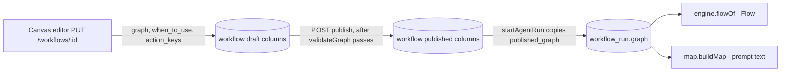

- A run **never** reads `workflow.published_graph` again after it starts. `loadRun` builds the flow from `workflow_run.graph` (`runner/context.ts:8-12`). Republishing does not change running conversations.
- Exception: the workflow agent's **"When to use"** text and the **"(needs approval)" markers** in its map are read live from `workflow` and `action` when the agent is first built (`agents.ts:62-63`). See Risk R6.

### 4.2 Graph items → engine nodes (`engine.ts:20-52`)

| Canvas item | Engine `FlowNode.type` | Step card `type` (`engine.ts:324-342`) | Completed by |
|---|---|---|---|
| `step` | `step` | `ai_step` (with `tools` = mentioned `@actions`) | `wf_complete_step` (needs its action output when it mentions one) |
| `bubble` | `say` | `bubble` | `wf_complete_step` → text queued in `outbox` |
| `input` | `ask` | `input` (`collects`, `answered?`) | `wf_save_input`, or `wf_complete_step` if already answered |
| `condition` mode `rules` | `branch` | `rules_condition` | `wf_choose_case` (the server re-checks with `chooseByRules`) |
| `condition` mode `ai`/unset | `branch` | `ai_condition` | `wf_choose_case` (any valid case id) |

Movement (`graphFlow`):
- `first()` = first item of the `start` group.
- `next(id)` = the following item in the same group. Otherwise the group's exit edge (`from.itemId` unset). Otherwise `{to:null}`, which ends the run.
- `afterCase(id, caseId)` = the edge from that case port. **An unconnected case falls through to `next(id)`.**
- An edge target is `to.itemId`, or the first item of `to.groupId`.

### 4.3 Values and variables

| Function | Lines | Meaning |
|---|---|---|
| `baseVars(conv)` | `runner/context.ts:15-16` | `customer.name`, `customer.email`, `today` (UTC `YYYY-MM-DD`) |
| `varsFor(base, declared, facts)` | `engine.ts:62-69` | base + declared workflow variables that have a value (`facts.vars[k] ?? facts.collected[k]`), stringified |
| `shownVars(declared, vars)` | `:72` | Declared but empty variables render as `''`, not `{{name}}` |
| `ruleValues(facts, vars)` | `:75` | `{...facts.collected, ...vars, ...facts.vars}`: what rules compare |
| `renderInline(content, vars)` | `workflows/inline.ts:4-9` | `@action` → `` `key` ``. `{{var}}` → value, or a literal `{{key}}` if unknown |
| `stepActions(content)` | `workflows/inline.ts:11-13` | The `@action` keys an AI step mentions. Used by `planCall`, `completeError`, `stepCard`, `buildMap` and `wfCallAction` |

`startAgentRun` seeds `facts.collected = {customer_name, email}` (`wf-tools.ts:256`).

### 4.4 Visits, trail and idempotency keys

- `facts.trail` lists the items finished on the current path (`follow`, `engine.ts:270-283`). A jump along an **edge** to an item already on the trail is a **loop back**.
- `rerun()` (`:250-267`) increments `facts.visits[edge.id]` (the first pass is implicitly 1). It returns `false` once `visit > maxVisits`, which ends the run `escalated / loop_limit`. For every item from the target to the end of the trail it:
  - moves `outputs` to `previous`,
  - clears `cases`, `attempts` and `asked`,
  - sets `since`,
  - if `fresh` ("ask again"), deletes the variables those items filled (`varsBy`, `collectedBy`).
- `visitOf(facts)` = `1 + Σ(visits − 1)` (`:246`). Action idempotency key = `"<runId>:<nodeId>:<visit>"` (`execute.ts:15`). A re-run after a loop gets a new key, so the action runs again. A repeat within a visit returns the stored result.
- `maxVisits` counts **total visits of the target including the first pass**. `maxVisits: 2` allows one loop back. The second loop back hits the limit (see test `engine.test.ts:73-93`).

### 4.5 Step card and tool result

Each successful `wf_*` move returns `ToolOk` (`wf-tools.ts:15`):
`{ok:true, run_id, status, progress, next: StepCard|null, actions?: ["key(arg: type (required), …)"], say: string[] (pending bubbles), result?}`.
Rejected moves return `{ok:false, reason, fix}` and log a `move_rejected` event (`wf-tools.ts:106-112`).
`progress` = `"Collected: k=v, …"` from `facts.vars`, or `"Nothing collected yet"` (`:43-46`).

---

## 5. HTTP API inventory

No endpoint has authentication or authorization. CORS restricts browser origins only. "Async effect" means work done later by the inbox.

| # | Method | Route | Handler | Sync effect | Async effect | Web caller |
|---|---|---|---|---|---|---|
| 1 | GET | `/workflows` | `WorkflowsController.list` → `listWorkflows` | read | — | yes |
| 2 | GET | `/variables` | `WorkflowsController.variables` | constant `VARIABLES` | — | yes |
| 3 | POST | `/workflows` | `createWorkflow` | insert workflow | — | yes |
| 4 | GET | `/workflows/:id` | `getWorkflow` | read + validate | — | yes |
| 5 | PUT | `/workflows/:id` | `saveWorkflow` | optimistic update of the draft | — | yes |
| 6 | POST | `/workflows/:id/publish` | `publishWorkflow` | copy draft to published, enable | — | yes |
| 7 | PATCH | `/workflows/:id` | `patchWorkflow` | `enabled` | — | yes |
| 8 | DELETE | `/workflows/:id` | `archiveWorkflow` | soft archive | — | yes |
| 9 | GET | `/actions` | `ActionsController.list` | read | — | yes |
| 10 | GET | `/actions/:key/sample` | `sample` | latest succeeded `action_run.result` | — | yes (save-response editor) |
| 11 | GET | `/actions/:key` | `get` | read / 404 | — | yes |
| 12 | PATCH | `/actions/:key` | `patch` | flags, details, rename | — | yes |
| 13 | DELETE | `/actions/:key` | `remove` | delete flow action | — | yes |
| 14 | POST | `/actions/from-flow` | `fromFlow` | upsert / disable / delete from a viaSocket event | — | yes (viasocket panel) |
| 15 | GET | `/integrations/builder-token` | `IntegrationsController.builder` | sign token | — | yes |
| 16 | GET | `/conversations` | `PlaygroundController.list` | read | — | yes |
| 17 | POST | `/conversations` | `create` | insert conversation | — | yes |
| 18 | GET | `/ai-calls/:id` | `aiCall` | read `llm_usage` incl. trace | — | yes |
| 19 | GET | `/conversations/:id` | `get` | read everything for the screen | — | yes |
| 20 | POST | `/conversations/:id/messages` | `send` → `postCustomerMessage` | insert message, enqueue | customer turn | yes |
| 21 | POST | `/conversations/:id/team-messages` | `teamSend` | insert `team` message | none (does not wake the run) | yes |
| 22 | POST | `/attachments` | `upload` | insert + write file | — | yes |
| 23 | GET | `/attachments/:id` | `file` | stream file | — | yes |
| 24 | POST | `/widget/conversations` | `WidgetController.start` | insert widget conversation | — | yes |
| 25 | GET | `/widget/conversations/:id` | `get` | read customer-visible messages + typing | — | yes |
| 26 | POST | `/widget/conversations/:id/messages` | `send` | insert message, enqueue | customer turn | yes |
| 27 | POST | `/runs/:id/:op` | `RunsController.control` | check status, enqueue | control turn | yes |
| 28 | GET | `/approvals?status=` | `approvals` | read | — | yes |
| 29 | POST | `/approvals/:id/decide` | `decide` | pending → approved/rejected, enqueue | approval turn | yes |
| 30 | POST | `/dev/agent-runs` | `DevController.start` | new conversation + run | — | no (curl) |
| 31 | GET | `/dev/agent-runs/:id` | `state` | run state + events | — | no |
| 32 | POST | `/dev/agent-runs/:id/tools/:tool` | `tool` | runs a `wf_*` tool synchronously | — | no |
| 33 | POST | `/dev/agent-runs/:id/approval` | `approval` | decides and applies synchronously | — | no |
| 34 | GET | `/dev/workflows/:id/map` | `map` | build the map | — | no |
| 35 | POST | `/dev/llm/probe` | `probe` | one LLM call | — | no |

There is no request-validation pipe (`ValidationPipe` is not registered), so bodies are untyped `any` beyond the checks written in each handler.

---

## 6. Module: Workflows

Files: `workflows/workflows.controller.ts`, `workflows/workflows.service.ts`, `workflows/graph.ts`, `workflows/inline.ts`.

### 6.1 `GET /workflows` — `listWorkflows` (`workflows.service.ts:15-18`)
- SQL: `select id, name, when_to_use, enabled, step_count, has_unpublished_changes, updated_at, published_at from workflow where archived_at is null order by created_at`.
- Response 200: array of those rows. No validation is computed here.

### 6.2 `GET /variables` (`workflows.controller.ts:8`)
Returns `VARIABLES` (`types.ts:92-96`): `customer.name`, `customer.email`, `today`.

### 6.3 `POST /workflows` — `createWorkflow` (`:26-36`)
1. `base = body.name?.trim() || 'Untitled workflow'`.
2. `taken = select name from workflow where name like '<base>%' and archived_at is null`. If `base` itself is taken, `name = "<base> <taken.length+1>"`.
3. `graph = emptyGraph()` (`:8`): a single empty `start` group.
4. `validateGraph(graph, enabledActionKeys())` to fill `action_keys` (`[]`) and `step_count` (0).
5. `insert into workflow (name, when_to_use='', graph, action_keys, step_count)`. Defaults: `enabled=false`, `has_unpublished_changes=true`, `row_version=1`.
6. Returns `getWorkflow(id)`.

Errors: a name collision that slips past step 2 (for example `X` and `X 3` exist, so the new name `X 3` collides) violates `workflow_name_active` and returns **500** (Risk R14). `%` and `_` in names act as `LIKE` wildcards.

### 6.4 `GET /workflows/:id` — `getWorkflow` (`:20-24`)
`select * ... where id=$1 and archived_at is null`. 404 `workflow not found`. Returns the row plus `validation = validateGraph(w.graph, enabledActionKeys())` = `{issues[], action_keys[], step_count}`. A malformed (non-uuid) id makes Postgres raise `invalid input syntax for type uuid`, which returns **500** **(unverified: default filter)**. The same applies to every uuid route param.

### 6.5 `PUT /workflows/:id` — `saveWorkflow` (`:38-50`)
Body `{name, when_to_use, graph?, row_version}`.
1. 400 `name is required` if the name is blank.
2. Load the current `graph` (404 if the row is missing; archived rows are **not** excluded here).
3. `graph = body.graph ?? cur.graph`. `validateGraph` computes `action_keys` and `step_count`. **Issues do not block saving.**
4. `update workflow set name, when_to_use, graph, action_keys, step_count, has_unpublished_changes=true, row_version=row_version+1, updated_at=now() where id=$1 and row_version=$7 and archived_at is null returning id`.
5. No row → **409** `This workflow changed elsewhere — reload to see the latest version.`. This covers a stale `row_version` and also an archived workflow.
6. Returns `getWorkflow(id)`.

Edge: a `graph` without `edges` (or with `groups` but a broken item shape) throws inside `validateGraph` and returns 500 (Risk R15).

### 6.6 `POST /workflows/:id/publish` — `publishWorkflow` (`:53-59`)

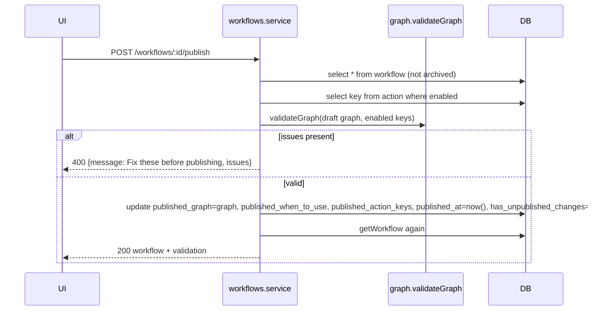

- Publishing **always enables** the workflow.
- There is no version history. The previous published copy is overwritten. Runs keep their own `graph` copy.
- There is no `row_version` check on publish. It publishes whatever draft is stored at that moment.

### 6.7 `PATCH /workflows/:id` — `patchWorkflow` (`:61-66`)
Body `{enabled?}`. 404 via `getWorkflow`. 400 `Publish the workflow before enabling it` when `enabled` is true and `published_graph` is null. Then `enabled = coalesce($2, enabled)`. Disabling hides the workflow from the supervisor and blocks `wfStart`/`wfSwitchWorkflow`. Active runs continue.

### 6.8 `DELETE /workflows/:id` — `archiveWorkflow` (`:68-71`)
`update workflow set archived_at=now(), enabled=false`. Returns `{ok:true}` even if the id does not exist. Active runs continue on their copy.

### 6.9 `validateGraph(g, enabledActions)` (`graph.ts:43-125`)
Returns `{issues: string[], action_keys, step_count}`. The rules, in order:

| Check | Issue text (abridged) |
|---|---|
| no groups | `Add at least one group` (early return) |
| empty group | `"<title>": add at least one step` |
| duplicate item id | `duplicate item id` |
| step with no text (actions count as text) | `a step is empty` |
| step `save` without an `@action` / empty path or var / duplicate var | `"Save response" needs an @action…`, `each saved field needs a path and a variable`, `a variable is saved twice in one step` |
| bubble empty / bubble with `@action` | `a text bubble is empty` / `can't run @actions; use an AI step` |
| input without `saveAs` / unknown format | `choose a variable…` / `unknown input type` |
| condition: first case not `if`; `else` not last; ai-mode case with no text; rules-mode case with no rules; rule without var; `ref === ''`; unknown op | respective texts |
| start group missing | `The start group is missing` |
| edge to/from a missing group | `An arrow points to a group that no longer exists` |
| edge `to.itemId` not in `to.groupId` | `…points to a step that no longer exists` |
| edge from a case that is not a condition case | `an arrow starts from a case that no longer exists` |
| two edges from the same output (`group:item:port`) | `one output has two arrows` |
| `maxVisits` not an integer in 1..100 | `repeat limit must be 1 to 100` |
| a group unreachable from the start (BFS over edges) | `"<title>" can't be reached from the start` |
| a cycle (Tarjan SCC over groups, `cycles()` `:22-41`) with no edge inside it carrying `maxVisits` | `Loop through … needs a repeat limit…` |
| `step_count` (non-condition items, `graphStepCount` `:19`) > 50 | `Too many steps` |
| an `@action` not in enabled actions | `@key doesn't exist or is disabled` |
| a `{{var}}` / `saveAs` / save var / rule var or ref not in `VARIABLES` or `graph.variables` | `Unknown variable {{k}}` |
| a declared variable not matching `^[a-z][a-z0-9_]*$` | `use lowercase letters, digits and _` |

`graphMentions` (`:6-16`) collects action keys and variable names. Those `action_keys` are stored on the draft and copied to `published_action_keys` on publish. The action rename and delete checks use them (§7).

---

## 7. Module: Actions

Files: `actions/actions.controller.ts`, `actions/execute.ts`, `integrations/viasocket.ts`.

### 7.1 Read endpoints
- `GET /actions` (`:32`): `select * from action order by source, created_at, key`. It exposes `via_flow_url`, which the code itself treats as a credential (§23).
- `GET /actions/:key/sample` (`:35-40`): newest `action_run` with `status='succeeded'` and non-null `result` for the key. Returns `{result|null, at|null}`. Used by the "Save response" field picker.
- `GET /actions/:key` (`:42-47`): 404 if missing.

### 7.2 `PATCH /actions/:key` (`:50-69`)
Body `{enabled?, requires_approval?, new_key?, name?, description?}`.
1. `this.get(key)` → 404.
2. If `new_key` differs from `key`:
   - 400 if it does not match `^[a-z][a-z0-9_]{1,47}$`
   - 400 if it already exists
   - 400 `@key is used by <names>…` if any **non-archived** workflow has the key in `action_keys` **or** `published_action_keys`
3. 400 if `name` or `description` is provided but blank.
4. Single `update`: each field uses `coalesce`. `details_edited = details_edited or (name or description provided)`. `key = coalesce(new_key, key)`.
5. Returns the action under its new key.

Not checked on rename: active runs' copied graphs and pending `approval_task.action_key` (Risk R8).

### 7.3 `DELETE /actions/:key` (`:71-77`)
1. 400 `used by: …` if any non-archived workflow has the key in its **draft** `action_keys`. `published_action_keys` is **not** checked (Risk R8).
2. `delete from action where key=$1 and source='viasocket_flow'`. Builtins are silently kept, but the response is still `{ok:true}`.

### 7.4 `POST /actions/from-flow` — `fromFlow` (`:80-108`)
Called by the web viaSocket panel when the builder posts a window message (`web/src/components/viasocket-panel.tsx:86`).

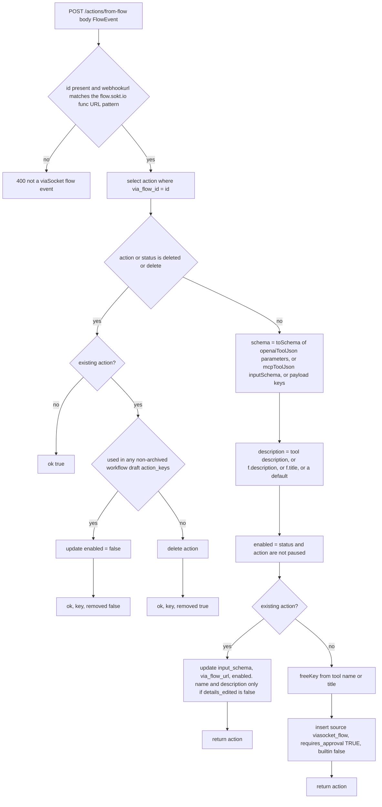

- `toSchema` (`:14-18`) keeps only `type` (default `string`) and `description` per property. `required` is filtered to known properties. With no schema it infers `number` or `string` from the sample payload values.
- `freeKey` (`:21-28`) lowercases, replaces non `[a-z0-9_]` with `_`, strips leading non-letters and trailing `_`, cuts to 40 chars, prefixes `flow_` if shorter than 2 chars, then appends `_2`, `_3`, … until the key is free (one query per try).
- An update event always sets `enabled` from the flow's paused state. It **re-enables** an action a teammate disabled here (Risk R16).

### 7.5 `executeAction(action, args, ctx)` (`execute.ts:12-39`)

Callers: `wfCallAction` (mode `auto`) and `runApproved` (mode `approved`, with `taskId`).

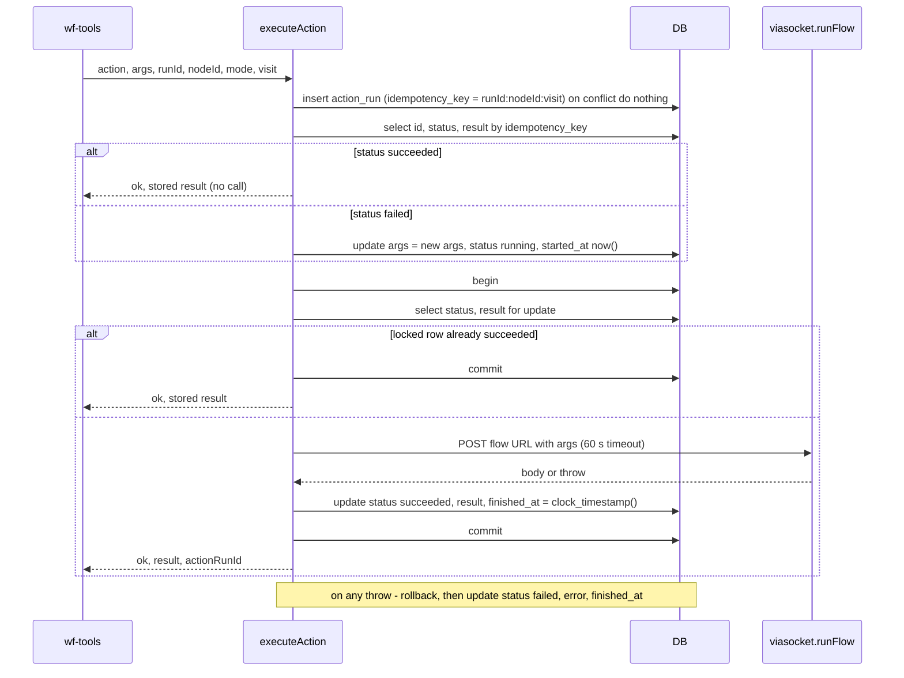

- Only `source='viasocket_flow'` has a runner. Any other source throws `<key> has no runner (source …)` and records `failed`. The two builtins never reach here because `planCall` maps them to `escalate` / `evidence` (§13).
- The row lock is held **across the HTTP call** (up to 60 s) on one of the 10 pool connections (Risk R12).
- A row left `running` (for example after a crash mid-call) is re-executed on the next call with the same key. Idempotency is "at most once per *succeeded* key", not exactly-once against the remote flow (Risk R11).

### 7.6 `runFlow(url, args)` and `flowError` (`viasocket.ts:18-36`)
- It re-checks the URL regex, then runs `axios.post(url, args, {timeout: 60000, validateStatus: () => true})`.
- `flowError(status, body)` returns a failure string when:
  - HTTP ≥ 400 (message from `body.message`, `body.error.message` or `body.error` string, else `flow failed (HTTP n): <first 300 chars>`), or
  - the body is an object (not an array) with `success === false`, or numeric `status`/`statusCode` ≥ 400, or a truthy `error`.
- On success it returns `r.data ?? {}`. **The result may be a string, number or array** if the flow returns one (Risk R10).

---

## 8. Module: Integrations

### `GET /integrations/builder-token` (`integrations.controller.ts:9`, `viasocket.ts:9-15`)
- Throws `viaSocket is not configured`, mapped to **400**, when `VIASOCKET_EMBED_SECRET` is empty.
- Builds an HS256 JWT by hand. Header `{alg:'HS256',typ:'JWT'}`. Payload `{org_id, project_id, user_id: uid, unique_identifier: uid}`, where `uid = VIASOCKET_UID || 'workflow-poc-agentic'`. It is signed with `createHmac('sha256', secret)` and base64url encoded.
- **No `exp`/`iat` claim**, so the token does not expire unless viaSocket enforces something itself **(unverified)**.
- Response `{token}`. The web passes it to viaSocket's `openViasocket` embed. App connections and tool flows live inside viaSocket. This server stores none.

---

## 9. Module: Conversations

Files: `playground/playground.controller.ts`, `playground/widget.controller.ts`, `playground/conversations.ts`.

### 9.1 `postCustomerMessage(conversationId, body)` (`conversations.ts:6-14`): shared intake
1. 400 `empty message` if there is no text and no `attachment_ids`.
2. `insert into message (conversation_id, role='customer', text, attachment_ids) returning *`. An unknown conversation id gives an FK violation and **500**.
3. `enqueue(conversationId, 'customer_message', {messageId})` is **not awaited**. If the insert into `ticket_event` fails, `.catch` inserts a `system` message `Error: …`.
4. Returns the message row (201, the NestJS default for POST **(unverified)**).

### 9.2 Playground endpoints (`playground.controller.ts`)

| Endpoint | Lines | Behaviour |
|---|---|---|
| `GET /conversations` | 15-21 | All conversations, newest first, each with `run_status` (latest run), `last_text` (latest non-system message) and `pending_approvals` count |
| `POST /conversations` | 23-27 | Insert with `customer_name` (default `Alex Kim`) and `customer_email` (default `alex@example.com`). Channel `playground` |
| `GET /ai-calls/:id` | 30-36 | One `llm_usage` row incl. `trace`. `cost_usd` is computed with `priceOf` when null. 404 if missing. The id is a sequential bigserial |
| `GET /conversations/:id` | 39-68 | See below |
| `POST /conversations/:id/messages` | 70-73 | `postCustomerMessage` |
| `POST /conversations/:id/team-messages` | 76-80 | 400 on empty. Inserts `role='team'`. **No enqueue**: the run is not woken. Agents see it in the next turn's history as `[Teammate] …` |
| `POST /attachments` | 82-93 | Body `{conversation_id, file_name, mime_type, data_base64}`. Decoded size must be 1 B to 5 MB (400 otherwise). Inserts a row with sha256 and `path=''`, writes `<UPLOADS>/<id>`, then updates `path`. Returns `{id, file_name, mime_type}` |
| `GET /attachments/:id` | 95-101 | 404 if there is no row. Sets `Content-Type` to the **stored client-supplied mime type** and pipes `createReadStream(path)` with no error handler (Risk R13, §23) |

`GET /conversations/:id` builds the whole playground screen in one poll:
1. `conversation` (404 if missing).
2. `messages`: all roles incl. `system`, each with `attachments[]` (left join on `attachment_ids`).
3. `runs`: all runs of the conversation, newest first.
4. `events`: the newest 500 `run_event` rows across all those runs, returned oldest first.
5. `approvals`: all tasks of the conversation.
6. `action_runs`: those of the **latest run only**.
7. `ai_usage`: `{calls[] (ordered by started_at,id, with cost), count, input_tokens, output_tokens, cost_usd, unpriced[] (models with no price)}`.

### 9.3 Widget endpoints (`widget.controller.ts`): the customer-facing subset

| Endpoint | Lines | Behaviour |
|---|---|---|
| `POST /widget/conversations` | 8-13 | 400 unless `email` contains `@`. Inserts channel `widget`, name = `name` or the email local part, email lowercased. Returns `{id, customer_name}` |
| `GET /widget/conversations/:id` | 15-29 | 404 unless the channel is `widget`. Messages without `system`. `typing = last message is customer AND latest run status not in (waiting_approval, escalated, paused)`. `waiting_approval` flag |
| `POST /widget/conversations/:id/messages` | 31-36 | 404 unless widget, then `postCustomerMessage`. Returns `{id}` only |

The widget never exposes runs, events, approvals or costs. However, the playground routes accept widget conversation ids too (§23).

---

## 10. Module: Inbox

File: `agents/inbox.ts`. This is the only path from triggers to agents (apart from `/dev`).

### 10.1 `enqueue(conversationId, kind, payload)` (`:12-15`)
It inserts a `ticket_event (status='pending')`, then calls `kick(conversationId)` without awaiting it. Callers:

| Caller | Kind | Payload |
|---|---|---|
| `postCustomerMessage` | `customer_message` | `{messageId}` |
| `RunsController.decide` | `approval_decided` | `{runId, taskId, approved, by, note}` |
| `RunsController.control` | `control` | `{runId, op, by}` |
| `sweep` | `timer` | `{runId}` |

### 10.2 `kick` and `drain` (`:19-56`)

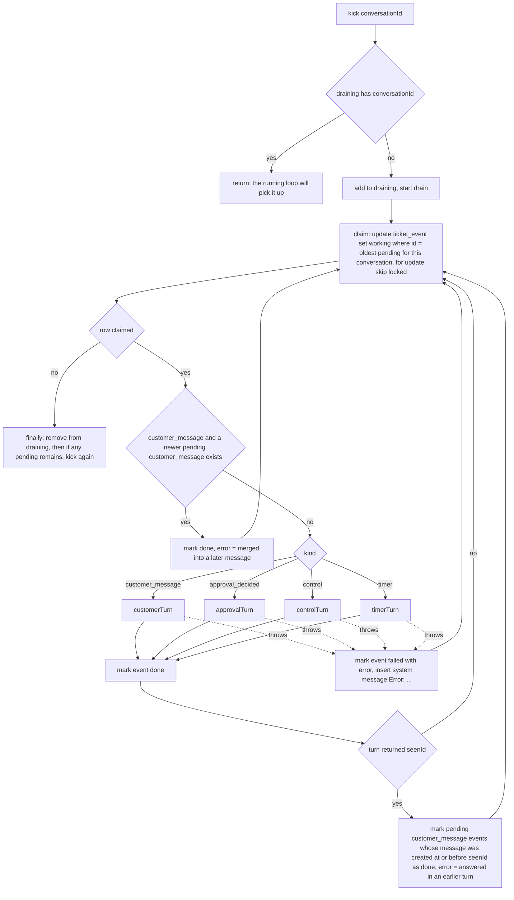

Properties:
- **Per-conversation serialization is in-process** (the `draining` Set). `for update skip locked` stops two processes from claiming the *same* row, but two instances could process two *different* events of one conversation concurrently (Risk R1).
- **Coalescing**: several quick customer messages produce one turn on the latest. The agents read the whole transcript.
- **Seen cleanup**: `seenId` is the newest customer message the agents loaded (`agents.ts:29-32`). Pending events for messages at or before it are closed without another turn.
- **Failure**: the event goes to `failed`, plus a `system` message (visible in the playground, hidden in the widget). **There is no retry.** Run state may be partly changed by whatever ran before the throw.

### 10.3 `timerTurn(conversationId, runId)` (`:59-79`): no AI
It re-reads the run and re-checks its state at processing time.

| Run state | Condition | Effect |
|---|---|---|
| `waiting_customer` + `waiting_for.type='customer'` | `now ≥ expires_at` | `end('expired', 'customer did not reply', closing text)` |
| same | `now ≥ remind_at` and not `reminded` | `jsonb_set(reminded,true)`, event `reminder_sent`, bot message `Just checking in: I still need <expects with _ → space, joined by " and "> to continue.` (or `a reply from you`) |
| `waiting_approval` + `type='approval'` | `now ≥ due_at` | `end('escalated', 'approval timed out', "Our team needs a little more time…")` |

`end()` (`:63-68`) does four things:
1. Pending `approval_task`s of the run become `expired` (when escalating) or `cancelled` (when expiring).
2. `workflow_run` gets `status`, `waiting_for=null`, `ended_at`, `end_reason`.
3. Event `run_<status>`.
4. `send()` the fixed text as a bot message.

It writes SQL directly, not through `saveRun`/`serial`.

### 10.4 `sweep()` (`:82-90`): every 30 s
It selects runs with `waiting_for` not null and either:
- `waiting_customer` and (not reminded and `remind_at ≤ now`, or `expires_at ≤ now`), or
- `waiting_approval` and `due_at ≤ now`,

and **no** `timer` event pending or working for the conversation. Each one gets a `timer` event enqueued. Runs left in `running` with `waiting_for=null` are never swept (Risk R3).

### 10.5 `startInbox()` (`:93-98`)
On boot it resets `working → pending`, so events cut off by a restart run again (**at-least-once**). It kicks every conversation with pending events and starts the sweeper interval. The first sweep happens about 30 s after boot. There is no guard against overlapping sweeps. Overlaps are harmless because `timerTurn` re-checks state.

---

## 11. Module: Agents

Files: `agents/agents.ts`, `agents/prompts.ts`, `agents/tools.ts`, `agents/mastra.ts`, `agents/usage.ts`.

### 11.1 The `Turn` object (`agents.ts:24-25`)
`{conversationId, messageId|null, runId|null, delegated, yielded?, seenId?}` is stored in a Mastra `RequestContext` under `'turn'`. It is the **only channel** between the supervisor, its tools and the workflow agent:
- `start_workflow` / `switch_workflow` change `turn.runId`, so later tool calls in the same turn act on the new run.
- `tools.ts:7-11` (`runIdOf`) reads the run id from `turn.runId`, or from `requestContext.get('runId')` for `/dev`. **The model never supplies a run id.**

### 11.2 `history(turn)` (`:29-37`)
`loadTranscript` (`runner/context.ts:18-24`) returns non-system messages with attachments, oldest first. `history` then:
- sets `turn.seenId` to the id of the newest customer message,
- returns the **last 20** as AI SDK messages: `customer` → `user`; `bot` and `team` → `assistant`. `team` text is prefixed `[Teammate] `. Empty text becomes `(attachment)`. Attachments add ` [n attachment(s)]`. **The agents never see attachment contents.**

### 11.3 Prompts (`prompts.ts`)
- `BASE_PROMPT` (`:4-8`): voice, no unconfirmed promises, never mention tools or ids, follow `fix` on `ok:false`.
- `supervisorPrompt(workflows, active)` (`:10-31`): lists published workflows (`id · name · when to use`), the active workflow description, and the routing rules (delegate with intent `answer`/`not_an_answer`/`off_topic`; switch ≥ 0.8; start ≥ 0.7; hand_off; clarify between 0.4 and 0.7; otherwise answer briefly).
- `workflowPrompt(mapText)` (`:33-55`): workflow-agent rules plus the map text (§14).
- `turnContext(...)` (`:58-66`): `INTENT`, `CURRENT STEP` (step card JSON), `PROGRESS`, `ACTIONS FOR THIS STEP`, `BUBBLES NOT SENT YET`. It is appended to the workflow prompt on each call.

### 11.4 Supervisor (`:137-196`) and `customerTurn` (`:199-235`)

Supervisor = `new Agent({id:'supervisor', instructions: BASE_PROMPT, model, tools: supervisorTools})`. The real instructions are passed per call.

| Tool | Input (zod) | Behaviour |
|---|---|---|
| `start_workflow` | `{workflow_id, confidence, reason}` | `wfStart` (§12.6). On ok: `turn.runId = new run`, system note `Supervisor: started a workflow…`, and event `customer_message` on the new run. Returns `{ok:true, run_started:true}` or the ToolErr |
| `switch_workflow` | same | Requires `turn.runId`. Calls `wfSwitchWorkflow`. On ok: `turn.runId` = new run, system note, event `customer_message` |
| `delegate_to_workflow` | `{intent: answer\|not_an_answer\|off_topic, note?}` | Requires `turn.runId`. Allowed once per turn. Event `supervisor_delegated`, then **synchronously runs `workflowTurn`**. If the workflow agent yielded: resets `delegated=false` and returns `{ok:false, yielded, fix}`. Otherwise `{ok:true, delivered:true}` |
| `hand_off` | `{reason}` | `wfHandoff(turn.runId)` if a run is active, then system note `Escalated to a human: …`. The supervisor then writes the sentence |

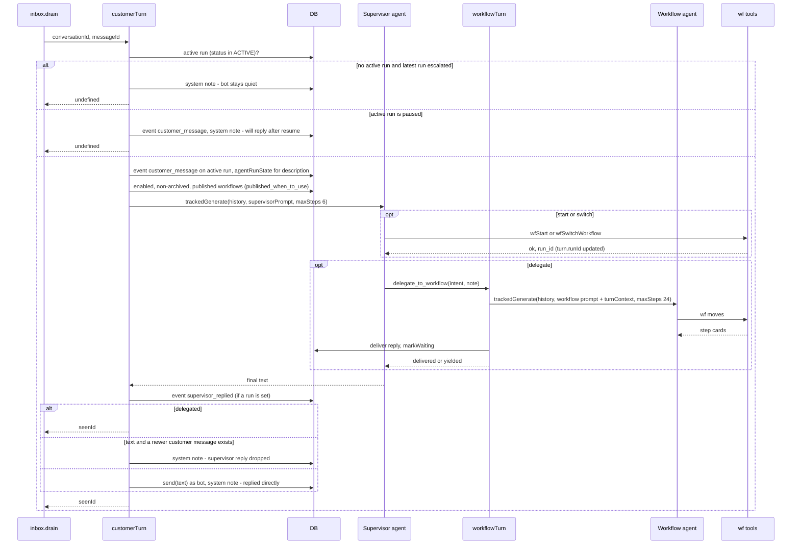

Notes:
- Escalated conversations stay silent **forever**. Nothing in the code resets this. Teammates can still post `team` messages.
- `hand_off` with **no active run** writes only a note. No run becomes `escalated`, so the bot keeps answering later messages.
- The `Supervisor: replied directly` note is written even when the supervisor produced no text (`:233`).
- `maxSteps: 6` caps the supervisor's tool rounds. Whether Mastra 1.75 honours `maxSteps` / `instructions` / `activeTools` as generate options is **(unverified)**.

### 11.5 Workflow agent: `workflowAgent(run)` (`:58-68`)
- Cache key = `"<workflow_id>:<sha1(JSON graph)>"` in the in-process `agents` Map (never evicted).
- On a miss it reads `when_to_use, published_when_to_use` from `workflow`, then calls `buildMap(run.graph, {name: run.workflow_name, whenToUse: published ?? draft ?? ''}, needsApproval())`. The prompt is `workflowPrompt(map.text)`.
- Tools: `wf_save_input`, `wf_choose_case`, `wf_complete_step`, `call_action`, `wf_handoff` (from `tools.ts`), and **`wf_yield`** (defined in `agents.ts:42-52`). `wf_switch_workflow` exists in `tools.ts` but is **not** given to any agent. Only `/dev` can call it.

### 11.6 `workflowTurn(rc, intent, note?)` (`:71-89`)
1. Load `workflow_id, workflow_name, graph` of `turn.runId`, then get or build the agent.
2. `s = agentRunState(runId)` (step card, actions, pending bubbles, plus **all** run events, which are loaded but unused here).
3. `messages = history(turn)`. If there is no `messageId` (approval or control turns), it appends a synthetic user message: `(No new customer message. Continue the workflow and tell the customer what happened.)`.
4. Event `agent_turn {agent, intent, note}`.
5. `trackedGenerate(agent, messages, {agent:'workflow: <name>', conversationId, runId}, {instructions: prompt + turnContext, requestContext: rc, maxSteps: 24})`.
6. Event `agent_replied {ms, tokens, usage_id}`.
7. If `turn.yielded`, return. No reply, no `markWaiting`, and the bubbles stay pending.
8. `deliver(turn, runId, text, agent)`, then `markWaiting(runId)`.

`wf_yield` (`:42-52`): allowed once per turn. Sets `turn.yielded = reason`, event `yielded`, returns `{ok:true, note}`.

### 11.7 `deliver` (`:97-118`): staleness and bubble enforcement

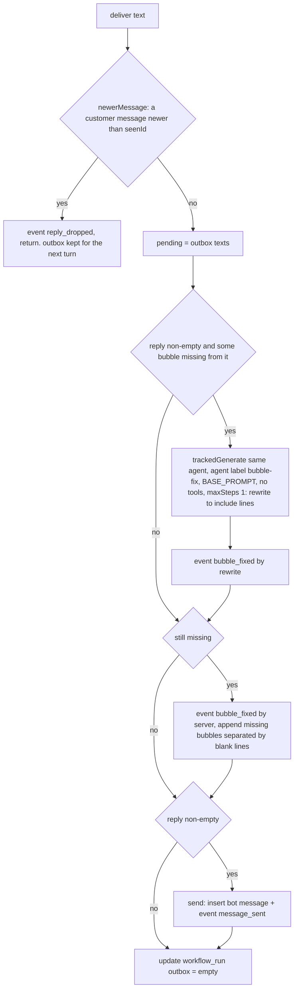

- The check is `reply.includes(bubble)`: exact substring, case-sensitive.
- `send(conversationId, runId, text)` (`:120-123`) is shared with the inbox timers and the supervisor.

### 11.8 `markWaiting(runId)` (`:126-133`)
It runs only when the run status is **`running`**. It sets `status='waiting_customer'` and `waiting_for = {type:'customer', node_id: next card id, expects: [card.collects.name] or [], remind_at: now+REMIND, expires_at: now+EXPIRE, reminded:false}`, guarded by `and status='running'`. If the turn made no successful move, the status is still `waiting_customer` and the **timers are not refreshed** (Risk R4).

### 11.9 `controlTurn` (`:238-247`) and `approvalTurn` (`:250-258`)

| Function | Steps |
|---|---|
| `controlTurn(conv, {runId, op, by})` | `controlAgentRun` (§12.9). If not ok: system note `<op> failed: <reason>`. If ok without `turn` (pause, resume, cancel): return. If `turn` (only a successful **retry**): `workflowTurn(intent 'resume', note 'A teammate retried the step that failed.')` |
| `approvalTurn(conv, {runId, taskId, approved, by, note})` | `decideAgentApproval` (§12.8). If not ok: bot message `Sorry, I hit a problem on my side. A teammate will take a look and follow up.` and return. If ok: `workflowTurn(intent 'resume', note 'The team approved/rejected the request[: note].')` |

Both create a `Turn` with `messageId: null` and `delegated: true`.

---

## 12. Module: wf tools

Files: `agents/wf-tools.ts` (logic), `agents/tools.ts` (Mastra wrappers with zod schemas).

### 12.1 Shared machinery

| Helper | Lines | Behaviour |
|---|---|---|
| `serial(key, fn)` | 23-28 | Per-run promise chain in an in-process Map. One move at a time per run. The Map is never cleaned up |
| `load(runId)` | 32-37 | `loadRun` (throws `run … not found`) + conversation → `{run (outbox copied), flow, base vars, declared}` |
| `active(runId)` | 91-96 | Rejects terminal runs (`completed, escalated, expired, cancelled`) and `waiting_approval`. **Allows `running`, `waiting_customer`, `paused`, `failed`** (Risk R5) |
| `ok(c, result?)` | 51-57 | Builds `ToolOk`: step card (null when terminal), `actions` arg specs from the `action` table, `say` = outbox texts |
| `argSpec(action)` | 234-235 | `"order_id: string (required), amount: integer"`, or `no args`. Used in `ok()` and in `call_action` rejections |
| `commit(c, s, events, result?)` | 64-76 | `current_node_id = s.end completed ? null : s.at`. `waiting_for = null`. `status = s.end?.status ?? 'running'`. `saveRun` (with `ended`, `end_reason`). Logs engine events (actor `system`). If ended: pending approval tasks → `cancelled`, plus event `run_completed` / `run_<status>`. Returns `ok()` |
| `advance(c, from, jump, result?)` | 79-85 | `follow()`. `LIMIT` → end `escalated/loop_limit`. Otherwise `settle(to)` → `commit` |
| `end(c, status, reason)` | 87-88 | `commit` with an end at the current node |
| `notCurrent` | 98-101 | Reject with the current card's id, type and text in `fix` |
| `logged(tool, fn)` | 106-112 | On `ok:false`: event `move_rejected {tool, reason, args}` |
| `saveRun` | `runner/context.ts:26-32` | Overwrites `status, current_node_id, facts, waiting_for, outbox, paused_from, updated_at`, plus `ended_at` if `ended` and `end_reason` via `coalesce`. **No optimistic check.** Relies on `serial` and the inbox |

### 12.2 `wf_save_input` → `wfSaveInput` (`:114-132`)
Input `{input_id, value}`.
1. `active()`.
2. The node must be `ask`, else reject `<id> is not an input`.
3. `input_id` must be the current node, or `reachableInput(flow, current, input_id)`: only bubbles and inputs between them. Else reject `can't be answered yet`.
4. `checkAnswer(format, value)` (§13).
   - **Invalid**: event `input_invalid`. `countAsk`. On the **4th** invalid answer (attempts > 3) the run ends `escalated` with reason `no valid answer after 3 tries`. Otherwise `saveRun` (attempts) and reject with `fix: Ask again: <retry text>`.
5. `saveAnswer` sets `facts.vars[saveAs]`, `varsBy`, `outputs[node]`, and clears `asked`. Event `input_received`.
6. If it is a later input: `saveRun` and return `ok` without moving. **The run does not skip it automatically.** When the run reaches it, the card shows `answered` and the agent must call `wf_complete_step` (§12.4). The code comment at `:130` says "the engine skips that input later", which is inaccurate.
7. If it is the current input: `advance(current, flow.next(current))`.

### 12.3 `wf_choose_case` → `wfChooseCase` (`:134-148`)
Input `{condition_id, case_id, reason}`.
1. `active()`. It must be the current node and a `branch`, else `notCurrent`.
2. `case_id` must be one of the condition's cases.
3. **Rules mode**: `chooseByRules(node, ruleValues(...))`. If the result differs from the agent's pick, reject `The rules pick <id> (<reason>)` with `fix: Choose <id>`. If no case matches and there is no `else`, every pick is rejected and the run cannot pass the condition (Risk R7).
4. `recordCase`, event `case_chosen`, `advance(node, flow.afterCase(node, case_id))`.

### 12.4 `wf_complete_step` → `wfCompleteStep` (`:150-173`)
Input `{step_id, summary}`. Requires the current node.

| Node type | Behaviour |
|---|---|
| `branch` | Reject `use wf_choose_case` |
| `say` (bubble) | `bubbleText`. If non-empty, push `{text, verbatim:true, nodeId}` to the outbox. Event `step_completed`. Advance |
| `ask` | Reject `<saveAs> is not saved yet` unless `node.id in facts.outputs`. Else event and advance |
| `step` | `completeError`: if the step mentions an action and `step.id` is not in `outputs`, reject `step completed without calling its action` (`fix: Call <actions> first.`). Else event `step_completed {summary}` and advance |

`completeError` only checks that `outputs[step]` exists. A pending or approved-then-failed approval (`{approval_task_id}`) counts as "called" (Risk R5).

### 12.5 `call_action` → `wfCallAction` (`:175-209`)
Input `{action_key, args?}`.

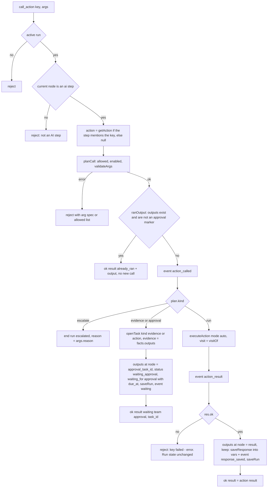

- `call_action` does **not** advance the run. The agent must then call `wf_complete_step`.
- A failed auto action leaves the run where it was. The `fix` is to try once more or hand off. A retry within the same visit reuses the idempotency key and updates `args` (§7.5).

### 12.6 Starting runs: `wfStart` (`:242-249`) and `startAgentRun` (`:252-266`)
`wfStart(conversationId, {workflow_id, confidence, reason})`:
1. Reject if `confidence < 0.7` (`START_CONFIDENCE`).
2. Reject if any run of the conversation is in the active set.
3. Reject unless the workflow is enabled, not archived, and published.
4. Call `startAgentRun`.

`startAgentRun(conversationId, workflowId, reason)`:
1. `published_graph, name` (reject if not published).
2. Conversation → `facts = {collected:{customer_name, email}, outputs:{}, cases:{}, attempts:{}, visits:{}}`.
3. `insert workflow_run (conversation_id, workflow_id, workflow_name, graph, current_node_id = flow.first(), facts)`. Status defaults to `running`. The partial unique index rejects a second active run with a Postgres error (thrown, not a ToolErr).
4. Event `run_started {workflow, reason}`.
5. `serial(newId)`: `settle(first)`, then `commit`. The status stays `running` at the first node, or the run is `completed` if the graph has no first item.

### 12.7 `wf_handoff` (`:211-216`) and `wf_switch_workflow` (`:220-231`)
- `wfHandoff`: reject if terminal (`paused`, `failed` and `waiting_approval` are accepted). Event `handoff`, then `end('escalated', reason || 'handoff')`.
- `wfSwitchWorkflow`:
  1. Reject if terminal, or if confidence < 0.8 (`SWITCH_CONFIDENCE`).
  2. The target must be enabled, published and not archived, and different from the current workflow.
  3. Event `workflow_switched`, then `end('cancelled', 'switched to <name>')`, then `startAgentRun(...)`.

  These are two separate writes. If the start fails, the old run stays cancelled.

### 12.8 Approvals: `decideAgentApproval` (`:269-280`) and `runApproved` (`:284-297`)

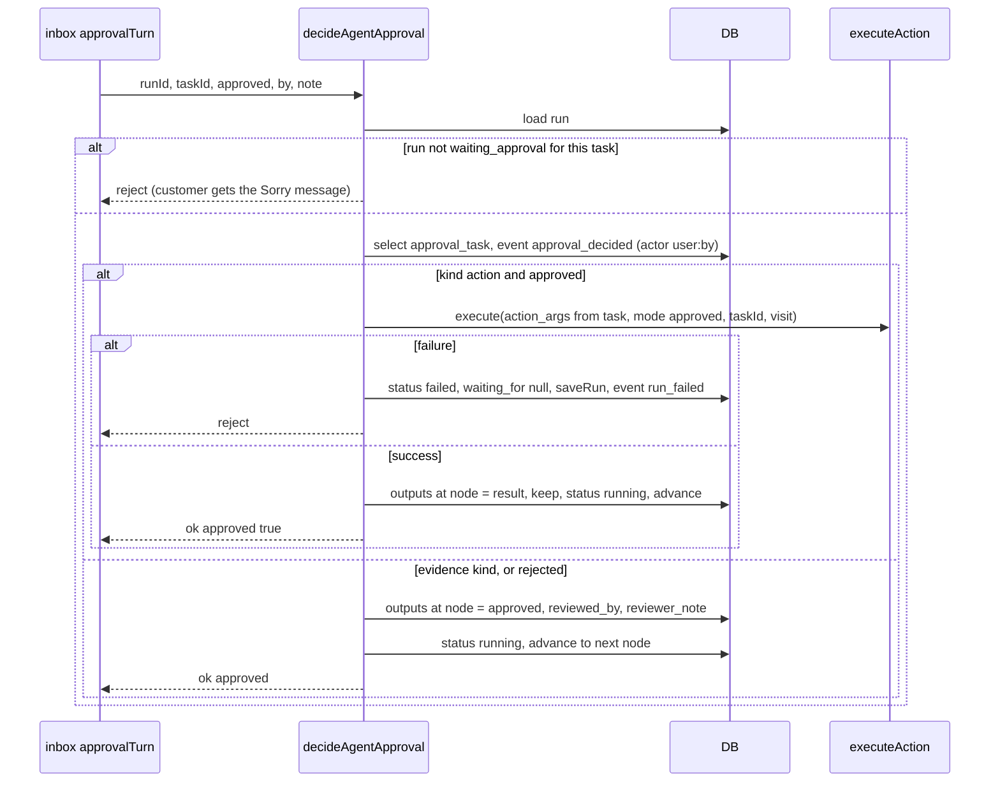

- A **rejected action** completes the step without running the action, and the flow moves to the **next** node. There is no separate rejected branch. The workflow agent then tells the customer.
- The approved action runs with the **args stored on the task** (`approval_task.action_args`), not new model args.
- `runApproved` looks up the action by `task.action_key`. If that action was renamed or deleted since, `getAction` returns null and `executeAction(null!)` throws a TypeError (Risk R8).

### 12.9 `controlAgentRun(runId, op, by)` (`:300-332`)
Common: reject if terminal. Event `signal {type: op (retry → retry_step), by}` with actor `user:<by>`.

| op | Behaviour | `turn` |
|---|---|---|
| `cancel` | `end('cancelled', 'cancelled by <by>')`. Pending tasks cancelled. **No customer message** | — |
| `pause` | Reject if already paused. `paused_from = {status, waiting_for}`, `status='paused'`, `waiting_for=null` | none |
| `resume` | Reject unless paused. Restore `status` and `waiting_for` from `paused_from` (default `running`/null). `paused_from=null` | **`false`** → no agent turn (Risk R2) |
| `retry` | Reject unless `failed`. Find `outputs[node].approval_task_id`. If that task is `approved` and kind `action`: `runApproved` again (same visit, so the same idempotency key re-runs the failed `action_run` with the task's args). Else set `status='running'` so the agent tries the step again | `true` on success |

Restored timers can already be overdue after a resume. The next sweep then reminds or expires the run immediately.

### 12.10 `agentRunState(runId)` (`:340-344`)
Returns `ok()` plus `facts` and every `run_event` of the run. Used by `workflowTurn`, `customerTurn` (for the description), `markWaiting`, and `GET /dev/agent-runs/:id`.

### 12.11 Mastra wrappers (`tools.ts:13-50`)

| Tool id | zod input | Function | Given to |
|---|---|---|---|
| `wf_save_input` | `{input_id: string, value: string}` | `wfSaveInput` | workflow agent, dev |
| `wf_choose_case` | `{condition_id, case_id, reason}` | `wfChooseCase` | workflow agent, dev |
| `wf_complete_step` | `{step_id, summary}` | `wfCompleteStep` | workflow agent, dev |
| `call_action` | `{action_key, args?: record}` | `wfCallAction` | workflow agent, dev |
| `wf_handoff` | `{reason}` | `wfHandoff` | workflow agent, dev |
| `wf_switch_workflow` | `{workflow_id, confidence, reason}` | `wfSwitchWorkflow` | **dev only** |
| `wf_yield` (`agents.ts`) | `{reason}` | sets `turn.yielded` | workflow agent only |

How Mastra reports a tool that **throws** (rather than returning `ok:false`) back to the model is **(unverified)**.

---

## 13. Module: Step engine

File: `engine/engine.ts`. Pure: no I/O. Functions that take `facts` change it in place.

| Function | Lines | Input → output | Notes |
|---|---|---|---|
| `graphFlow(g)` / `flowOf(v)` | 20-57 | graph → `Flow{first,node,next,afterCase}` | `flowOf` throws without a graph |
| `varsFor`, `shownVars`, `ruleValues` | 62-75 | see §4.3 | |
| `checkAnswer(format, raw)` | 82-100 | `{ok, value}` | empty → invalid. **email**: first `x@y.tld` match, lowercased. **number**: strips `,`, first `-?\d+(\.\d+)?` → Number. **phone**: keeps digits and `+`, must match `^\+?\d{7,15}$`. **text**: trimmed |
| `RETRY` | 102-107 | per-format default retry text | used by `askText` |
| `saveAnswer` | 110-115 | sets `vars`, `varsBy`, `outputs`, clears `asked` | |
| `countAsk` | 118-121 | `attempts[node]++`, returns `> MAX_ASKS (3)` | |
| `askText`, `bubbleText` | 124-127 | render prompt, retry or bubble | |
| `test(rule, values)` (private) | 132-146 | bool | `=`/`!=`/`contains` are case-insensitive. `>`/`<` are numeric (`NaN` → false). `empty`/`not_empty` |
| `chooseByRules(branch, values)` | 149-157 | `{case_id\|null, reason}` | first matching case (join `and` by default). `else` wins when reached |
| `recordCase` | 159-161 | `facts.cases[node]` | |
| `getPath(obj, path)` | 166-175 | value | `$` = whole. `a[0].b` / `a.0.b`. `.length` on arrays and strings |
| `saveResponse(facts, node, save, output)` | 178-192 | `{saved, missing}` | writes `vars`, `varsBy` |
| `validateArgs(action, raw)` | 195-209 | `{ok, args}` / error | drops empty values. `integer`: coerces digit strings, otherwise error. `string`: `String(v)`. **Other types (number, boolean, object) and extra keys pass through unchecked** |
| `planCall(step, key, action, args)` | 216-224 | `CallPlan` | not mentioned → error. Action missing or disabled → `<key> is disabled`. `escalate_to_human` → `escalate`. `request_approval` → `evidence`. `requires_approval` → `approval`. Else `run` |
| `ranOutput(facts, node)` | 227-230 | output or undefined | ignores `{approval_task_id}` markers. Uses the `in` operator, which throws on string or number outputs (Risk R10) |
| `completeError(step, facts)` | 233-235 | message or null | |
| `approvalTask(action)` | 238 | `{summary: action.name}` | |
| `visitOf`, `rerun`, `follow` | 246-283 | see §4.4 | events `goto_jumped`, `goto_limit` |
| `settle(at)` | 295-296 | `Settled` | `null` → `completed` |
| `reachableInput(flow, from, target)` | 301-310 | bool | walks only through `say`/`ask`, at most 200 hops |
| `stepCard(flow, id, shown, facts?)` | 324-342 | `StepCard\|null` | see §4.2 |

---

## 14. Module: Workflow map

File: `engine/map.ts`. Pure.

`buildMap(graph, {name, whenToUse}, needsApproval:Set)` (`:25-71`):
1. Numbers groups breadth-first from `start`, following item (case) edges first, then the group exit edge. Unreachable groups are appended last and marked `(not reachable)`.
2. Item refs are `"<group>.<n>"`. Edge targets are shown as an item ref or a group ref.
3. `loops` = edges with `maxVisits` → `{from, to, maxVisits, fresh}`. `goes` adds ` (loop)` for such edges.
4. Items:
   - `ai_step` (text, `tools[{key, needsApproval}]`, `save[]`)
   - `bubble`
   - `input` (`collects`)
   - `condition` (`mode`, `cases[{id, kind, when, goes}]`; rules `when` = `var op "value"`/`{{ref}}`, else the rendered condition, else `otherwise`)
5. `then` = the group exit target, or `end`.

`mapText` (`:74-95`) renders `WORKFLOW`, `When to use`, `WORKFLOW MAP`, one line per item with `[id]`, `then → …`, and `loop a → b: max n visits, ask again|keep answers`.

Callers:
- `workflowAgent` (prompt, built from the **run's** graph)
- `GET /dev/workflows/:id/map` (built from `published_graph`)

The map is **not stored**. `workflow_version.agent_map` was dropped in 0016.

---

## 15. Module: Runs and approvals API

File: `runner/runs.controller.ts`, `runner/tasks.ts`.

### 15.1 `POST /runs/:id/:op` — `control` (`:14-22`)
- `op` must be in `ALLOWED` (`:6-9`), else 400 `unknown operation`:

  | op | Allowed statuses at request time |
  |---|---|
  | `pause` | `running`, `waiting_customer`, `waiting_approval` |
  | `resume` | `paused` |
  | `retry` | `failed` |
  | `cancel` | `running`, `waiting_customer`, `waiting_approval`, `paused`, `failed` |

- 404 `run not found`. 400 `"<op>" is not allowed while the run is <status>`.
- `enqueue(conversation_id, 'control', {runId, op, by: body.by || 'teammate'})` (awaited). Response `{ok:true}`.
- The operation is applied **later** by the inbox (`controlTurn` → `controlAgentRun`), in order with agent turns. Status can change in between. `controlAgentRun` re-checks part of this (§12.9).

### 15.2 `GET /approvals?status=pending` (`:24-32`)
- `status` defaults to `pending`. `all` returns every status. Any other string filters by that exact status.
- Join: `approval_task` + `conversation (customer_name, customer_email)` + `workflow_run (workflow_name)`.
- `attachments` = attachments whose ids appear in `evidence->'attachment_ids'`. **Current code never writes `attachment_ids` into `evidence`** (`wf-tools.ts:192-193` writes `{facts}`), so this is always `[]` for new tasks (Risk R17).

### 15.3 `POST /approvals/:id/decide` (`:35-43`)
Body `{approved: boolean, note?, by?}`.
1. Atomic `update approval_task set status = approved|rejected, decided_by = coalesce(by,'Team'), decided_at = now(), decision_note where id and status='pending' returning *`.
2. No row → 404 `task not pending`. This makes the decision idempotent against double clicks.
3. `enqueue(conversation_id, 'approval_decided', {runId, taskId, approved, by: decided_by, note})`.
4. Returns the task row.

The task is marked decided **before** the run accepts it. If `decideAgentApproval` later rejects (for example because the run was paused, Risk R9), the task stays approved/rejected but the run never applies it.

### 15.4 `openTask(run, nodeId, t)` (`runner/tasks.ts:7-19`)
- `due = now + APPROVAL_TIMEOUT_SEC`.
- If a pending task exists for `(run_id, node_id)`, return its id (also enforced by the unique partial index).
- Else insert `{run_id, conversation_id, node_id, kind, action_key, action_args, summary, evidence, due_at}`, then event `approval_requested {task_id, kind, summary}`.
- `summary` = `approvalTask(action).summary` (the action's display name) for `kind:'action'`, or `args.summary` for `request_approval`.

---

## 16. Module: LLM usage and cost

Files: `agents/usage.ts`, `agents/prices.ts`.

| Function | Lines | Behaviour |
|---|---|---|
| `MODEL_PRICES` | `prices.ts:3-5` | `{'openai/gpt-6-luna': {input: 0.10, output: 0.50}}` USD per 1M tokens |
| `priceOf(model, in, out)` | `usage.ts:10-13` | `(in·p.in + out·p.out)/1e6`, or `null` when the model is not listed |
| `mastraModel()` | `:15` | `"<LLM_PROVIDER>/<LLM_MODEL>"`, the key used for pricing and the `model` column |
| `recordUsage(meta, usage, opts)` | `:18-26` | Insert `llm_usage (conversation_id, run_id, agent, model, input_tokens, output_tokens, cost_usd, started_at, trace)`. Returns `id` |
| `trackedGenerate(agent, input, meta, options)` | `:30-34` | `startedAt` → `agent.generate(input, options)` → `recordUsage(meta, out.totalUsage, {startedAt, trace: traceOf(out)})`. Returns the Mastra result plus `usageId` |
| `traceOf(out)` | `:37-53` | Per step: `request.body` (JSON-parsed), `text`, `toolCalls`, `toolResults`, `finishReason`, `usage`. Plus `final_text` |

- Callers, by `agent` label: `supervisor`, `workflow: <name>`, `bubble-fix`, `probe`.
- A failed `generate` writes **no** usage row (the throw happens before `recordUsage`).
- Nested calls: the supervisor's `totalUsage` and the delegated workflow agent's call are recorded as **separate rows**. Whether the supervisor's usage also includes the nested agent's tokens is **(unverified)**, but the code assumes it does not.
- `trace` stores full provider request bodies (prompts and transcript), so it contains customer PII (§23).
- `cost_usd` is computed at insert time. Read paths recompute it when it is null (`playground.controller.ts:35,58-59`), so adding a price later back-fills on read.

---

## 17. Module: Dev endpoints

File: `dev/dev.controller.ts`. Every handler calls `guard()` first (`:12`): **404** unless `DEV_ENDPOINTS=1`. These routes **bypass the inbox**, so moves run synchronously in the request (still serialized per run by `serial`).

| Route | Lines | Behaviour |
|---|---|---|
| `POST /dev/agent-runs` `{workflow_id}` | 20-27 | 400 unless published (enabled is **not** required). Inserts a `Dev tester` conversation. `startAgentRun(conv, wf, 'dev endpoint')` → ToolResult |
| `GET /dev/agent-runs/:id` | 29-34 | 404 if missing (`id::text`, so a non-uuid gives 404, not 500). Returns `agentRunState` |
| `POST /dev/agent-runs/:id/tools/:tool` | 37-46 | `wfTools[tool]` (400 listing valid names). `inputSchema.safeParse(body)` → 400 with zod issues. `t.execute(parsed, {requestContext: new RequestContext([['runId', id]])})`. `wf_yield` is not available here |
| `POST /dev/agent-runs/:id/approval` `{approved, note?}` | 49-56 | Finds the run's pending task (400 if none). Updates it directly (`decided_by='dev'`). Calls `decideAgentApproval` **synchronously**. No workflow-agent turn and no customer message |
| `GET /dev/workflows/:id/map` | 59-65 | 400 unless published. `buildMap(published_graph, {name, published_when_to_use}, needsApproval())` → full `WorkflowMap` |
| `POST /dev/llm/probe` `{message?}` | 68-74 | `probeChat(message, 'dev-probe')` (Mastra memory thread `dev-probe`, resource `dev`). Then `select agent, model, input_tokens, output_tokens, created_at from llm_usage …`. **`llm_usage.created_at` was dropped in 0016**, so this query fails and the endpoint returns 500 after the LLM call and usage row have succeeded (Risk R18) |

---

## 18. End-to-end scenario traces

### 18.1 A. Customer message starts a workflow and completes the first blocks

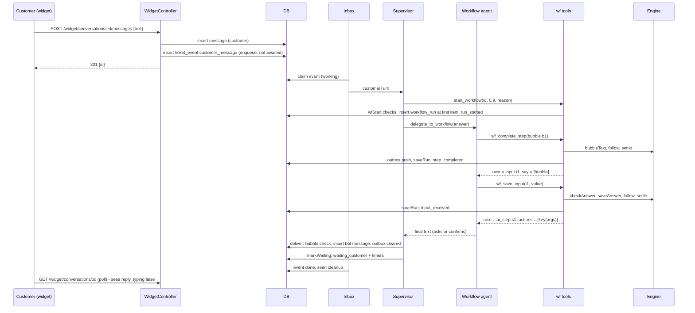

### 18.2 B. AI step with an action that needs approval

1. The workflow agent calls `call_action(key, args)`. `planCall` returns `approval` because `requires_approval` is set.
2. `openTask` creates `approval_task(kind 'action', action_args)`, then `outputs[node] = {approval_task_id}`, `status=waiting_approval`, `waiting_for={approval, due_at}`.
3. The tool returns `{waiting: 'team approval'}`. The agent tells the customer the team is checking. `deliver` sends it. `markWaiting` does nothing (the status is not `running`).
4. A teammate calls `POST /approvals/:id/decide {approved:true}`. The task is marked approved and an `approval_decided` event is enqueued.
5. Inbox → `approvalTurn` → `decideAgentApproval` → `runApproved` → `executeAction(mode 'approved', taskId)` → `outputs[node] = result`, `saveResponse`, `advance` to the next node, `status=running`.
6. `workflowTurn(intent 'resume', note 'The team approved…')`. The approved step is already behind the run (`runApproved` called `advance()`), so the agent does **not** call `wf_complete_step` for it. It works on the *next* card, then `deliver` and `markWaiting` run.
7. If no one decides: after `APPROVAL_TIMEOUT_SEC`, the sweeper sends a timer → `timerTurn` → `escalated / approval timed out` (pending task → `expired`), plus the fixed message.

### 18.3 C. Auto action failure and retry
- `call_action` runs the flow. On failure: `action_run.failed`, event `action_result {ok:false}`, ToolErr `<key> failed: …`. The run status is unchanged. The agent can retry in the same turn (same idempotency key, new args) or hand off.
- An **approved** action failure sets `status='failed'` (§12.8). `POST /runs/:id/retry` → `controlTurn` → `controlAgentRun('retry')` → `runApproved` again → on success the workflow agent speaks.

### 18.4 D. Invalid input and escalation
`wf_save_input` with a bad email → `input_invalid`, attempts 1..3 → reject with the retry text. The 4th invalid answer → `end('escalated', 'no valid answer after 3 tries')`. Pending tasks are cancelled and the run ends. The next customer message gets silence (escalated conversation).

### 18.5 E. Loop back with "ask again"
A group exit edge with `maxVisits: 2, fresh: true` that points back to an earlier input:
- `follow` → `rerun` clears outputs, cases and attempts of the items from the target onward, and deletes the variables they filled. `visits[edge]=2`. Event `goto_jumped`.
- The card is the earlier input again, with no `answered`.
- The second jump back → `visit 3 > 2` → `LIMIT` → `escalated / loop_limit`, event `goto_limit`.

### 18.6 F. Topic switch
The supervisor sees a different request → `switch_workflow(id, ≥0.8)` → `wfSwitchWorkflow`: event `workflow_switched`, old run `cancelled` (pending tasks cancelled), `startAgentRun` new → `turn.runId` updated → `delegate_to_workflow(answer)`. Or the workflow agent calls `wf_yield` → `delegate_to_workflow` returns `yielded` → the supervisor switches and delegates again, or replies itself.

### 18.7 G. Customer writes twice quickly
- Two `customer_message` events. When the first is claimed, a newer pending one exists, so the first is closed as `merged into a later message`. One turn runs on the latest, and the agents read the full transcript.
- If the customer writes **during** a turn, `deliver` (or the supervisor path) sees `newerMessage` and the reply is dropped (`reply_dropped`, bubbles kept). The next event runs a fresh turn.

### 18.8 H. Silence: reminder and expiry
After `markWaiting`, the sweeper (every 30 s):
- at `remind_at` → `Just checking in…` (once),
- at `expires_at` → `expired / customer did not reply`, plus the closing message.

A later message from the customer finds no active run and no escalation, so the supervisor may start a new run. The old one is not resumed.

### 18.9 I. Teammate pause and resume
- `POST /runs/:id/pause` → `status=paused` (previous status and timers saved).
- A customer message while paused gets event `customer_message` and a system note. No reply, and the event is closed.
- `POST /runs/:id/resume` restores the status and timers, but **no agent turn runs** (Risk R2). The customer's message from the pause stays unanswered until they write again (or a timer fires).

---

## 19. State machines

### 19.1 `workflow_run.status`

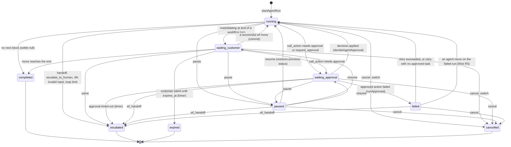

Active set (DB index and `types.ts:54` `ACTIVE`): `running, waiting_customer, waiting_approval, paused, failed`. Only one active run per conversation is allowed.

### 19.2 `ticket_event.status`

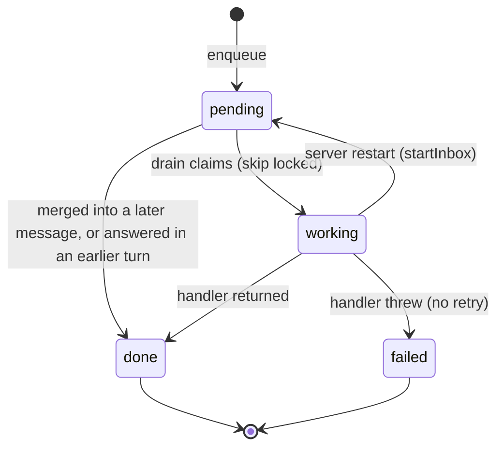

### 19.3 `approval_task.status`

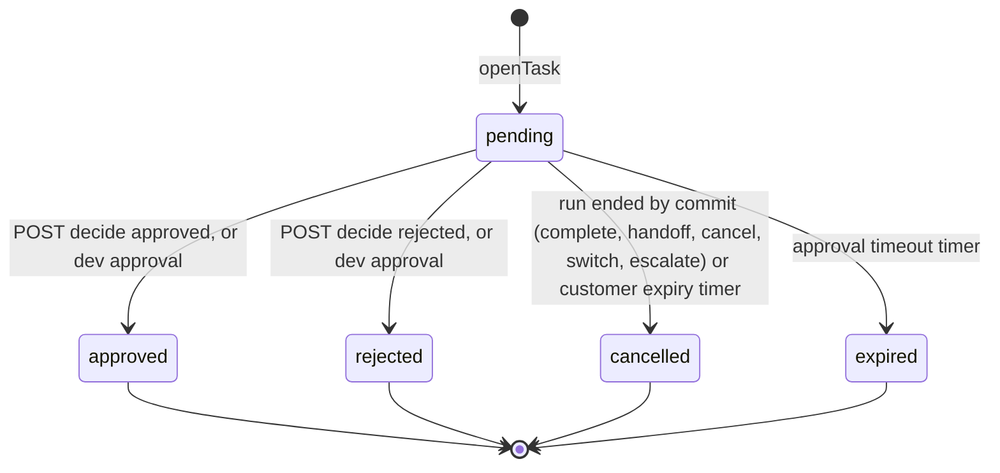

### 19.4 `action_run.status`

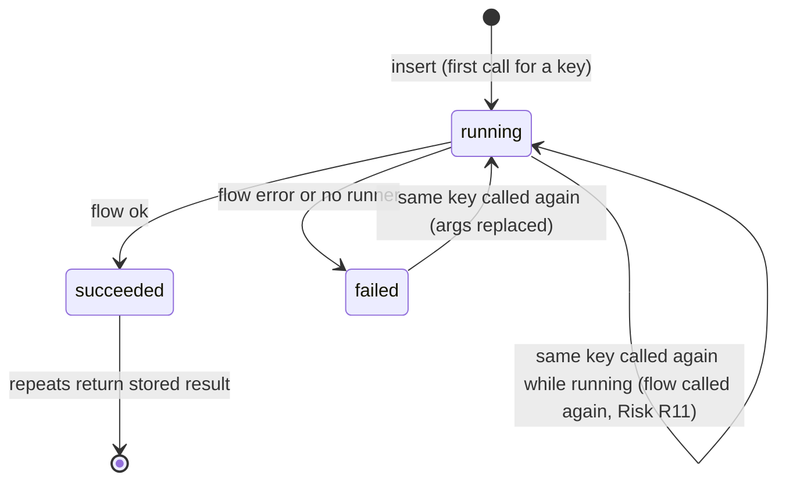

---

## 20. run_event catalogue

`run_event` is the run timeline. It is the only structured execution log apart from `llm_usage`. Other logging uses Nest's `Logger('Inbox')` (`inbox.ts:9`) for drain and sweep errors, plus one `console.log` at boot. There are no metrics, tracing spans or correlation ids. `llm_usage.id` is referenced from events as `usage_id`.

| type | actor | Written by | data |
|---|---|---|---|
| `run_started` | system | `startAgentRun` | `{workflow, reason}` |
| `customer_message` | customer | `customerTurn`, `start_workflow`, `switch_workflow` | `{messageId}` |
| `supervisor_delegated` | ai | `delegate_to_workflow` | `{intent, note}` |
| `supervisor_replied` | ai | `customerTurn` (if a run is set) | `{ms, tokens, usage_id}` |
| `agent_turn` | ai | `workflowTurn` | `{agent, intent, note}` |
| `agent_replied` | ai | `workflowTurn` | `{agent, ms, tokens, usage_id}` |
| `yielded` | ai | `wf_yield` | `{reason}` |
| `message_sent` | ai | `send` (with a run) | `{text}` |
| `reply_dropped` | system | `deliver` | `{reason, text}` |
| `bubble_fixed` | system | `deliver` | `{by: rewrite, still_missing, usage_id}` or `{by: server, added}` |
| `move_rejected` | ai | `logged()` | `{tool, reason, args}` |
| `input_invalid` / `input_received` | ai | `wfSaveInput` | `{<saveAs>: value, format}` |
| `case_chosen` | ai | `wfChooseCase` | `{case_id, reason}` |
| `step_completed` | ai | `wfCompleteStep` | `{summary}` |
| `action_called` | ai | `wfCallAction` | `{key, args}` |
| `action_result` | system | `wfCallAction`, `runApproved` | `ExecResult` `{ok, result\|error, actionRunId}` |
| `response_saved` | system | `keep()` | `{saved, missing}` |
| `waiting` | system | `wfCallAction` | `{for:'approval', task_id}` |
| `approval_requested` | system | `openTask` | `{task_id, kind, summary}` |
| `approval_decided` | `user:<by>` | `decideAgentApproval` | `{task_id, approved}` |
| `signal` | `user:<by>` | `controlAgentRun` | `{type: pause\|resume\|cancel\|retry_step, by}` |
| `handoff` | ai | `wfHandoff` | `{reason}` |
| `workflow_switched` | ai | `wfSwitchWorkflow` | `{to, confidence, reason}` |
| `goto_jumped` / `goto_limit` | system | `follow` via `commit` | `{target, visit, max_visits, direction}` / `{target, max_visits}` |
| `run_completed`, `run_escalated`, `run_cancelled` | system | `commit` | `{reason}` |
| `run_failed` | system | `runApproved` | `{error}` |
| `run_expired`, `run_escalated` | system | `timerTurn.end` | `{reason}` |
| `reminder_sent` | system | `timerTurn` | `{}` |

`system`-role `message` rows act as a second, human-readable log in the playground (supervisor decisions, pause notes, dropped replies, inbox errors).

---

## 21. Cross-feature dependencies and coupling

### 21.1 Import graph (verified from `import` statements)

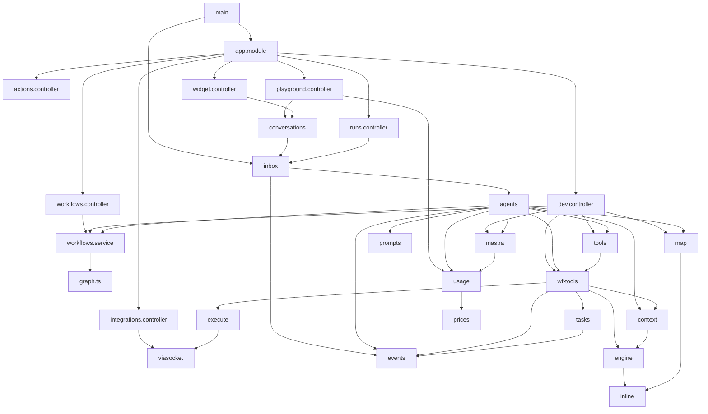

`db.ts`, `config.ts` and `types.ts` are imported by most modules and are left out for clarity. **There are no circular imports.**

### 21.2 Functions reused across features

| Function | Callers |
|---|---|
| `enqueue` (`inbox.ts:12`) | `postCustomerMessage`, `RunsController.control`, `RunsController.decide`, `sweep` |
| `send` (`agents.ts:120`) | `customerTurn`, `deliver`, `timerTurn.end` |
| `addEvent` (`runner/events.ts:4`) | wf-tools (most moves), agents, inbox timers, `openTask` |
| `startAgentRun` | `wfStart` (supervisor), `wfSwitchWorkflow`, `POST /dev/agent-runs` |
| `agentRunState` | `customerTurn`, `workflowTurn`, `markWaiting`, `GET /dev/agent-runs/:id` |
| `decideAgentApproval` | `approvalTurn`, `POST /dev/agent-runs/:id/approval` |
| `executeAction` | `wfCallAction` (auto), `runApproved` (approved, and retry) |
| `buildMap` + `needsApproval` | `workflowAgent`, `GET /dev/workflows/:id/map` |
| `validateGraph` | `getWorkflow`, `createWorkflow`, `saveWorkflow`, `publishWorkflow` |
| `trackedGenerate` | supervisor, workflow agent, bubble-fix rewrite, probe |
| `priceOf` | `recordUsage`, `GET /conversations/:id`, `GET /ai-calls/:id` |
| `loadTranscript` | `history()` |

### 21.3 Critical execution-order requirements
1. Migrations must run before the server starts. `render.yaml` runs them on every start.
2. A workflow must be **published and enabled** for the supervisor to see or start it (`agents.ts:221-222`, `wf-tools.ts:246`). `/dev/agent-runs` only needs it published.
3. A step that mentions an action: `call_action` must succeed (or open an approval) **before** `wf_complete_step`.
4. `history()` must run before `newerMessage()`, because it sets `turn.seenId`. Both turn paths do this.
5. In `workflowTurn`, `deliver` runs before `markWaiting`, so the waiting timers start after the reply.
6. Control and approval events go through the **same per-conversation queue** as customer messages, so a decision never runs inside an agent turn.
7. `startInbox` runs after `listen`. Events enqueued before boot finishes are drained by the boot `kick`.

### 21.4 Hidden coupling to watch when changing code
- **Action keys are plain strings** in graph JSON, `action_keys`, `published_action_keys`, every run's `graph` copy, and `approval_task.action_key`. There is no FK. Rename and delete checks only look at `workflow` rows (Risk R8).
- **Builtin keys are hard-coded** in `planCall` (`escalate_to_human`, `request_approval`). Their `action` rows must exist and be enabled, or the call is rejected as `disabled`.
- **`facts.outputs[node]` has four meanings**: action result, input answer `{saveAs: value}`, approval marker `{approval_task_id}`, and approval decision `{approved, reviewed_by, reviewer_note}`. `ranOutput`, `completeError` and the retry path depend on the literal key `approval_task_id`.
- **The outbox** is filled by `wfCompleteStep` (through `saveRun`) but cleared by a direct `update` in `deliver`.
- **Run status strings** are duplicated in `types.ts:54` (`ACTIVE`), `wf-tools.ts:20` (`TERMINAL`), `wf-tools.ts:244` (literal list), `runs.controller.ts:6-9`, `widget.controller.ts:27`, the DB check constraint and the partial unique index.
- **Event type strings** are read by migration `0014` (`agent_replied`, `supervisor_replied` `data.ms`/`usage_id`) and by the web run panel (not verified here).
- **Confidence thresholds** live in two places: the prompt text (`prompts.ts:24-27`) and the code (`START_CONFIDENCE` 0.7, `SWITCH_CONFIDENCE` 0.8).
- **The workflow-agent cache** depends on the graph hash only (Risk R6).

---

## 22. Error handling, retries, idempotency, concurrency

| Concern | Mechanism | Where |
|---|---|---|
| HTTP errors | `BadRequestException` (400), `NotFoundException` (404), `ConflictException` (409). Everything else is 500 by Nest default **(unverified)** | controllers, `workflows.service` |
| Model-facing errors | `{ok:false, reason, fix}` + `move_rejected` event. The prompt tells agents to follow `fix` | wf-tools |
| Turn failure | The event is marked `failed` and a `system` message `Error: …` is written. **No retry**, and earlier writes in the turn stay | `inbox.ts:50-54` |
| Restart | `working` events go back to `pending` (at-least-once) | `inbox.ts:94` |
| Optimistic concurrency | `row_version` on workflow save → 409 | `workflows.service.ts:44-48` |
| One active run | Partial unique index `workflow_run_one_active` plus the check in `wfStart` | migration 0004, `wf-tools.ts:244` |
| One pending task per node | Partial unique index plus lookup in `openTask` | migration 0001, `tasks.ts:11` |
| Decision idempotency | `update … where status='pending' returning` | `runs.controller.ts:37-40` |
| Action idempotency | Unique `idempotency_key = run:node:visit`, `succeeded` short-circuit, `select … for update` in a transaction, and `ranOutput` in facts | `execute.ts`, `engine.ts:227-230` |
| Action retry | Same key: a `failed` row is re-run with new args. Approved actions retry via `POST /runs/:id/retry` | `execute.ts:22`, `wf-tools.ts:320-331` |
| Remote timeout | 60 s axios timeout. Body-level failure detection in `flowError` | `viasocket.ts:20-35` |
| Input retries | 3 invalid answers allowed. The 4th escalates | `engine.ts:79,118-121` |
| Loop bound | `maxVisits` per edge (validated 1..100). Every cycle needs one | `graph.ts:101-116`, `engine.ts:250-283` |
| Agent loop bound | `maxSteps` 6 (supervisor), 24 (workflow), 1 (bubble fix) **(unverified Mastra semantics)** | `agents.ts:83,108,225` |
| Per-run serialization | `serial()` promise chain (in-process) | `wf-tools.ts:23-28` |
| Per-conversation serialization | `draining` Set + `skip locked` claim (in-process) | `inbox.ts:18-33` |
| Stale replies | `newerMessage` drop + event coalescing + seen cleanup | `agents.ts:92-101,231`, `inbox.ts:35-49` |
| Fallback text | Approval apply failure → apology message. Timers → fixed texts. Missing bubbles → appended by the server | `agents.ts:252`, `inbox.ts:70-77`, `agents.ts:112-115` |

**Concurrency model.** The design assumes **one server process**. Every lock that orders work per run or per conversation lives in memory. Postgres only guards single rows (`skip locked`, `for update`, unique indexes).

---

## 23. Security considerations

1. **No authentication or authorization** on any route. CORS (`main.ts:11`) only limits browsers. Any HTTP client can read all conversations, decide approvals, control runs, edit actions, publish workflows and register flows. The README lists this as a POC shortcut.
2. **Widget isolation is partial.** `/widget/*` hides system messages, runs and costs. But `GET /conversations` lists every conversation id, including widget ones, and `/conversations/:id` returns everything for any id.
3. **`GET /ai-calls/:id` uses sequential ids**, so anyone can enumerate every stored prompt and transcript (`llm_usage.trace` holds full provider request bodies with customer PII). There is no retention limit.
4. **`GET /integrations/builder-token`** hands out a viaSocket embed token with no expiry claim to any caller.
5. **`via_flow_url` is a bearer credential** (`viasocket.ts:17`, migration 0005 comment), and `GET /actions` returns it unauthenticated.
6. **`POST /actions/from-flow`** accepts any `https://flow.sokt.io/func/<id>` URL from any caller. New actions start with `requires_approval=true`, but an update to an existing flow id can change its URL and re-enable it.
7. **Attachments**: the client-supplied `mime_type` is served back as `Content-Type` from the API origin (`playground.controller.ts:99`). An HTML or SVG upload could run script in that origin **(unverified: no `nosniff` / CSP headers are set by this code)**. The size limit is 5 MB with no type allowlist. Files live on local disk.
8. **SQL**: all queries are parameterized. `setup-db.js:15` interpolates the DB name from `DATABASE_URL`, which is trusted config.
9. **Model trust boundary**: run ids come from the request context, never the model (`tools.ts:7-11`). The engine enforces order, rule picks, action allow-lists and approval gates. Action **arguments** do come from the model (shaped by customer text). `validateArgs` checks only required fields, `integer` and `string`. For approval-gated actions the team sees the args on the task.
10. **Dev routes** are off unless `DEV_ENDPOINTS=1`. `.env.example` sets it to 1. `render.yaml` does not set it, so it is off in that deployment.
11. **Secrets** (`LLM_API_KEY`, `VIASOCKET_EMBED_SECRET`) are read from env. `.env` is git-ignored (`server/.gitignore`). This document did not open `server/.env`.

---

## 24. Observed risks and edge cases

Each item is supported by the cited code. Severity is a judgement for a POC.

| # | Risk | Evidence | Effect |
|---|---|---|---|
| R1 | Single-process assumption | `inbox.ts:18-27`, `wf-tools.ts:23-28`, `agents.ts:55` | Two instances could run two events of one conversation at once and interleave `saveRun` writes (last write wins) |
| R2 | Resume never wakes the agent | `wf-tools.ts:318` returns `turn:false`. `agents.ts:241`. The note at `agents.ts:209` and the comment at `wf-tools.ts:299` say the bot replies after resume | A customer message sent while paused stays unanswered after resume |
| R3 | Runs left `running` get no timers | `markWaiting` runs only at the end of `workflowTurn` (`agents.ts:88`). It is skipped on yield (`:86`) and never runs if the supervisor starts a run but does not delegate. `sweep` needs `waiting_for` (`inbox.ts:84`) | Such runs never get reminders or expiry and stay active, which blocks `start_workflow` on that conversation until a switch, cancel or handoff |
| R4 | Timers not refreshed without a move | `markWaiting` requires `status='running'` (`agents.ts:129`) | Off-topic chat or invalid answers do not extend `expires_at`. An active customer can be expired, and `reminded` stays true |
| R5 | Failed and paused runs accept moves | `active()` (`wf-tools.ts:91-96`) only blocks terminal and `waiting_approval`. `completeError` treats `{approval_task_id}` as done (`engine.ts:233-235`) | On a `failed` run, the agent can `wf_complete_step` past an approved action that never ran, or `call_action` again and open a second approval task. Paused runs are reachable this way only through `/dev` |
| R6 | Stale workflow-agent prompt | Cache key = workflow id + graph hash (`agents.ts:59`). `when_to_use` and `needsApproval()` are read once (`:62-63`) | After a republish that changes only "When to use", or after toggling `requires_approval`, the map text is stale until restart. Enforcement still uses the live action row. Runs on an older graph also get the *current* published "When to use" |
| R7 | Rules condition with no matching case and no Else | `chooseByRules` returns `null` (`engine.ts:156`). `wfChooseCase` requires the pick to equal it (`wf-tools.ts:143-144`) | The agent can never pass the condition. Only handoff remains. `validateGraph` does not require an Else |
| R8 | Action rename or delete vs in-flight runs | Rename checks draft and published keys (`actions.controller.ts:58`). Delete and flow-delete check draft keys only (`:73`, `:86`). Neither checks `workflow_run.graph` or pending tasks | `call_action` on a removed key returns `<key> is disabled`. `runApproved` with a renamed or deleted key throws (`getAction` null), so the inbox event fails |
| R9 | Pause during an approval | Pause is allowed in `waiting_approval` (`runs.controller.ts:7`). `decide` commits first (`:37-40`). `decideAgentApproval` rejects when not `waiting_approval` (`wf-tools.ts:272`) | The customer gets the apology message, the task stays decided, and after resume the run waits on a non-pending task until the approval timeout escalates it |
| R10 | Non-object action result | `runFlow` returns `r.data ?? {}` (`viasocket.ts:23`). `ranOutput` uses `'approval_task_id' in done` (`engine.ts:229`) | If a flow returns a string or number body, a later `call_action` on that step throws a TypeError |
| R11 | Re-execution of a `running` action_run | `executeAction` only short-circuits `succeeded` (`execute.ts:20,28`) | A crash mid-call (or concurrent use of the same key) calls the remote flow again |
| R12 | DB lock held across HTTP | `tx` wraps `runFlow` (`execute.ts:26-33`), pool `max: 10` (`db.ts:4`) | Slow flows can tie up pool connections for up to 60 s each |
| R13 | Attachment stream errors | `createReadStream(a.path).pipe(res)` with no `error` handler (`playground.controller.ts:100`) | A missing file (for example on Render's ephemeral disk after a redeploy) emits an unhandled stream error. This can crash the process **(unverified runtime behaviour)** |
| R14 | Workflow name collision | `createWorkflow` numbering (`workflows.service.ts:28-29`) | Possible 500 from the unique index. `%`/`_` act as wildcards |
| R15 | Malformed graph | `validateGraph` iterates `graph.edges` and item fields without guards (`graph.ts:90`) | 500 on save, get or publish |
| R16 | Flow update overrides local disable | `fromFlow` always sets `enabled` (`actions.controller.ts:96-99`) | A teammate's disable is undone by the next viaSocket update event |
| R17 | Approval attachments always empty | The query reads `evidence->'attachment_ids'` (`runs.controller.ts:28`). `openTask` callers write `{facts}` only (`wf-tools.ts:192-193`) | Evidence images never show on approval tasks created by current code |
| R18 | Dev probe uses a dropped column | `select … created_at from llm_usage` (`dev.controller.ts:72`). Dropped in `0016_minimal_schema.sql:28` | `POST /dev/llm/probe` returns 500 after a successful model call |
| R19 | Escalation silence is permanent | `customerTurn` (`agents.ts:202-205`) | No code path re-opens the bot on that conversation. `hand_off` with no active run does not silence it |
| R20 | Non-atomic switch | `wfSwitchWorkflow` cancels, then starts (`wf-tools.ts:229-230`) | If the start fails, there is no active run and `turn.runId` still points to the cancelled run, so the following delegate is rejected |
| R21 | Widget "typing" stuck after a failed turn | The inbox writes only a `system` message on failure (`inbox.ts:53`). The widget hides system messages and computes `typing` from the last visible message (`widget.controller.ts:26-27`) | The widget shows typing indefinitely after a failed turn |
| R22 | Usage under-reported on failure | `recordUsage` runs only after `generate` resolves (`usage.ts:32-33`) | Calls that fail or time out are not costed |
| R23 | Unbounded in-memory maps | `agents` (`agents.ts:55`), `queues` (`wf-tools.ts:23`) | Memory grows with publishes and runs over a long uptime |
| R24 | Loose arg validation | `validateArgs` (`engine.ts:195-209`) | `number`, `boolean` and `object` types and unknown keys go to the flow unchecked |

Minor notes:
- `Supervisor: replied directly` is logged even when the supervisor sent nothing (`agents.ts:233`).
- The comment at `wf-tools.ts:130` ("the engine skips that input later") does not match the behaviour (§12.2).
- `facts.since` and `facts.previous` are written (`engine.ts:255-261`) but never read by server code.
- `facts.asked` and `facts.collectedBy` are only read or deleted, never written, by current code.

---

## 25. Tests

`npm test` compiles `test/**/*.ts` with `tsconfig.test.json` into `dist-test/`, then runs `node --test`.

| File | Covers |
|---|---|
| `test/fixtures.ts` | `returnGraph()` (4 groups, rules condition, loop `maxVisits:2, fresh:true`, an unreachable group), `newFacts()`, `action()` builder |
| `test/engine.test.ts` | `checkAnswer` per format, `saveAnswer` + `countAsk` limit (4th is true), retry text; `chooseByRules` (first match, else, `ref`, `or`, `contains`, `empty`/`not_empty`); `follow` loop visits, fresh clearing, limit, non-fresh keeps; `getPath`/`saveResponse`; `planCall` (not allowed, disabled, bad args, approval, escalate, evidence); `ranOutput`/`completeError`; `settle`, `reachableInput`, `stepCard` |
| `test/map.test.ts` | `buildMap` group order and unreachable last, collects/tools/saves, branch targets and loop, `text` rendering |

**Not covered:** every module that touches the DB, HTTP, LLM or viaSocket: controllers, `executeAction`, inbox, agents, `wf-tools` orchestration, `validateGraph`, `flowError`, `builderToken`.

---

## 26. Completeness checklist

Legend: ✅ documented · 🟡 partially documented · 🔍 needs runtime or library verification.

| Item | Status |
|---|---|
| **API endpoints**: all 35 in §5 (workflows 8, actions 6, integrations 1, playground 8, widget 3, runs/approvals 3, dev 6) | ✅ |
| Status codes for non-HttpException errors (uuid parse, FK, unique violations) | 🔍 (NestJS default filter) |
| POST success code 201 | 🔍 (NestJS default) |
| **Services and business functions**: `workflows.service` (all), `graph.ts` (all), `inline.ts`, `execute.ts`, `viasocket.ts`, `conversations.ts`, `context.ts`, `events.ts`, `tasks.ts` | ✅ |
| `agents.ts` (history, wf_yield, workflowAgent, workflowTurn, newerMessage, deliver, send, markWaiting, supervisor tools, customerTurn, controlTurn, approvalTurn) | ✅ |
| `wf-tools.ts` (all exports and helpers) | ✅ |
| `engine.ts`, `map.ts` (all exports) | ✅ |
| `usage.ts`, `prices.ts`, `prompts.ts`, `tools.ts` | ✅ |
| `mastra.ts` model selection and probe | ✅ / 🔍 (PostgresStore and Memory internals) |
| **Database models**: 12 app tables + `schema_migrations` + `mastra` schema | ✅ (final schema derived by hand, 🔍 against a live DB) |
| Significant queries (claim, sweep, seen cleanup, conversation view, approvals join) | ✅ |
| **Background jobs**: inbox drain, sweeper (30 s), boot recovery | ✅ |
| **Queue consumers**: `ticket_event` kinds `customer_message`, `approval_decided`, `control`, `timer` | ✅ |
| Webhooks: none inbound from servers. viaSocket events arrive via the browser (`/actions/from-flow`) | ✅ |
| **External integrations**: LLM providers (OpenAI, Anthropic, OpenAI-compatible), viaSocket flow URLs, viaSocket embed token | ✅ / 🔍 (provider and viaSocket behaviour) |
| **Error handling and retries** | ✅ (§22) |
| Logging, metrics, tracing | ✅ (§20: events + `llm_usage`. No metrics or tracing exist) |
| Caching | ✅ (only the in-process agent cache. No external cache) |
| Streaming, WebSockets, SSE | ✅ (none. Clients poll) |
| Feature flags | ✅ (`DEV_ENDPOINTS` only) |
| Migrations 0001–0017 | ✅ |
| Tests | ✅ |
| Web app internals | out of scope (only API call sites checked) |

---

## 27. Coverage gaps after cross-check

Cross-check performed: every file under `server/src/` (30 files), `server/migrations/` (16 files), `server/scripts/setup-db.js`, `server/test/` (3 files), `package.json`, `.env.example`, `render.yaml`, `.claude/launch.json`, plus a grep of `web/src` for API call sites. Every route decorator in the 7 controllers appears in §5. Every exported function in `src/` appears in §6–§17.

Remaining gaps:
1. **Library behaviour (unverified)**:
   - Mastra 1.75: per-call `instructions` / `maxSteps` / `activeTools` options, function-valued `model`, how thrown tool errors reach the model, whether the supervisor's `totalUsage` includes nested calls, and the `PostgresStore` schema and table creation timing.
   - NestJS: default status codes for unhandled errors, and the 201 default for POST.
   - Express and Node: the unhandled read-stream error in `GET /attachments/:id`.
2. **Nothing was executed.** The final schema in §3.1 is derived from migrations, not read from a live database. No LLM or viaSocket call was observed.
3. **viaSocket contract**: the `FlowEvent` shape is taken from the TypeScript interface and the web caller. The real window-message payloads and flow response formats were not checked.
4. **Configured values**: `server/.env` was not opened (it holds secrets), so the effective `LLM_*`, `VIASOCKET_*` and timer values in local use are unknown.
5. **Legacy data**: rows written by removed code (`facts.collected` beyond the two seeded keys, `facts.collectedBy`, `facts.asked`, pre-0016 action sources) can still be read by current code. Their original writers are no longer in this repository.
6. **Web consumers of `run_event` types and `facts` fields** (`since`, `previous`) were not traced. Changing event names may break the run panel.
7. **README drift** (outside this document's scope, noted for whoever maintains it):
   - `README.md` says "Publishing freezes a version". Since 0017 there is no version history.
   - It names launch configs `workflow-poc-agentic-server` / `-web`. `.claude/launch.json` uses `agentic-server` / `agentic-web`.
   - It says an early answer is skipped by the engine. The agent must complete it.

---

## Appendix A: Changes since the 2026-10-13 version

| Area | Before (old doc) | Now (code) |
|---|---|---|
| Publishing | Inserted `workflow_version` rows with `agent_map`. `workflow.published_version_id` | Copies the draft into `published_graph`, `published_when_to_use`, `published_action_keys`, `published_at` on the same row. No history (`0017`) |
| Runs | `workflow_run.workflow_version_id`, `engine` | `workflow_run.workflow_id`, `workflow_name`, and its own `graph` copy. No `engine` column |
| Agent map | Stored in `workflow_version.agent_map`. Dev map read it | Built from the run's graph when the agent is built, and from `published_graph` for `/dev/workflows/:id/map`. Not stored |
| `GET /workflows` | Returned `published_version` | Returns `published_at` |
| Action rename check | Draft `action_keys` and any `workflow_version` | Draft `action_keys` or `published_action_keys` of non-archived workflows |
| `action` table | `kind`, `subject_field`, `amount_field`, viaSocket app fields, source `mock`/`viasocket` | Those columns are dropped. Source is `builtin` or `viasocket_flow` |
| `llm_usage` | `created_at` | `started_at` only (not null). This breaks the dev probe (R18) |
| Workflow | `steps`, `template` columns | Dropped. `graph` is not null |
| Newly documented findings | — | R2, R3, R4, R5, R7, R9, R10, R17, R18, R20, R21, R24 |
