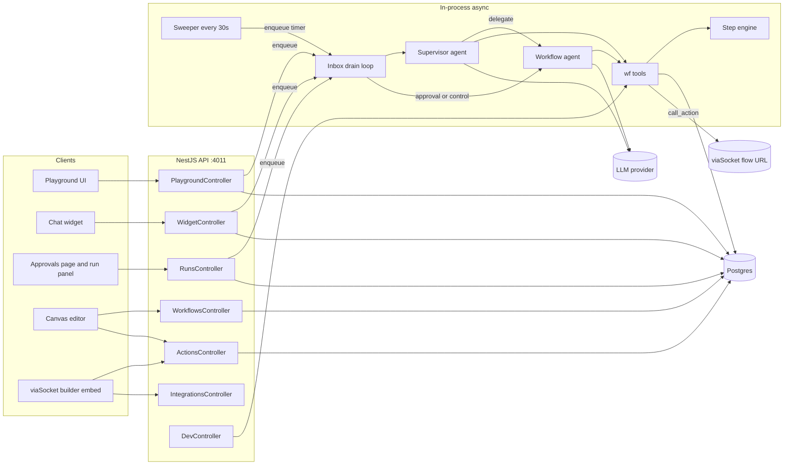
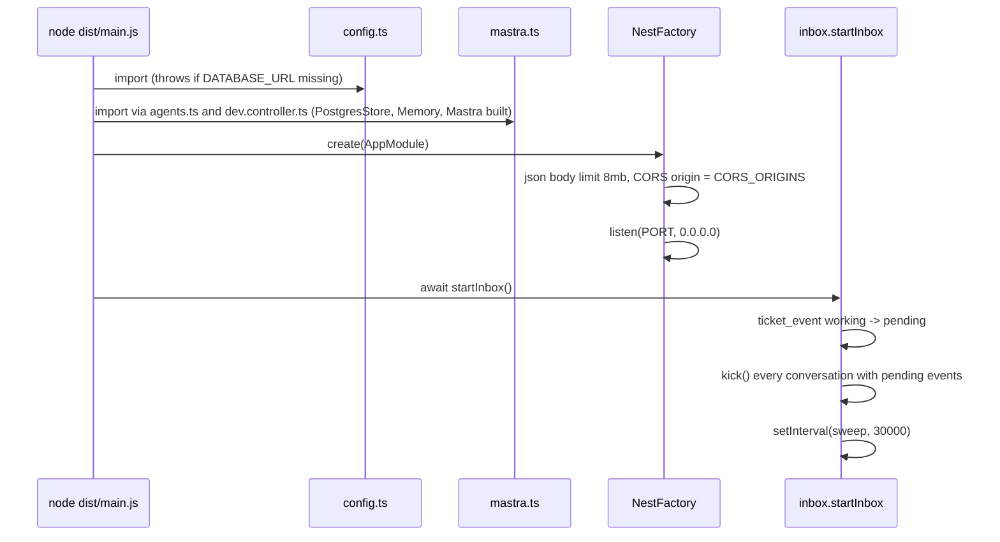
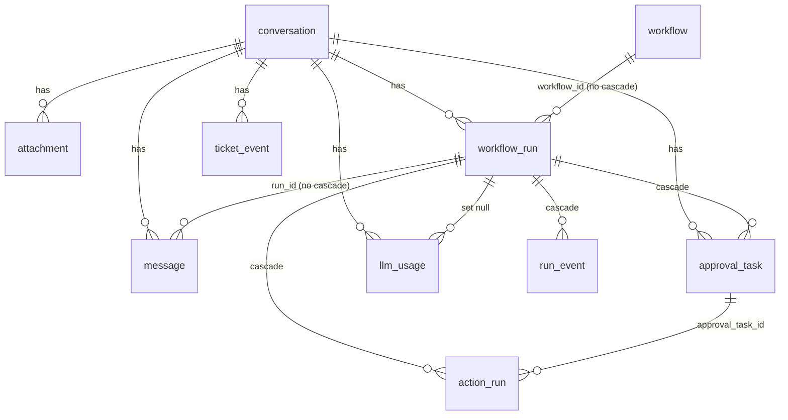
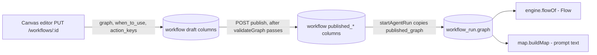
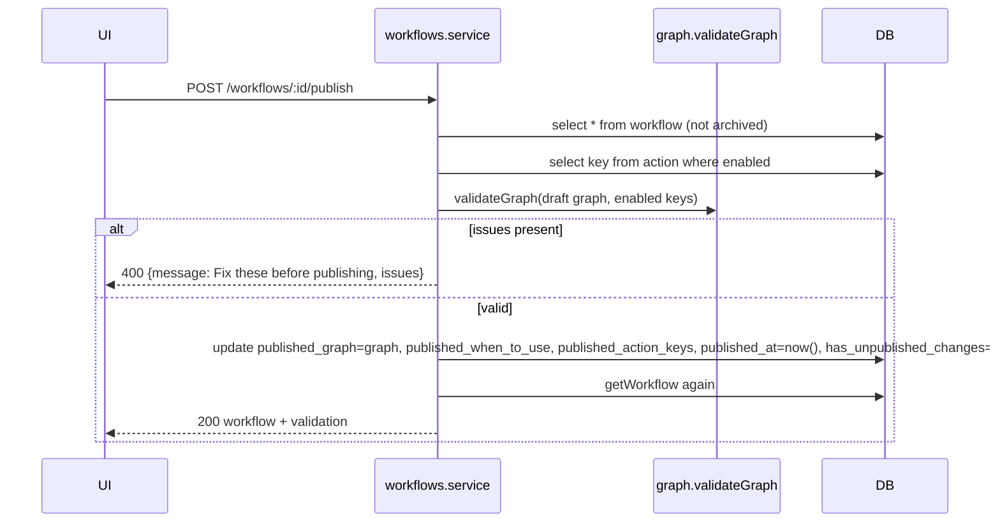
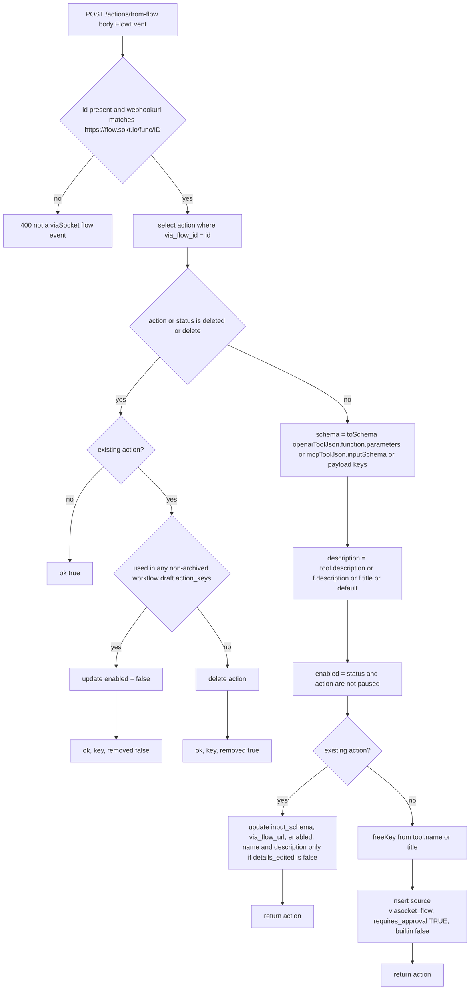
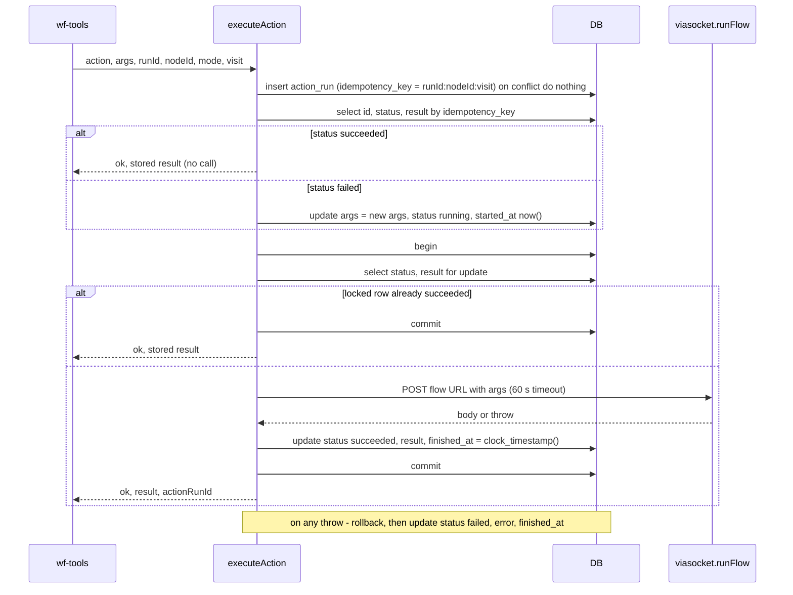
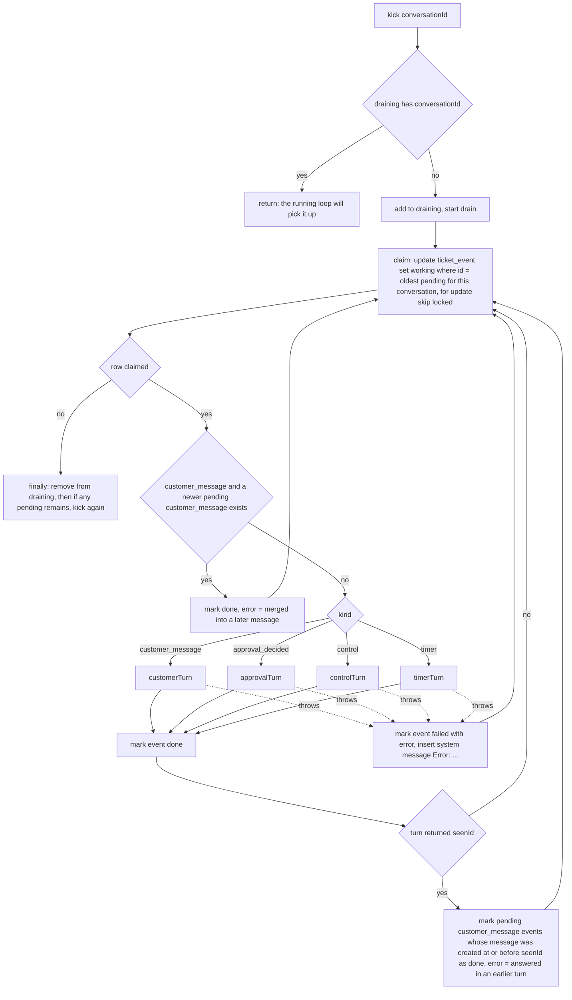

# Backend End-to-End Documentation: `workflow-poc-agentic/server`

Reverse-engineered from the source on **2026-10-14**, after migrations `0016_minimal_schema.sql` and `0017_draft_and_published.sql`.
It replaces the 2026-10-13 version, which described the removed `workflow_version` table, `agent_map`, and `workflow_run.engine` (see [Appendix A](#appendix-a-changes-since-the-2026-10-13-version)).

**Scope.** `server/` (NestJS 12, Mastra 1.75, `pg`). The Next.js `web/` app is out of scope except where it calls the API.
`server/dist/` and `server/dist-test/` are build output. `dist/` was rebuilt at the same time as `src/` (2026-10-14 11:38), so it matches.

**Conventions**
- `file.ts:12-30` = source path under `server/src/` and line range in the current tree.
- **(unverified)** = depends on third-party library behaviour (Mastra, AI SDK, NestJS, Express, `pg`) or runtime conditions this document could not confirm from the repository.
- **Risk Rn** = a behaviour the code supports that may be unintended. All of them are listed in [§24](#24-observed-risks-and-edge-cases).
- Nothing here was confirmed by running the server. It was all read from source.

---

## Table of contents

1. [System overview](#1-system-overview)
2. [Boot, configuration and shared infrastructure](#2-boot-configuration-and-shared-infrastructure)
3. [Data model](#3-data-model)
4. [Core concepts: graph, flow, facts, step cards](#4-core-concepts-graph-flow-facts-step-cards)
5. [HTTP API inventory](#5-http-api-inventory)
6. [Module: Workflows (canvas CRUD, validation, publish)](#6-module-workflows)
7. [Module: Actions (tool registry, viaSocket flows, execution)](#7-module-actions)
8. [Module: Integrations (viaSocket builder token)](#8-module-integrations)
9. [Module: Conversations (playground, widget, attachments, AI calls)](#9-module-conversations)
10. [Module: Inbox (per-conversation event queue and sweeper)](#10-module-inbox)
11. [Module: Agents (supervisor, workflow agent, delivery)](#11-module-agents)
12. [Module: wf_* tools (guarded moves)](#12-module-wf-tools)
13. [Module: Step engine (pure rules)](#13-module-step-engine)
14. [Module: Workflow map](#14-module-workflow-map)
15. [Module: Runs and approvals API](#15-module-runs-and-approvals-api)
16. [Module: LLM usage and cost](#16-module-llm-usage-and-cost)
17. [Module: Dev endpoints](#17-module-dev-endpoints)
18. [End-to-end scenario traces](#18-end-to-end-scenario-traces)
19. [State machines](#19-state-machines)
20. [run_event catalogue (logging and tracing)](#20-run_event-catalogue)
21. [Cross-feature dependencies and coupling](#21-cross-feature-dependencies-and-coupling)
22. [Error handling, retries, idempotency, concurrency](#22-error-handling-retries-idempotency-concurrency)
23. [Security considerations](#23-security-considerations)
24. [Observed risks and edge cases](#24-observed-risks-and-edge-cases)
25. [Tests](#25-tests)
26. [Completeness checklist](#26-completeness-checklist)
27. [Coverage gaps after cross-check](#27-coverage-gaps-after-cross-check)
- [Appendix A: Changes since the 2026-10-13 version](#appendix-a-changes-since-the-2026-10-13-version)

---

## 1. System overview

The server runs customer chats through **canvas workflows** driven by LLM agents. A **supervisor** agent reads each customer message and routes it. A **workflow agent** (one per published graph) moves through the blocks using `wf_*` tools. A pure **step engine** checks each move.

| Layer | Files | Role |
|---|---|---|
| HTTP | 7 controllers registered in `app.module.ts:10` | CRUD, chat intake, teammate controls, approvals, dev tools |
| Inbox | `agents/inbox.ts` | Every trigger (customer message, approval decision, run control, timer) becomes a `ticket_event` row. Rows are processed one at a time per conversation, in-process |
| Agents | `agents/agents.ts`, `prompts.ts`, `mastra.ts`, `usage.ts` | Supervisor routes. The workflow agent replies. Replies are bubble-checked and dropped if stale |
| Guarded moves | `agents/wf-tools.ts`, `agents/tools.ts` | Load the run, check the move with the engine, persist, and return the next step card or `{ok:false, reason, fix}` |
| Step engine | `engine/engine.ts`, `engine/map.ts` | Pure functions: graph traversal, input formats, rules, loops, idempotency, step cards, map text. No DB, no AI |
| Persistence | `db.ts`, `runner/context.ts`, `runner/events.ts`, `runner/tasks.ts` | Postgres via a `pg` Pool. Run state in `workflow_run`, timeline in `run_event` |
| Actions | `actions/execute.ts`, `integrations/viasocket.ts` | Run viaSocket flow URLs, once per idempotency key |

**Synchronous vs asynchronous.** HTTP handlers only validate, write rows, and call `enqueue()` (`inbox.ts:12-15`). All agent work (LLM calls, `wf_*` moves, action execution, replies) runs **asynchronously** in the inbox drain loop, after the HTTP response is sent. Screens see results by **polling** `GET /conversations/:id` or `GET /widget/conversations/:id`. There is no WebSocket or SSE. The only exception is `/dev/*`, which calls `wf_*` functions synchronously inside the request.

---

## 2. Boot, configuration and shared infrastructure

### 2.1 Process start (`main.ts:8-17`)

- `AppModule` (`app.module.ts:10`) only registers controllers. There are no providers, guards, interceptors, pipes or exception filters. Errors use NestJS's default exception handling. Thrown `HttpException`s become their status code. Anything else becomes 500 **(unverified: NestJS default filter)**.
- `playground.controller.ts:10-11` creates `UPLOADS_DIR` (default `<cwd>/uploads`) **at import time**.
- `mastra.ts:24-30` builds a `PostgresStore` (schema `mastra`), a `Memory` (last 20 messages) and a `Mastra` instance with one `probe` agent, also at import time. Whether `PostgresStore` connects or creates tables at construction or on first use is **(unverified)**.

### 2.2 Configuration (`config.ts:4-21`)

| Key | Env | Default | Used by |
|---|---|---|---|
| `port` | `PORT` | 4011 | `main.ts` |
| `corsOrigins` | `CORS_ORIGINS` (comma list) | `http://localhost:4010` | `main.ts` |
| `databaseUrl` | `DATABASE_URL` | **required**, boot throws without it | `db.ts`, `mastra.ts` |
| `llm.provider` | `LLM_PROVIDER` | `openai` | `mastra.model()`, `usage.mastraModel()` |
| `llm.model` / `apiKey` / `baseUrl` | `LLM_MODEL` / `LLM_API_KEY` / `LLM_BASE_URL` | empty | `mastra.model()`. It throws on the first agent call if model or key is empty |
| `devEndpoints` | `DEV_ENDPOINTS === '1'` | false | `dev.controller.ts` guard |
| `remindAfterSec` / `expireAfterSec` | `REMIND_AFTER_SEC` / `EXPIRE_AFTER_SEC` | 120 / 600 | `agents.markWaiting` |
| `approvalTimeoutSec` | `APPROVAL_TIMEOUT_SEC` | 1800 | `runner/tasks.openTask` |
| `maxVisits` | constant | 100 | `graph.validateGraph` (loop repeat limit range) |
| `maxGraphSteps` | constant | 50 | `graph.validateGraph` |

Read directly from `process.env` elsewhere: `VIASOCKET_ORG_ID`, `VIASOCKET_PROJECT_ID`, `VIASOCKET_EMBED_SECRET`, `VIASOCKET_UID` (`viasocket.ts:5`), and `UPLOADS_DIR` (`playground.controller.ts:10`).
There are no feature flags apart from `DEV_ENDPOINTS`.

### 2.3 Database helpers (`db.ts`)

| Function | Lines | Behaviour |
|---|---|---|
| `pool` | 4 | `pg.Pool`, `max: 10` |
| `q(sql, params)` | 6-8 | Returns `rows` |
| `one(sql, params)` | 10-12 | First row or `null` |
| `tx(fn)` | 14-27 | `begin` → `fn(client)` → `commit`. On throw: `rollback` and rethrow. Always `release()`. **Only `executeAction` uses it** |

All other writes are single autocommit statements. Multi-statement operations (for example "cancel run, then start new run" in a switch) are **not** atomic.

### 2.4 Migrations (`scripts/setup-db.js:6-40`, `npm run db:setup`)

1. Connect to the `postgres` maintenance DB. Create the target DB if it is missing. Skip with a log line if that fails (managed Postgres).
2. `create table if not exists schema_migrations(name pk, applied_at)`.
3. For each `migrations/*.sql` in lexical order that is not yet in `schema_migrations`: `begin` → run file → insert name → `commit`. On error, it prints the message and exits 1 (the open transaction is dropped with the connection).
4. `render.yaml` runs `npm run db:setup && npm start` on **every** start.

There is no `0008_*.sql` file (the numbering has a gap). This is harmless because names are tracked, not numbers.

### 2.5 Mastra and model (`agents/mastra.ts`)

- `model()` (`:13-22`): builds an AI SDK model on every call.
  - `anthropic` → `createAnthropic({apiKey, baseURL?})(id)`
  - `openai-compatible` → requires `LLM_BASE_URL`, uses `createOpenAI(...).chat(id)` (Chat Completions)
  - otherwise → `createOpenAI({apiKey, baseURL?})(id)`

  Agents pass `model: () => model()`, so the env is read at call time **(unverified: Mastra resolves a function model per call)**.
- `storage` / `memory` (`:24-25`) are used only by the dev `probe` agent. The supervisor and workflow agents have **no Mastra memory**. Chat history is passed explicitly on every call (`agents.ts:29-37`).

### 2.6 Scripts and deployment

| Script | Command |
|---|---|
| `build` | `nest build` → `dist/` |
| `start` | `node --env-file-if-exists=.env dist/main.js` |
| `dev` | build, then start (no watch) |
| `db:setup` | migrations (above) |
| `test` | `tsc -p tsconfig.test.json` → `node --test dist-test/test/**/*.test.js` |

`render.yaml`: free Postgres, API service (`healthCheckPath: /actions`, so the health check hits the DB), and web service (`NEXT_PUBLIC_API_URL=/api`, with Next rewriting `/api/*` to `API_ORIGIN`, see `web/next.config.ts:7`).

---

## 3. Data model

### 3.1 Final schema (after all migrations)

Derived by replaying `migrations/0001`–`0017` by hand. **(unverified against a live database.)**

`action` is not linked by foreign key. Workflows reference action keys as plain text in `action_keys`, `published_action_keys`, inside graph JSON, and in `approval_task.action_key` / `action_run.action_key`.

| Table | Columns (final) | Constraints and indexes | Written by | Read by |
|---|---|---|---|---|
| `action` | `key` pk, `name`, `description`, `builtin`, `input_schema` jsonb, `enabled`, `source` (`builtin`\|`viasocket_flow`, default `viasocket_flow`), `via_flow_id` unique, `via_flow_url`, `created_at`, `requires_approval`, `details_edited` | `key ~ '^[a-z][a-z0-9_]{1,47}$'` | `ActionsController` | `execute.getAction`, `workflows.service` (enabled keys, needsApproval), `wf-tools.ok` (arg spec) |
| `workflow` | `id` uuid, `name`, `when_to_use`, `graph` jsonb **not null**, `action_keys text[]`, `step_count`, `enabled`, `has_unpublished_changes`, `archived_at`, `row_version`, `created_at`, `updated_at`, `published_graph`, `published_when_to_use`, `published_action_keys text[]`, `published_at` | unique `name` where `archived_at is null` (`workflow_name_active`) | `workflows.service` | supervisor list, `wfStart`, `wfSwitchWorkflow`, `startAgentRun`, `workflowAgent`, action rename/delete checks, dev map |
| `conversation` | `id`, `customer_name`, `customer_email`, `created_at`, `channel` (`playground`\|`widget`) | — | Playground, Widget, Dev | everywhere |
| `message` | `id`, `conversation_id`, `role` (`customer`\|`bot`\|`team`\|`system`), `text`, `attachment_ids uuid[]`, `run_id`, `created_at` | index `(conversation_id, created_at)` | `postCustomerMessage`, `teamSend`, `agents.send`, `sysNote`, inbox error path | transcript, `newerMessage`, inbox seen-cleanup, screens |
| `attachment` | `id`, `conversation_id`, `file_name`, `mime_type`, `size_bytes`, `sha256`, `path`, `created_at` | — | `POST /attachments` | message joins, `GET /attachments/:id`, approvals list |
| `workflow_run` | `id`, `conversation_id`, `workflow_id` (not null), `workflow_name`, `graph` jsonb (not null), `status`, `current_node_id`, `facts`, `waiting_for`, `outbox`, `paused_from`, `started_at`, `updated_at`, `ended_at`, `end_reason` | status check (9 values). **Unique `(conversation_id)` where status in `running, waiting_customer, waiting_approval, paused, failed`** (`workflow_run_one_active`) | `startAgentRun`, `saveRun`, inbox `timerTurn`, `markWaiting`, `deliver` (outbox) | everything |
| `approval_task` | `id`, `run_id`, `conversation_id`, `node_id`, `kind` (`evidence`\|`action`), `action_key`, `action_args`, `summary`, `evidence`, `status` (`pending`\|`approved`\|`rejected`\|`expired`\|`cancelled`), `decided_by`, `decided_at`, `decision_note`, `due_at`, `created_at` | unique `(run_id, node_id)` where `status='pending'` | `openTask`, `decide`, `commit` (cancel on end), `timerTurn`, dev approval | approvals list, `decideAgentApproval`, retry |
| `action_run` | `id`, `action_key`, `run_id`, `node_id`, `idempotency_key` **unique**, `mode` (`auto`\|`approved`\|`test`), `approval_task_id`, `args`, `status` (`running`\|`succeeded`\|`failed`), `result`, `error`, `started_at`, `finished_at`, `visit` | — | `executeAction` | `GET /actions/:key/sample`, conversation view |
| `run_event` | `id` bigserial, `run_id`, `node_id`, `actor`, `type`, `data`, `at` | index `(run_id, id)` | `addEvent` | conversation view, `agentRunState` |
| `ticket_event` | `id` bigserial, `conversation_id`, `kind` (`customer_message`\|`approval_decided`\|`timer`\|`control`), `payload`, `status` (`pending`\|`working`\|`done`\|`failed`), `error`, `created_at`, `done_at` | partial index `(conversation_id, id)` where status in (`pending`,`working`) | `enqueue`, `drain`, `startInbox` | `drain`, `kick`, `sweep` |
| `llm_usage` | `id` bigserial, `conversation_id`, `run_id` (on delete set null), `agent`, `model`, `input_tokens`, `output_tokens`, `cost_usd` numeric, `started_at` not null default now(), `trace` jsonb | index `(conversation_id, started_at)` | `recordUsage` | conversation view, `/ai-calls/:id`, dev probe |
| `schema_migrations` | `name` pk, `applied_at` | — | `setup-db.js` | `setup-db.js` |
| schema `mastra` | managed by `@mastra/pg` **(unverified contents)** | — | Mastra | dev probe memory |

Dropped along the way: `app_setting`, `app_connection`, `shop_order`, `workflow_version`, schema `dbos`. Also dropped: the action columns `kind`, `autonomy`, `max_auto_minor`, `approver_team`, `subject_field`, `amount_field`, `via_*` app fields and `input_template`; the workflow columns `steps`, `template`, `autonomy`, `published_version_id`; and `workflow_run.engine` and `workflow_version_id`.

### 3.2 Migration history

| File | Effect on the final model |
|---|---|
| `0001_init` | Base tables. Seeds 4 actions (`lookup_order`, `refund_order`, builtin `request_approval`, builtin `escalate_to_human`) and `shop_order` |
| `0002_viasocket` | `action.source` and viaSocket app fields, `app_connection`. Builtins get `source='builtin'` |
| `0003` | Name unique only among non-archived workflows |
| `0004_plan_alignment` | `requires_approval` replaces autonomy. `waiting_team` → `waiting_approval`. `facts.visits`. `action_run.visit`. `message.role` adds `team`. `conversation.channel` |
| `0005` | `source` adds `viasocket_flow`, plus `via_flow_id` (unique) and `via_flow_url` |
| `0006` | `details_edited` |
| `0007` | `workflow.graph`, `workflow_version.graph` |
| `0009` | Archive workflows that use the mock actions. Delete `source='mock'` actions. Drop `shop_order` |
| `0010` | `workflow_run.engine`, `workflow_version.agent_map`, `llm_usage` |
| `0011` / `0012` | `ticket_event`, then kind `control` |
| `0013`–`0015` | `llm_usage.cost_usd`, `started_at` (backfilled from `run_event.data.ms`), `trace` |
| `0016_minimal_schema` | Drops the legacy columns and tables listed above. `graph` becomes not null. Drops `llm_usage.created_at` |
| `0017_draft_and_published` | Draft and published copy on one row. `workflow_run` stores `workflow_id`, `workflow_name` and its own `graph`. Drops `workflow_version` |

After 0009 and 0016, the only seeded actions left are the two builtins, `request_approval` and `escalate_to_human` (`source='builtin'`, `requires_approval=false`).

### 3.3 JSON shapes stored in columns (`types.ts`)

| Column | Type | Notes |
|---|---|---|
| `workflow.graph` / `published_graph` / `workflow_run.graph` | `WorkflowGraph` (`types.ts:17-34`) | `{start, groups[{id,title,x,y,items[]}], edges[{id,from{groupId,itemId?,port?},to{groupId,itemId?},maxVisits?,fresh?}], variables?[]}` |
| graph items | `GraphItem` (`:20-24`) | `step{content: Inline[], save?: [{path,var}]}` · `bubble{content}` · `input{prompt, saveAs, format, retry?}` · `condition{mode?: ai\|rules, cases[{id, kind: if\|else_if\|else, condition: Inline[], rules?, join?}]}` |
| `Inline` | `:2` | `{t:'text',v}` · `{t:'action',key}` · `{t:'var',key}` |
| `workflow_run.facts` | `Facts` (`:56-69`) | `collected`, `outputs` (node → result), `cases` (node → `{case_id, reason}`), `attempts` (node → count, `'!'+node` reset key), `visits` (edge → visit no.), `since`, `previous`, `collectedBy`, `vars`, `varsBy`, `asked`, `trail` |
| `workflow_run.waiting_for` | `WaitingFor` (`:71-73`) | `{type:'customer', node_id, expects[], remind_at, expires_at, reminded}` or `{type:'approval', node_id, task_id, due_at}` (epoch ms) |
| `workflow_run.outbox` | `OutboxItem[]` (`:76`) | `{text, verbatim:true, nodeId?}`: text bubbles the next reply must contain |
| `workflow_run.paused_from` | `:89` | `{status, waiting_for}` to restore on resume |
| `approval_task.evidence` | object | Current code writes `{facts: run.facts.outputs}` (`wf-tools.ts:192-193`) |
| `llm_usage.trace` | object | `{rounds[{round, request, response{text, tool_calls, tool_results, finish_reason, usage}}], final_text}` (`usage.ts:37-53`) |

### 3.4 Feature → table map

| Feature | Reads | Inserts | Updates | Deletes |
|---|---|---|---|---|
| Workflow CRUD and publish | `workflow`, `action` | `workflow` | `workflow` | — (soft archive) |
| Action registry | `action`, `workflow`, `action_run` | `action` | `action` | `action` (flows only) |
| Chat intake | `conversation` | `message`, `conversation`, `attachment`, `ticket_event` | `attachment.path` | — |
| Inbox | `ticket_event`, `workflow_run`, `message` | `ticket_event`, `message` | `ticket_event`, `workflow_run`, `approval_task` | — |
| Agent turn | `workflow_run`, `workflow`, `message`, `attachment`, `action`, `run_event`, `conversation` | `message`, `run_event`, `llm_usage` | `workflow_run` | — |
| wf moves | `workflow_run`, `conversation`, `action`, `approval_task`, `workflow` | `workflow_run`, `run_event`, `approval_task`, `action_run` | `workflow_run`, `approval_task`, `action_run` | — |
| Approvals | `approval_task`, `conversation`, `workflow_run`, `attachment` | `ticket_event` | `approval_task` | — |

---

## 4. Core concepts: graph, flow, facts, step cards

### 4.1 Draft vs published vs run copy

- A run **never** reads `workflow.published_graph` again after it starts. `loadRun` builds the flow from `workflow_run.graph` (`runner/context.ts:8-12`). Republishing does not change running conversations.
- Exception: the workflow agent's **"When to use"** text and the **"(needs approval)" markers** in its map are read live from `workflow` and `action` when the agent is first built (`agents.ts:62-63`). See Risk R6.

### 4.2 Graph items → engine nodes (`engine.ts:20-52`)

| Canvas item | Engine `FlowNode.type` | Step card `type` (`engine.ts:324-342`) | Completed by |
|---|---|---|---|
| `step` | `step` | `ai_step` (with `tools` = mentioned `@actions`) | `wf_complete_step` (needs its action output when it mentions one) |
| `bubble` | `say` | `bubble` | `wf_complete_step` → text queued in `outbox` |
| `input` | `ask` | `input` (`collects`, `answered?`) | `wf_save_input`, or `wf_complete_step` if already answered |
| `condition` mode `rules` | `branch` | `rules_condition` | `wf_choose_case` (the server re-checks with `chooseByRules`) |
| `condition` mode `ai`/unset | `branch` | `ai_condition` | `wf_choose_case` (any valid case id) |

Movement (`graphFlow`):
- `first()` = first item of the `start` group.
- `next(id)` = the following item in the same group. Otherwise the group's exit edge (`from.itemId` unset). Otherwise `{to:null}`, which ends the run.
- `afterCase(id, caseId)` = the edge from that case port. **An unconnected case falls through to `next(id)`.**
- An edge target is `to.itemId`, or the first item of `to.groupId`.

### 4.3 Values and variables

| Function | Lines | Meaning |
|---|---|---|
| `baseVars(conv)` | `runner/context.ts:15-16` | `customer.name`, `customer.email`, `today` (UTC `YYYY-MM-DD`) |
| `varsFor(base, declared, facts)` | `engine.ts:62-69` | base + declared workflow variables that have a value (`facts.vars[k] ?? facts.collected[k]`), stringified |
| `shownVars(declared, vars)` | `:72` | Declared but empty variables render as `''`, not `{{name}}` |
| `ruleValues(facts, vars)` | `:75` | `{...facts.collected, ...vars, ...facts.vars}`: what rules compare |
| `renderInline(content, vars)` | `workflows/inline.ts:4-9` | `@action` → `` `key` ``. `{{var}}` → value, or a literal `{{key}}` if unknown |

`startAgentRun` seeds `facts.collected = {customer_name, email}` (`wf-tools.ts:256`).

### 4.4 Visits, trail and idempotency keys

- `facts.trail` lists the items finished on the current path (`follow`, `engine.ts:270-283`). A jump along an **edge** to an item already on the trail is a **loop back**.
- `rerun()` (`:250-267`) increments `facts.visits[edge.id]` (the first pass is implicitly 1). It returns `false` once `visit > maxVisits`, which ends the run `escalated / loop_limit`. For every item from the target to the end of the trail it:
  - moves `outputs` to `previous`,
  - clears `cases`, `attempts` and `asked`,
  - sets `since`,
  - if `fresh` ("ask again"), deletes the variables those items filled (`varsBy`, `collectedBy`).
- `visitOf(facts)` = `1 + Σ(visits − 1)` (`:246`). Action idempotency key = `"<runId>:<nodeId>:<visit>"` (`execute.ts:15`). A re-run after a loop gets a new key, so the action runs again. A repeat within a visit returns the stored result.
- `maxVisits` counts **total visits of the target including the first pass**. `maxVisits: 2` allows one loop back. The second loop back hits the limit (see test `engine.test.ts:73-93`).

### 4.5 Step card and tool result

Each successful `wf_*` move returns `ToolOk` (`wf-tools.ts:15`):
`{ok:true, run_id, status, progress, next: StepCard|null, actions?: ["key(arg: type (required), …)"], say: string[] (pending bubbles), result?}`.
Rejected moves return `{ok:false, reason, fix}` and log a `move_rejected` event (`wf-tools.ts:106-112`).
`progress` = `"Collected: k=v, …"` from `facts.vars`, or `"Nothing collected yet"` (`:43-46`).

---

## 5. HTTP API inventory

No endpoint has authentication or authorization. CORS restricts browser origins only. "Async effect" means work done later by the inbox.

| # | Method | Route | Handler | Sync effect | Async effect | Web caller |
|---|---|---|---|---|---|---|
| 1 | GET | `/workflows` | `WorkflowsController.list` → `listWorkflows` | read | — | yes |
| 2 | GET | `/variables` | `WorkflowsController.variables` | constant `VARIABLES` | — | yes |
| 3 | POST | `/workflows` | `createWorkflow` | insert workflow | — | yes |
| 4 | GET | `/workflows/:id` | `getWorkflow` | read + validate | — | yes |
| 5 | PUT | `/workflows/:id` | `saveWorkflow` | optimistic update of the draft | — | yes |
| 6 | POST | `/workflows/:id/publish` | `publishWorkflow` | copy draft to published, enable | — | yes |
| 7 | PATCH | `/workflows/:id` | `patchWorkflow` | `enabled` | — | yes |
| 8 | DELETE | `/workflows/:id` | `archiveWorkflow` | soft archive | — | yes |
| 9 | GET | `/actions` | `ActionsController.list` | read | — | yes |
| 10 | GET | `/actions/:key/sample` | `sample` | latest succeeded `action_run.result` | — | yes (save-response editor) |
| 11 | GET | `/actions/:key` | `get` | read / 404 | — | yes |
| 12 | PATCH | `/actions/:key` | `patch` | flags, details, rename | — | yes |
| 13 | DELETE | `/actions/:key` | `remove` | delete flow action | — | yes |
| 14 | POST | `/actions/from-flow` | `fromFlow` | upsert / disable / delete from a viaSocket event | — | yes (viasocket panel) |
| 15 | GET | `/integrations/builder-token` | `IntegrationsController.builder` | sign token | — | yes |
| 16 | GET | `/conversations` | `PlaygroundController.list` | read | — | yes |
| 17 | POST | `/conversations` | `create` | insert conversation | — | yes |
| 18 | GET | `/ai-calls/:id` | `aiCall` | read `llm_usage` incl. trace | — | yes |
| 19 | GET | `/conversations/:id` | `get` | read everything for the screen | — | yes |
| 20 | POST | `/conversations/:id/messages` | `send` → `postCustomerMessage` | insert message, enqueue | customer turn | yes |
| 21 | POST | `/conversations/:id/team-messages` | `teamSend` | insert `team` message | none (does not wake the run) | yes |
| 22 | POST | `/attachments` | `upload` | insert + write file | — | yes |
| 23 | GET | `/attachments/:id` | `file` | stream file | — | yes |
| 24 | POST | `/widget/conversations` | `WidgetController.start` | insert widget conversation | — | yes |
| 25 | GET | `/widget/conversations/:id` | `get` | read customer-visible messages + typing | — | yes |
| 26 | POST | `/widget/conversations/:id/messages` | `send` | insert message, enqueue | customer turn | yes |
| 27 | POST | `/runs/:id/:op` | `RunsController.control` | check status, enqueue | control turn | yes |
| 28 | GET | `/approvals?status=` | `approvals` | read | — | yes |
| 29 | POST | `/approvals/:id/decide` | `decide` | pending → approved/rejected, enqueue | approval turn | yes |
| 30 | POST | `/dev/agent-runs` | `DevController.start` | new conversation + run | — | no (curl) |
| 31 | GET | `/dev/agent-runs/:id` | `state` | run state + events | — | no |
| 32 | POST | `/dev/agent-runs/:id/tools/:tool` | `tool` | runs a `wf_*` tool synchronously | — | no |
| 33 | POST | `/dev/agent-runs/:id/approval` | `approval` | decides and applies synchronously | — | no |
| 34 | GET | `/dev/workflows/:id/map` | `map` | build the map | — | no |
| 35 | POST | `/dev/llm/probe` | `probe` | one LLM call | — | no |

There is no request-validation pipe (`ValidationPipe` is not registered), so bodies are untyped `any` beyond the checks written in each handler.

---

## 6. Module: Workflows

Files: `workflows/workflows.controller.ts`, `workflows/workflows.service.ts`, `workflows/graph.ts`, `workflows/inline.ts`.

### 6.1 `GET /workflows` — `listWorkflows` (`workflows.service.ts:15-18`)
- SQL: `select id, name, when_to_use, enabled, step_count, has_unpublished_changes, updated_at, published_at from workflow where archived_at is null order by created_at`.
- Response 200: array of those rows. No validation is computed here.

### 6.2 `GET /variables` (`workflows.controller.ts:8`)
Returns `VARIABLES` (`types.ts:92-96`): `customer.name`, `customer.email`, `today`.

### 6.3 `POST /workflows` — `createWorkflow` (`:26-36`)
1. `base = body.name?.trim() || 'Untitled workflow'`.
2. `taken = select name from workflow where name like '<base>%' and archived_at is null`. If `base` itself is taken, `name = "<base> <taken.length+1>"`.
3. `graph = emptyGraph()` (`:8`): a single empty `start` group.
4. `validateGraph(graph, enabledActionKeys())` to fill `action_keys` (`[]`) and `step_count` (0).
5. `insert into workflow (name, when_to_use='', graph, action_keys, step_count)`. Defaults: `enabled=false`, `has_unpublished_changes=true`, `row_version=1`.
6. Returns `getWorkflow(id)`.

Errors: a name collision that slips past step 2 (for example `X` and `X 3` exist, so the new name `X 3` collides) violates `workflow_name_active` and returns **500** (Risk R14). `%` and `_` in names act as `LIKE` wildcards.

### 6.4 `GET /workflows/:id` — `getWorkflow` (`:20-24`)
`select * ... where id=$1 and archived_at is null`. 404 `workflow not found`. Returns the row plus `validation = validateGraph(w.graph, enabledActionKeys())` = `{issues[], action_keys[], step_count}`. A malformed (non-uuid) id makes Postgres raise `invalid input syntax for type uuid`, which returns **500** **(unverified: default filter)**. The same applies to every uuid route param.

### 6.5 `PUT /workflows/:id` — `saveWorkflow` (`:38-50`)
Body `{name, when_to_use, graph?, row_version}`.
1. 400 `name is required` if the name is blank.
2. Load the current `graph` (404 if the row is missing; archived rows are **not** excluded here).
3. `graph = body.graph ?? cur.graph`. `validateGraph` computes `action_keys` and `step_count`. **Issues do not block saving.**
4. `update workflow set name, when_to_use, graph, action_keys, step_count, has_unpublished_changes=true, row_version=row_version+1, updated_at=now() where id=$1 and row_version=$7 and archived_at is null returning id`.
5. No row → **409** `This workflow changed elsewhere — reload to see the latest version.`. This covers a stale `row_version` and also an archived workflow.
6. Returns `getWorkflow(id)`.

Edge: a `graph` without `edges` (or with `groups` but a broken item shape) throws inside `validateGraph` and returns 500 (Risk R15).

### 6.6 `POST /workflows/:id/publish` — `publishWorkflow` (`:53-59`)

- Publishing **always enables** the workflow.
- There is no version history. The previous published copy is overwritten. Runs keep their own `graph` copy.
- There is no `row_version` check on publish. It publishes whatever draft is stored at that moment.

### 6.7 `PATCH /workflows/:id` — `patchWorkflow` (`:61-66`)
Body `{enabled?}`. 404 via `getWorkflow`. 400 `Publish the workflow before enabling it` when `enabled` is true and `published_graph` is null. Then `enabled = coalesce($2, enabled)`. Disabling hides the workflow from the supervisor and blocks `wfStart`/`wfSwitchWorkflow`. Active runs continue.

### 6.8 `DELETE /workflows/:id` — `archiveWorkflow` (`:68-71`)
`update workflow set archived_at=now(), enabled=false`. Returns `{ok:true}` even if the id does not exist. Active runs continue on their copy.

### 6.9 `validateGraph(g, enabledActions)` (`graph.ts:43-125`)
Returns `{issues: string[], action_keys, step_count}`. The rules, in order:

| Check | Issue text (abridged) |
|---|---|
| no groups | `Add at least one group` (early return) |
| empty group | `"<title>": add at least one step` |
| duplicate item id | `duplicate item id` |
| step with no text (actions count as text) | `a step is empty` |
| step `save` without an `@action` / empty path or var / duplicate var | `"Save response" needs an @action…`, `each saved field needs a path and a variable`, `a variable is saved twice in one step` |
| bubble empty / bubble with `@action` | `a text bubble is empty` / `can't run @actions; use an AI step` |
| input without `saveAs` / unknown format | `choose a variable…` / `unknown input type` |
| condition: first case not `if`; `else` not last; ai-mode case with no text; rules-mode case with no rules; rule without var; `ref === ''`; unknown op | respective texts |
| start group missing | `The start group is missing` |
| edge to/from a missing group | `An arrow points to a group that no longer exists` |
| edge `to.itemId` not in `to.groupId` | `…points to a step that no longer exists` |
| edge from a case that is not a condition case | `an arrow starts from a case that no longer exists` |
| two edges from the same output (`group:item:port`) | `one output has two arrows` |
| `maxVisits` not an integer in 1..100 | `repeat limit must be 1 to 100` |
| a group unreachable from the start (BFS over edges) | `"<title>" can't be reached from the start` |
| a cycle (Tarjan SCC over groups, `cycles()` `:22-41`) with no edge inside it carrying `maxVisits` | `Loop through … needs a repeat limit…` |
| `step_count` (non-condition items, `graphStepCount` `:19`) > 50 | `Too many steps` |
| an `@action` not in enabled actions | `@key doesn't exist or is disabled` |
| a `{{var}}` / `saveAs` / save var / rule var or ref not in `VARIABLES` or `graph.variables` | `Unknown variable {{k}}` |
| a declared variable not matching `^[a-z][a-z0-9_]*$` | `use lowercase letters, digits and _` |

`graphMentions` (`:6-16`) collects action keys and variable names. Those `action_keys` are stored on the draft and copied to `published_action_keys` on publish. The action rename and delete checks use them (§7).

---

## 7. Module: Actions

Files: `actions/actions.controller.ts`, `actions/execute.ts`, `integrations/viasocket.ts`.

### 7.1 Read endpoints
- `GET /actions` (`:32`): `select * from action order by source, created_at, key`. Exposes `via_flow_url`, which the code itself calls credential-like (Risk/security §23).
- `GET /actions/:key/sample` (`:35-40`): newest `action_run` with `status='succeeded'` and non-null `result` for the key. Returns `{result|null, at|null}`. Used by the "Save response" field picker.
- `GET /actions/:key` (`:42-47`): 404 if missing.

### 7.2 `PATCH /actions/:key` (`:50-69`)
Body `{enabled?, requires_approval?, new_key?, name?, description?}`.
1. `this.get(key)` → 404.
2. If `new_key` differs from `key`:
   - 400 if it does not match `^[a-z][a-z0-9_]{1,47}$`
   - 400 if it already exists
   - 400 `@key is used by <names>…` if any **non-archived** workflow has the key in `action_keys` **or** `published_action_keys`
3. 400 if `name` or `description` is provided but blank.
4. Single `update`: each field uses `coalesce`. `details_edited = details_edited or (name or description provided)`. `key = coalesce(new_key, key)`.
5. Returns the action under its new key.

Not checked on rename: active runs' copied graphs and pending `approval_task.action_key` (Risk R8).

### 7.3 `DELETE /actions/:key` (`:71-77`)
1. 400 `used by: …` if any non-archived workflow has the key in its **draft** `action_keys`. `published_action_keys` is **not** checked (Risk R8).
2. `delete from action where key=$1 and source='viasocket_flow'`. Builtins are silently kept, but the response is still `{ok:true}`.

### 7.4 `POST /actions/from-flow` — `fromFlow` (`:80-108`)
Called by the web viaSocket panel when the builder posts a window message (`web/src/components/viasocket-panel.tsx:86`).

- `toSchema` (`:14-18`) keeps only `type` (default `string`) and `description` per property. `required` is filtered to known properties. With no schema it infers `number` or `string` from the sample payload values.
- `freeKey` (`:21-28`) lowercases, replaces non `[a-z0-9_]` with `_`, strips leading non-letters and trailing `_`, cuts to 40 chars, prefixes `flow_` if shorter than 2 chars, then appends `_2`, `_3`, … until the key is free (one query per try).
- An update event always sets `enabled` from the flow's paused state. It **re-enables** an action a teammate disabled here (Risk R16).

### 7.5 `executeAction(action, args, ctx)` (`execute.ts:12-39`)

Callers: `wfCallAction` (mode `auto`) and `runApproved` (mode `approved`, with `taskId`).

- Only `source='viasocket_flow'` has a runner. Any other source throws `<key> has no runner (source …)` and records `failed`. The two builtins never reach here because `planCall` maps them to `escalate` / `evidence` (§13).
- The row lock is held **across the HTTP call** (up to 60 s) on one of the 10 pool connections (Risk R12).
- A row left `running` (for example after a crash mid-call) is re-executed on the next call with the same key. Idempotency is "at most once per *succeeded* key", not exactly-once against the remote flow (Risk R11).

### 7.6 `runFlow(url, args)` and `flowError` (`viasocket.ts:18-36`)
- It re-checks the URL regex, then runs `axios.post(url, args, {timeout: 60000, validateStatus: () => true})`.
- `flowError(status, body)` returns a failure string when:
  - HTTP ≥ 400 (message from `body.message`, `body.error.message` or `body.error` string, else `flow failed (HTTP n): <first 300 chars>`), or
  - the body is an object (not an array) with `success === false`, or numeric `status`/`statusCode` ≥ 400, or a truthy `error`.
- On success it returns `r.data ?? {}`. **The result may be a string, number or array** if the flow returns one (Risk R10).

---

## 8. Module: Integrations

### `GET /integrations/builder-token` (`integrations.controller.ts:9`, `viasocket.ts:9-15`)
- Throws `viaSocket is not configured`, mapped to **400**, when `VIASOCKET_EMBED_SECRET` is empty.
- Builds an HS256 JWT by hand. Header `{alg:'HS256',typ:'JWT'}`. Payload `{org_id, project_id, user_id: uid, unique_identifier: uid}`, where `uid = VIASOCKET_UID || 'workflow-poc-agentic'`. It is signed with `createHmac('sha256', secret)` and base64url encoded.
- **No `exp`/`iat` claim**, so the token does not expire unless viaSocket enforces something itself **(unverified)**.
- Response `{token}`. The web passes it to viaSocket's `openViasocket` embed. App connections and tool flows live inside viaSocket. This server stores none.

---

## 9. Module: Conversations

Files: `playground/playground.controller.ts`, `playground/widget.controller.ts`, `playground/conversations.ts`.

### 9.1 `postCustomerMessage(conversationId, body)` (`conversations.ts:6-14`): shared intake
1. 400 `empty message` if there is no text and no `attachment_ids`.
2. `insert into message (conversation_id, role='customer', text, attachment_ids) returning *`. An unknown conversation id gives an FK violation and **500**.
3. `enqueue(conversationId, 'customer_message', {messageId})` is **not awaited**. If the insert into `ticket_event` fails, `.catch` inserts a `system` message `Error: …`.
4. Returns the message row (201, the NestJS default for POST **(unverified)**).

### 9.2 Playground endpoints (`playground.controller.ts`)

| Endpoint | Lines | Behaviour |
|---|---|---|
| `GET /conversations` | 15-21 | All conversations, newest first, each with `run_status` (latest run), `last_text` (latest non-system message) and `pending_approvals` count |
| `POST /conversations` | 23-27 | Insert with `customer_name` (default `Alex Kim`) and `customer_email` (default `alex@example.com`). Channel `playground` |
| `GET /ai-calls/:id` | 30-36 | One `llm_usage` row incl. `trace`. `cost_usd` is computed with `priceOf` when null. 404 if missing. The id is a sequential bigserial |
| `GET /conversations/:id` | 39-68 | See below |
| `POST /conversations/:id/messages` | 70-73 | `postCustomerMessage` |
| `POST /conversations/:id/team-messages` | 76-80 | 400 on empty. Inserts `role='team'`. **No enqueue**: the run is not woken. Agents see it in the next turn's history as `[Teammate] …` |
| `POST /attachments` | 82-93 | Body `{conversation_id, file_name, mime_type, data_base64}`. Decoded size must be 1 B to 5 MB (400 otherwise). Inserts a row with sha256 and `path=''`, writes `<UPLOADS>/<id>`, then updates `path`. Returns `{id, file_name, mime_type}` |
| `GET /attachments/:id` | 95-101 | 404 if there is no row. Sets `Content-Type` to the **stored client-supplied mime type** and pipes `createReadStream(path)` with no error handler (Risk R13, §23) |

`GET /conversations/:id` builds the whole playground screen in one poll:
1. `conversation` (404 if missing).
2. `messages`: all roles incl. `system`, each with `attachments[]` (left join on `attachment_ids`).
3. `runs`: all runs of the conversation, newest first.
4. `events`: the newest 500 `run_event` rows across all those runs, returned oldest first.
5. `approvals`: all tasks of the conversation.
6. `action_runs`: those of the **latest run only**.
7. `ai_usage`: `{calls[] (ordered by started_at,id, with cost), count, input_tokens, output_tokens, cost_usd, unpriced[] (models with no price)}`.

### 9.3 Widget endpoints (`widget.controller.ts`): the customer-facing subset

| Endpoint | Lines | Behaviour |
|---|---|---|
| `POST /widget/conversations` | 8-13 | 400 unless `email` contains `@`. Inserts channel `widget`, name = `name` or the email local part, email lowercased. Returns `{id, customer_name}` |
| `GET /widget/conversations/:id` | 15-29 | 404 unless the channel is `widget`. Messages without `system`. `typing = last message is customer AND latest run status not in (waiting_approval, escalated, paused)`. `waiting_approval` flag |
| `POST /widget/conversations/:id/messages` | 31-36 | 404 unless widget, then `postCustomerMessage`. Returns `{id}` only |

The widget never exposes runs, events, approvals or costs. However, the playground routes accept widget conversation ids too (§23).

---

## 10. Module: Inbox

File: `agents/inbox.ts`. This is the only path from triggers to agents (apart from `/dev`).

### 10.1 `enqueue(conversationId, kind, payload)` (`:12-15`)
It inserts a `ticket_event (status='pending')`, then calls `kick(conversationId)` without awaiting it. Callers:

| Caller | Kind | Payload |
|---|---|---|
| `postCustomerMessage` | `customer_message` | `{messageId}` |
| `RunsController.decide` | `approval_decided` | `{runId, taskId, approved, by, note}` |
| `RunsController.control` | `control` | `{runId, op, by}` |
| `sweep` | `timer` | `{runId}` |

### 10.2 `kick` and `drain` (`:19-56`)

Properties:
- **Per-conversation serialization is in-process** (the `draining` Set). `for update skip locked` stops two processes from claiming the *same* row, but two instances could process two *different* events of one conversation concurrently (Risk R1).
- **Coalescing**: several quick customer messages produce one turn on the latest. The agents read the whole transcript.
- **Seen cleanup**: `seenId` is the newest customer message the agents loaded (`agents.ts:29-32`). Pending events for messages at or before it are closed without another turn.
- **Failure**: the event goes to `failed`, plus a `system` message (visible in the playground, hidden in the widget). **There is no retry.** Run state may be partly changed by whatever ran before the throw.

### 10.3 `timerTurn(conversationId, runId)` (`:59-79`): no AI
It re-reads the run and re-checks its state at processing time.

| Run state | Condition | Effect |
|---|---|---|
| `waiting_customer` + `waiting_for.type='customer'` | `now ≥ expires_at` | `end('expired', 'customer did not reply', closing text)` |
| same | `now ≥ remind_at` and not `reminded` | `jsonb_set(reminded,true)`, event `reminder_sent`, bot message `Just checking in: I still need <expects with _ → space, joined by " and "> to continue.` (or `a reply from you`) |
| `waiting_approval` + `type='approval'` | `now ≥ due_at` | `end('escalated', 'approval timed out', "Our team needs a little more time…")` |

`end()` (`:63-68`) does four things:
1. Pending `approval_task`s of the run become `expired` (when escalating) or `cancelled` (when expiring).
2. `workflow_run` gets `status`, `waiting_for=null`, `ended_at`, `end_reason`.
3. Event `run_<status>`.
4. `send()` the fixed text as a bot message.

It writes SQL directly, not through `saveRun`/`serial`.

### 10.4 `sweep()` (`:82-90`): every 30 s
It selects runs with `waiting_for` not null and either:
- `waiting_customer` and (not reminded and `remind_at ≤ now`, or `expires_at ≤ now`), or
- `waiting_approval` and `due_at ≤ now`,

and **no** `timer` event pending or working for the conversation. Each one gets a `timer` event enqueued. Runs left in `running` with `waiting_for=null` are never swept (Risk R3).

### 10.5 `startInbox()` (`:93-98`)
On boot it resets `working → pending`, so events cut off by a restart run again (**at-least-once**). It kicks every conversation with pending events and starts the sweeper interval. The first sweep happens about 30 s after boot. There is no guard against overlapping sweeps. Overlaps are harmless because `timerTurn` re-checks state.
