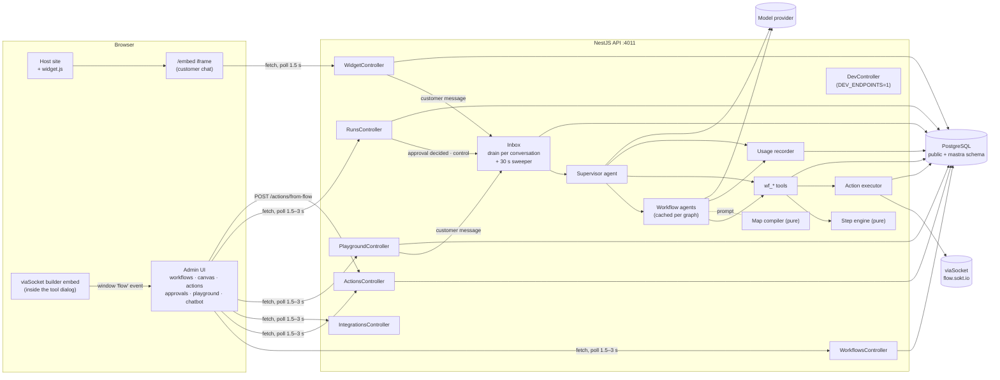
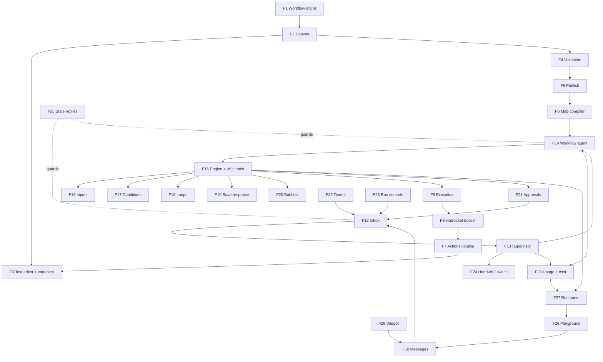
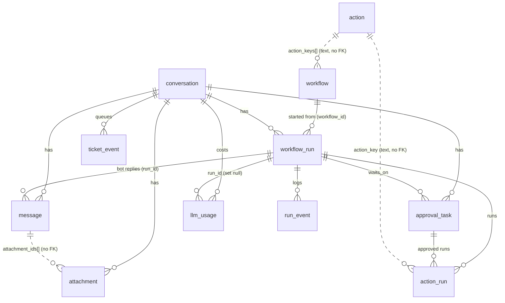
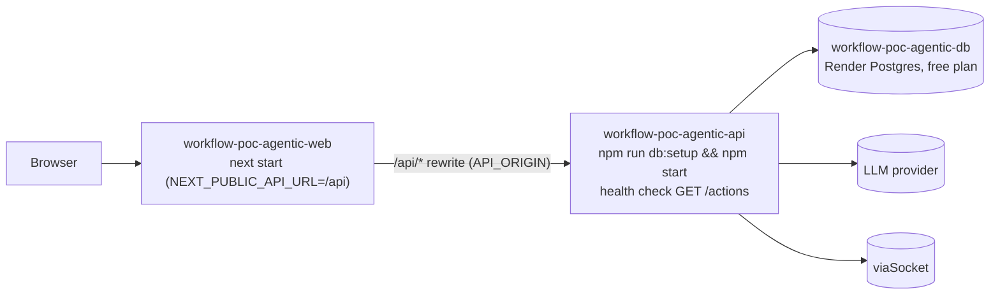
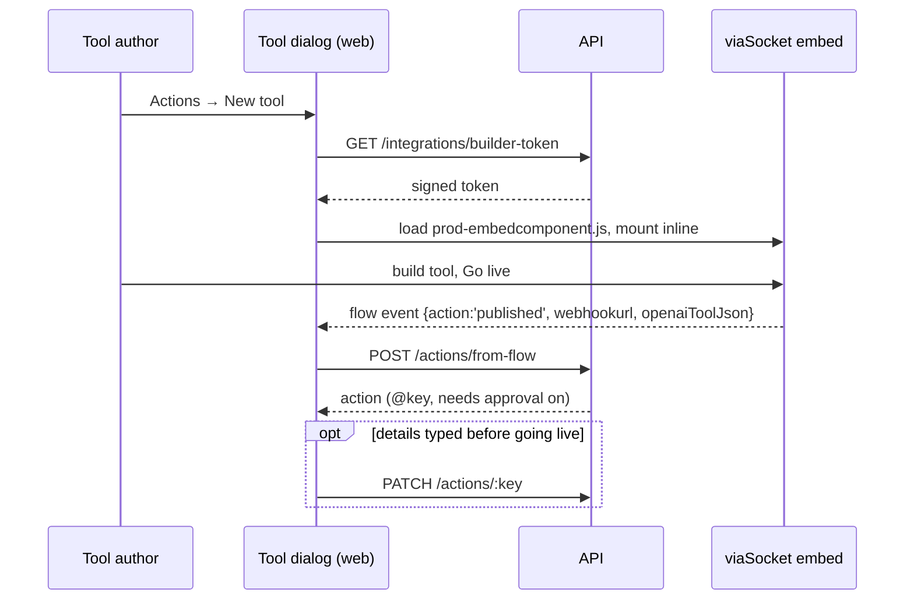
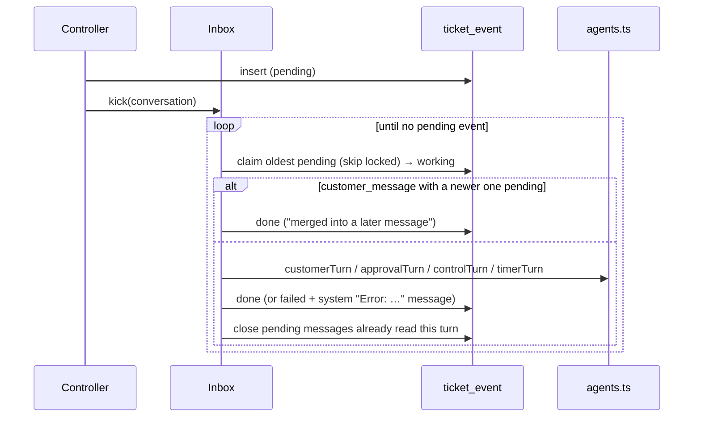
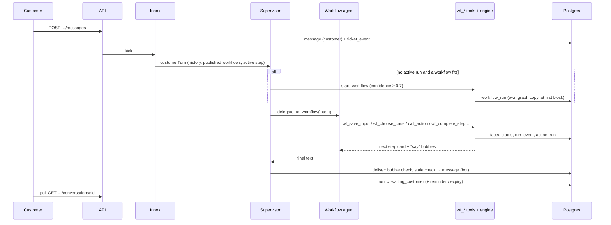
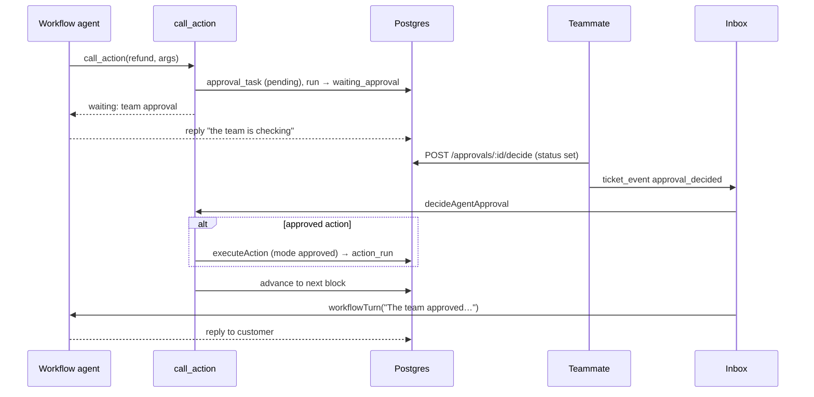
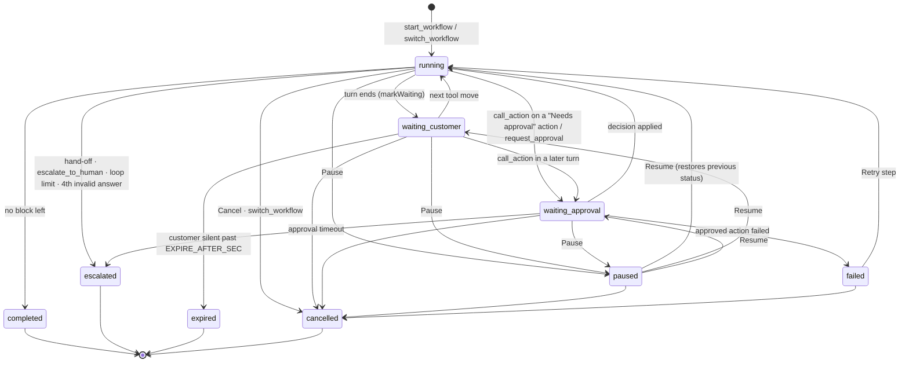

# Workflows POC (agentic): Functional Documentation

High-level functional documentation for `workflow-poc-agentic`, written from the source code as of **2026-10-14**
(after migrations `0016_minimal_schema.sql` and `0017_draft_and_published.sql`).
It explains **what** each feature does, **how** the pieces fit together and **where** to look. Exact SQL, prompt wording
and component props are left to the code.

> **Conventions.** Paths are relative to the repository root. `⚠ Unverified` marks statements the code alone can't confirm.
> `⚠ Risk` marks behaviour or architecture problems the code supports. Inventory status values:
> **Implemented**, **Partial** (works, but part of it is missing or not wired), **Dev-only**, **Legacy** (left in code or
> schema, no longer reachable), **Planned** (described in `docs/*.html` or `README.md`, not in code).

---

## Table of contents

1. [Project overview](#1-project-overview)
2. [Feature inventory](#2-feature-inventory)
3. [System architecture](#3-system-architecture)
4. [Repository structure](#4-repository-structure)
5. [Data model](#5-data-model)
6. [Configuration and environment](#6-configuration-and-environment)
7. [Deployment](#7-deployment)
8. [Feature documentation](#8-feature-documentation)
   - [F1 Workflow management](#f1-workflow-management)
   - [F2 Canvas workflow editor](#f2-canvas-workflow-editor)
   - [F3 Block text editor and variables](#f3-block-text-editor-and-variables)
   - [F4 Workflow validation](#f4-workflow-validation)
   - [F5 Draft and published copy](#f5-draft-and-published-copy)
   - [F6 Workflow map compiler](#f6-workflow-map-compiler)
   - [F7 Actions (tool) catalog](#f7-actions-tool-catalog)
   - [F8 viaSocket tool builder integration](#f8-viasocket-tool-builder-integration)
   - [F9 Action execution and idempotency](#f9-action-execution-and-idempotency)
   - [F10 Conversations and messages](#f10-conversations-and-messages)
   - [F11 Attachments](#f11-attachments)
   - [F12 Per-conversation event inbox](#f12-per-conversation-event-inbox)
   - [F13 Supervisor agent](#f13-supervisor-agent)
   - [F14 Workflow agent](#f14-workflow-agent)
   - [F15 Step engine and `wf_*` tools](#f15-step-engine-and-wf_-tools)
   - [F16 Input blocks](#f16-input-blocks)
   - [F17 Conditions (AI and rules)](#f17-conditions-ai-and-rules)
   - [F18 Loops (repeat limit, ask again)](#f18-loops-repeat-limit-ask-again)
   - [F19 Save response](#f19-save-response)
   - [F20 Text bubbles and the verbatim reply check](#f20-text-bubbles-and-the-verbatim-reply-check)
   - [F21 Approvals](#f21-approvals)
   - [F22 Timers: reminder, expiry, approval timeout](#f22-timers-reminder-expiry-approval-timeout)
   - [F23 Run controls (pause, resume, cancel, retry)](#f23-run-controls-pause-resume-cancel-retry)
   - [F24 Hand-off, yield and workflow switching](#f24-hand-off-yield-and-workflow-switching)
   - [F25 Stale-reply protection and message merging](#f25-stale-reply-protection-and-message-merging)
   - [F26 Playground](#f26-playground)
   - [F27 Run panel and timeline](#f27-run-panel-and-timeline)
   - [F28 AI usage, cost and call traces](#f28-ai-usage-cost-and-call-traces)
   - [F29 Embeddable chat widget](#f29-embeddable-chat-widget)
   - [F30 Model provider and Mastra setup](#f30-model-provider-and-mastra-setup)
   - [F31 Dev endpoints](#f31-dev-endpoints)
   - [F32 Database setup and migrations](#f32-database-setup-and-migrations)
   - [F33 API client and server wake-up handling](#f33-api-client-and-server-wake-up-handling)
   - [F34 App shell: navigation, approvals badge, server status](#f34-app-shell-navigation-approvals-badge-server-status)
   - [F35 Unit tests](#f35-unit-tests)
9. [API reference (summary)](#9-api-reference-summary)
10. [Run lifecycle](#10-run-lifecycle)
11. [Architectural risks, duplication and coupling](#11-architectural-risks-duplication-and-coupling)
12. [Verification against the repository](#12-verification-against-the-repository)

---

## 1. Project overview

**What it is.** A proof of concept for "Ticket0 workflows": support playbooks drawn on a canvas and carried out in a
customer chat by AI agents. It started as a copy of a sibling baseline (`../workflows-poc`, the DBOS + GTWY version) and
replaces that deterministic runner with agents (`README.md`). Ports and database differ, so both can run side by side.

**Core idea.** Two kinds of [Mastra](https://mastra.ai) agents talk to the customer:

- a **supervisor** reads every customer message and decides who handles it;
- one **workflow agent per published workflow graph** walks the canvas block by block.

Agents never change run state directly. Every move goes through a `wf_*` tool, and each tool checks the move with a
**pure step engine** (`server/src/engine/engine.ts`: no database, no AI). The engine stops the agent from skipping
steps, taking a wrong branch, running an action twice or getting past an approval.

**Primary use cases**

| Who | Does what | Where |
|---|---|---|
| Workflow author | Draws a workflow (AI steps, text bubbles, inputs, conditions, loops), saves a draft, publishes it | `/workflows`, `/workflows/[id]` |
| Tool author | Builds tools (actions) in viaSocket's embedded builder; sets "Needs approval" | `/actions` |
| Teammate | Approves or rejects actions and evidence; pauses, resumes, cancels or retries runs; writes in the chat | `/approvals`, `/playground` |
| Tester | Chats as a demo customer and watches the run, its tool calls, timeline and AI cost | `/playground` |
| Host product | Embeds the chat with one script tag | `/chatbot`, `web/public/widget.js` |
| Developer | Calls the `wf_*` tools by hand, inspects the agent map, probes the model | `/dev/*` (`DEV_ENDPOINTS=1`) |

**POC shortcuts** (stated in `README.md` and visible in code): single tenant (no `org_id`), no authentication,
playground conversations stand in for tickets, run timeline in Postgres (`run_event`), attachments on local disk,
replies are sent automatically (no draft mode).

**Tech stack**

| Part | Stack | Port |
|---|---|---|
| `server/` | NestJS 12, Mastra 1.75 (`@mastra/core`, `@mastra/memory`, `@mastra/pg`), AI SDK providers, `pg`, axios, zod | 4011 |
| `web/` | Next.js 16 (App Router), React 19, Tailwind 4, React Flow (`@xyflow/react` 12), TipTap 3, lucide-react | 4010 |
| Database | PostgreSQL; app tables in `public`, Mastra tables in schema `mastra` | — |
| External | Model provider (OpenAI, Anthropic or OpenAI-compatible), viaSocket (tool builder embed and flow run URLs) | — |

---

## 2. Feature inventory

Every feature found in the code, with its status and whether this document covers it. The coverage check in
[§12](#12-verification-against-the-repository) cross-checks this list against controllers, routes, tables and tools.

| # | Feature | Status | Main code | Documented |
|---|---|---|---|---|
| F1 | Workflow management (list, create, save draft, enable, delete/archive) | Implemented | `server/src/workflows/workflows.service.ts`, `web/src/app/workflows/` | ✅ |
| F2 | Canvas workflow editor (groups, blocks, arrows, palette, undo/redo, copy/paste, tidy) | Implemented | `web/src/components/canvas/*`, `web/src/lib/graph.ts` | ✅ |
| F3 | Block text editor (`@action`, `{{variable}}` chips) and workflow variables | Implemented | `web/src/components/step-editor.tsx`, `canvas/var-select.tsx`, `server/src/types.ts#VARIABLES` | ✅ |
| F4 | Workflow validation | Implemented | `server/src/workflows/graph.ts#validateGraph` | ✅ |
| F5 | Draft and published copy (publish, no version history) | Implemented | `workflows.service.ts#publishWorkflow`, migration `0017` | ✅ |
| F6 | Workflow map compiler (canvas → read-only agent map) | Implemented | `server/src/engine/map.ts` | ✅ |
| F7 | Actions catalog (list, enable, needs approval, rename, delete) | Implemented | `server/src/actions/actions.controller.ts`, `web/src/app/actions/page.tsx` | ✅ |
| F8 | viaSocket tool builder integration | Implemented | `web/src/components/viasocket-panel.tsx`, `server/src/integrations/*`, `POST /actions/from-flow` | ✅ |
| F9 | Action execution with idempotency | Implemented | `server/src/actions/execute.ts`, `integrations/viasocket.ts#runFlow` | ✅ |
| F10 | Conversations and messages (customer, bot, team, system) | Implemented | `server/src/playground/*` | ✅ |
| F11 | Attachments (upload, serve) | Partial (images never reach the model or the approval card) | `playground.controller.ts` | ✅ |
| F12 | Per-conversation event inbox and sweeper | Implemented | `server/src/agents/inbox.ts` | ✅ |
| F13 | Supervisor agent (start, switch, delegate, hand off, reply) | Implemented | `server/src/agents/agents.ts`, `prompts.ts` | ✅ |
| F14 | Workflow agent (one per published graph) | Implemented | `agents.ts#workflowAgent`, `#workflowTurn` | ✅ |
| F15 | Step engine and `wf_*` tools | Implemented | `engine/engine.ts`, `agents/wf-tools.ts`, `agents/tools.ts` | ✅ |
| F16 | Input blocks (text, email, number, phone; retries; answering ahead) | Implemented | `engine.ts#checkAnswer`, `wf-tools.ts#wfSaveInput` | ✅ |
| F17 | Conditions (AI-judged and rules) | Implemented | `engine.ts#chooseByRules`, `wf-tools.ts#wfChooseCase` | ✅ |
| F18 | Loops with repeat limit and "ask again" | Implemented | `engine.ts#follow`, `#rerun`; `graph.ts#cycles` | ✅ |
| F19 | Save response (action output → variables) | Implemented | `engine.ts#saveResponse`, `canvas/save-response.tsx`, `GET /actions/:key/sample` | ✅ |
| F20 | Text bubbles and the verbatim reply check | Implemented | `wf-tools.ts#wfCompleteStep`, `agents.ts#deliver` | ✅ |
| F21 | Approvals (action approval, evidence review) | Implemented / Partial (evidence photos) | `runner/tasks.ts`, `runner/runs.controller.ts`, `wf-tools.ts#decideAgentApproval` | ✅ |
| F22 | Timers: reminder, expiry, approval timeout | Implemented | `inbox.ts#sweep`, `#timerTurn`; `agents.ts#markWaiting` | ✅ |
| F23 | Run controls: pause, resume, cancel, retry | Implemented | `runs.controller.ts`, `wf-tools.ts#controlAgentRun`, `agents.ts#controlTurn` | ✅ |
| F24 | Hand-off to a person, yield, workflow switching | Implemented | `wf-tools.ts#wfHandoff`, `#wfSwitchWorkflow`; `agents.ts` | ✅ |
| F25 | Stale-reply protection and quick-message merging | Implemented | `inbox.ts#drain`, `agents.ts#newerMessage`, `#deliver` | ✅ |
| F26 | Playground (personas, chat as customer or team) | Implemented | `web/src/app/playground/page.tsx` | ✅ |
| F27 | Run panel (steps view, timeline, controls) | Implemented | `web/src/components/run-panel.tsx`, `run-timeline.tsx`, `tool-call.tsx`, `json-view.tsx` | ✅ |
| F28 | AI usage, cost and full call traces | Implemented | `agents/usage.ts`, `prices.ts`, `GET /ai-calls/:id`, `components/ai-call.tsx` | ✅ |
| F29 | Embeddable chat widget (loader, iframe, setup page, demo host) | Implemented | `web/public/widget.js`, `web/src/app/{embed,embed-demo,chatbot}`, `widget.controller.ts` | ✅ |
| F30 | Model provider configuration and Mastra setup | Implemented | `server/src/agents/mastra.ts`, `config.ts` | ✅ |
| F31 | Dev endpoints (`/dev/*`) and model probe | Dev-only (probe has a bug, §11.3) | `server/src/dev/dev.controller.ts` | ✅ |
| F32 | Database setup and migrations | Implemented | `server/scripts/setup-db.js`, `server/migrations/*` | ✅ |
| F33 | API client with server wake-up handling | Implemented | `web/src/lib/api.ts` | ✅ |
| F34 | App shell (navigation, pending-approvals badge, server status banner) | Implemented | `web/src/components/nav.tsx`, `server-status.tsx`, `app/layout.tsx` | ✅ |
| F35 | Unit tests (engine, map) | Implemented | `server/test/*` | ✅ |
| — | Evals harness, `ticket_timer` table, Langfuse tracing, GTWY model endpoint, spending limits | Planned | `docs/agent-workflows-full-plan.html` | §12 |
| — | Auth, multi-tenant `org_id`, draft-reply mode | Planned | `README.md` "POC shortcuts" | §12 |

---

## 3. System architecture

### 3.1 Components

| Component | Responsibility | Code |
|---|---|---|
| **Web app** (Next.js) | Admin screens (workflows, canvas, actions, approvals, playground, widget setup) and the customer widget page | `web/src/app/*`, `web/src/components/*` |
| **Widget loader** | Plain script a host site pastes; injects a chat button and an iframe on `/embed` | `web/public/widget.js` |
| **REST API** (NestJS) | Seven controllers; validation; persistence | `server/src/app.module.ts` |
| **Event inbox** | Queues every trigger per conversation in `ticket_event`; runs them one at a time; sweeper for timers | `server/src/agents/inbox.ts` |
| **Agents** (Mastra) | Supervisor (routing) and workflow agents (block-by-block execution), prompts, tool wiring | `server/src/agents/agents.ts`, `prompts.ts`, `tools.ts` |
| **`wf_*` tools** | The only way run state changes: load run → check with engine → save → log event → return next step card | `server/src/agents/wf-tools.ts` |
| **Step engine** | Pure rules: graph traversal, input formats, rules, loops, save response, action planning, step cards | `server/src/engine/engine.ts` |
| **Map compiler** | Pure: published graph → numbered, read-only workflow map text for the agent prompt | `server/src/engine/map.ts` |
| **Action executor** | Runs a tool once per idempotency key; calls viaSocket flow URLs | `server/src/actions/execute.ts`, `server/src/integrations/viasocket.ts` |
| **Usage recorder** | One `llm_usage` row per agent call: tokens, cost, full per-round trace | `server/src/agents/usage.ts`, `prices.ts` |
| **PostgreSQL** | All state: workflows, actions, conversations, runs, events, approvals, usage, inbox | `server/migrations/*.sql` |
| **Model provider** | OpenAI / Anthropic / OpenAI-compatible endpoint | `server/src/agents/mastra.ts#model` |
| **viaSocket** | Embedded builder (`embed.viasocket.com`) to create tools; `https://flow.sokt.io/func/<id>` to run them | `viasocket-panel.tsx`, `viasocket.ts` |

### 3.2 System architecture diagram



### 3.3 Communication patterns

| From → To | Mechanism | Notes |
|---|---|---|
| Browser → API | JSON over HTTP (`web/src/lib/api.ts#api`) | No WebSockets. Screens **poll**: playground and widget every 1.5 s, approvals page and nav badge every 3 s. |
| Browser → API (deployed) | Same origin `/api/*`, rewritten by Next to `API_ORIGIN` | `web/next.config.ts` |
| API → inbox | `enqueue()` inserts a `ticket_event` row and starts a drain loop | `inbox.ts#enqueue`, `#kick` |
| Inbox → agents | Direct function calls: `customerTurn`, `approvalTurn`, `controlTurn`, `timerTurn` | One event at a time per conversation |
| Supervisor → workflow agent | Synchronous tool call `delegate_to_workflow` runs `workflowTurn` inside the supervisor's turn | Shared `Turn` object in Mastra `RequestContext` |
| Agents → state | Mastra tools → `wf-tools.ts` functions → DB | The run id comes from the request context, never from the model (`tools.ts#runIdOf`) |
| Executor → viaSocket | `axios.post(flowUrl, args)`, 60 s timeout | `viasocket.ts#runFlow` |
| viaSocket embed → web | `embed.on('flow', …)` callback in the page | `viasocket-panel.tsx` |
| Widget iframe → host page | `postMessage({ t0: 'close' })`; loader checks the origin | `embed/page.tsx`, `widget.js` |

### 3.4 Feature interaction diagram



### 3.5 Shared utilities and cross-cutting services

| Utility | Purpose | Used by |
|---|---|---|
| `server/src/db.ts` (`q`, `one`, `tx`, `pool` max 10) | Thin `pg` helpers; `tx` wraps begin/commit/rollback | Every server module |
| `server/src/config.ts` | All env reads; refuses to boot without `DATABASE_URL`; limits `maxVisits = 100`, `maxGraphSteps = 50` | Server-wide |
| `server/src/types.ts` | Graph, run, facts, action types; `RULE_OPS`, `INPUT_FORMATS`, `ACTIVE` statuses, built-in `VARIABLES` | Server-wide |
| `server/src/workflows/inline.ts` | `renderInline` (rich text → prompt text), `stepActions` (actions mentioned in a step) | Engine, map compiler |
| `server/src/runner/events.ts#addEvent` | Appends a `run_event` row (timeline and audit) | Tools, agents, inbox |
| `server/src/runner/context.ts` | `loadRun`, `saveRun`, `loadTranscript`, `baseVars` | Tools, agents |
| `server/src/runner/tasks.ts#openTask` | Opens (or reuses) the pending approval task of a step | `wf-tools.ts#wfCallAction` |
| `server/src/agents/usage.ts#trackedGenerate` | Every agent call goes through it: `agent.generate` + `llm_usage` row | Agents, probe |
| `web/src/lib/api.ts` | Fetch wrapper, error shape (`ApiError` with `issues`), wake-up retry, `usd()` | All pages |
| `web/src/lib/graph.ts` | Client copy of the graph types plus immutable edit helpers | Canvas, run panel |
| `web/src/components/ui.tsx` | `Button`, `Toggle`, `StatusChip`, `Card`, `AttentionDot` | All pages |

No middleware, guards, interceptors or pipes are registered in Nest (`main.ts` only sets an 8 MB JSON body limit and CORS).

---

## 4. Repository structure

```
workflow-poc-agentic/
├─ README.md                  How it works, how to run, POC shortcuts
├─ render.yaml                Render blueprint: Postgres + API + web
├─ .claude/launch.json        Dev server entries (agentic-server :4011, agentic-web :4010)
├─ docs/
│  ├─ agent-workflows-full-plan.html   Target design and stages (source of "Planned" items)
│  ├─ agent-run-workflows-plan.html    Earlier plan
│  └─ FUNCTIONAL_DOCUMENTATION.md      This file
├─ server/
│  ├─ migrations/0001…0017.sql   Schema history (no 0008); applied once each by scripts/setup-db.js
│  ├─ scripts/setup-db.js        Creates the database if missing, applies migrations
│  ├─ src/
│  │  ├─ main.ts, app.module.ts, config.ts, db.ts, types.ts
│  │  ├─ workflows/   controller + service (CRUD, publish), graph.ts (validation), inline.ts
│  │  ├─ engine/      engine.ts (pure step rules), map.ts (pure map compiler)
│  │  ├─ agents/      agents.ts (supervisor, workflow agent, turns), inbox.ts, wf-tools.ts, tools.ts,
│  │  │               prompts.ts, mastra.ts (model + storage), usage.ts, prices.ts
│  │  ├─ actions/     actions.controller.ts (catalog, from-flow), execute.ts (idempotent execution)
│  │  ├─ integrations/ viasocket.ts (builder token, runFlow, flowError), integrations.controller.ts
│  │  ├─ runner/      runs.controller.ts (controls, approvals), context.ts, events.ts, tasks.ts
│  │  ├─ playground/  playground.controller.ts, widget.controller.ts, conversations.ts
│  │  └─ dev/         dev.controller.ts (DEV_ENDPOINTS only)
│  └─ test/           engine.test.ts, map.test.ts, fixtures.ts (node:test)
└─ web/
   ├─ public/widget.js           Embeddable loader
   ├─ next.config.ts             /api rewrite to API_ORIGIN
   └─ src/
      ├─ app/  workflows/, workflows/[id]/, actions/, approvals/, playground/, chatbot/, embed/, embed-demo/,
      │        layout.tsx (shell), page.tsx (redirect to /workflows), globals.css (tokens, editor and canvas styles)
      ├─ components/ canvas/ (canvas.tsx, group-card.tsx, edge.tsx, save-response.tsx, var-select.tsx, context.ts),
      │              step-editor.tsx, viasocket-panel.tsx, run-panel.tsx, run-timeline.tsx, tool-call.tsx,
      │              ai-call.tsx, json-view.tsx, inline-text.tsx, nav.tsx, server-status.tsx, ui.tsx
      └─ lib/  api.ts, graph.ts, inline.ts
```

**Where the business logic lives**

| Concern | File(s) |
|---|---|
| Workflow rules at run time | `server/src/engine/engine.ts` (pure) and `server/src/agents/wf-tools.ts` (applies them to stored runs) |
| What makes a workflow publishable | `server/src/workflows/graph.ts#validateGraph` |
| Routing and agent behaviour | `server/src/agents/agents.ts`, `server/src/agents/prompts.ts` |
| Ordering, timers, retries after restart | `server/src/agents/inbox.ts` |
| Running tools exactly once | `server/src/actions/execute.ts` |
| Canvas editing semantics | `web/src/lib/graph.ts` |

Build output (`server/dist`, `server/dist-test`, `web/.next`), `node_modules`, `uploads/` and `.env` files are
git-ignored (`.gitignore`) and are not documented.

---

## 5. Data model

### 5.1 Entity relationship diagram

State after migration `0017`. Mastra creates its own tables in schema `mastra` (⚠ Unverified which ones; only the dev
probe agent uses Mastra memory).



### 5.2 Tables

| Table | Purpose | Key columns and constraints |
|---|---|---|
| `workflow` | One workflow: the **draft** and the **published copy** on one row | `graph` (draft canvas, not null), `when_to_use`, `action_keys`, `step_count`; `published_graph`, `published_when_to_use`, `published_action_keys`, `published_at`; `enabled`, `has_unpublished_changes`, `row_version` (optimistic lock), `archived_at` (soft delete); name unique among non-archived rows |
| `action` | Tools workflows mention as `@key` | `key` (`^[a-z][a-z0-9_]{1,47}$`), `name`, `description`, `input_schema`, `requires_approval`, `enabled`, `builtin`, `source` (`builtin` \| `viasocket_flow`), `via_flow_id` (unique), `via_flow_url`, `details_edited` |
| `conversation` | Stands in for a ticket | `customer_name`, `customer_email`, `channel` (`playground` \| `widget`) |
| `message` | Chat transcript | `role` (`customer` \| `bot` \| `team` \| `system`), `text`, `attachment_ids[]`, `run_id` |
| `attachment` | Uploaded files | `file_name`, `mime_type`, `size_bytes`, `sha256`, `path` (local disk) |
| `workflow_run` | One execution of a workflow on a conversation | `workflow_id`, `workflow_name`, `graph` (**own copy** of the published graph), `status`, `current_node_id`, `facts`, `waiting_for`, `outbox`, `paused_from`, `end_reason`; **one active run per conversation** (partial unique index on active statuses) |
| `run_event` | Append-only timeline | `run_id`, `node_id`, `actor` (`ai`, `system`, `customer`, `user:<name>`), `type`, `data` |
| `approval_task` | A decision a run waits on | `kind` (`evidence` \| `action`), `action_key`, `action_args`, `summary`, `evidence`, `status` (`pending` \| `approved` \| `rejected` \| `expired` \| `cancelled`), `decided_by`, `decision_note`, `due_at`; one pending task per (run, node) |
| `action_run` | Every tool execution | `idempotency_key` (unique, `<run>:<node>:<visit>`), `mode` (`auto` \| `approved`; `test` allowed but unused), `args`, `status`, `result`, `error`, `visit`, `approval_task_id` |
| `ticket_event` | Per-conversation inbox | `kind` (`customer_message` \| `approval_decided` \| `timer` \| `control`), `payload`, `status` (`pending` \| `working` \| `done` \| `failed`), `error` |
| `llm_usage` | One row per model call | `agent`, `model` (`provider/model`), `input_tokens`, `output_tokens`, `cost_usd`, `started_at`, `trace` (per-round request and response) |
| `schema_migrations` | Applied migration files | Created by `scripts/setup-db.js` |

Built-in actions seeded by `0001_init.sql` and still present: `request_approval` (evidence review) and
`escalate_to_human`. Tables removed over time: `workflow_version`, `shop_order`, `app_setting`, `app_connection`, schema
`dbos` (`0009`, `0016`, `0017`).

### 5.3 Run state (`workflow_run.facts`, `waiting_for`, `outbox`)

| Field | Meaning | Written by |
|---|---|---|
| `facts.vars` | The workflow's own variables: input answers and saved responses | `engine.ts#saveAnswer`, `#saveResponse` |
| `facts.varsBy` | Block id → variables it filled ("ask again" clears them) | same |
| `facts.outputs` | Block id → its result (`{var: value}` for inputs, tool result for steps, `{approval_task_id}` while waiting, `{approved, …}` after review) | tools |
| `facts.cases` | Condition id → chosen case and reason | `engine.ts#recordCase` |
| `facts.attempts` | Invalid-answer count per input | `engine.ts#countAsk` |
| `facts.visits` | Loop edge id → visit number; feeds the idempotency visit | `engine.ts#rerun` |
| `facts.trail` | Block ids in the order they finished (detects loop-backs) | `engine.ts#follow` |
| `facts.collected` | Seeded with `customer_name` and `email`; read only as a fallback | `wf-tools.ts#startAgentRun` |
| `facts.since`, `facts.previous` | Written on loop-backs, never read | `engine.ts#rerun` (Legacy) |
| `facts.asked`, `facts.collectedBy` | Deleted or read but never set | Legacy |
| `waiting_for` | `{type:'customer', node_id, expects, remind_at, expires_at, reminded}` or `{type:'approval', node_id, task_id, due_at}` | `agents.ts#markWaiting`, `wf-tools.ts#wfCallAction` |
| `outbox` | Text bubbles the next reply must contain word for word | `wf-tools.ts#wfCompleteStep`; cleared by `agents.ts#deliver` |
| `paused_from` | Status and wait to restore on resume | `wf-tools.ts#controlAgentRun` |

---

## 6. Configuration and environment

### 6.1 Server (`server/.env`; template `server/.env.example`; read in `server/src/config.ts`)

| Variable | Default | Required | Effect |
|---|---|---|---|
| `DATABASE_URL` | — | **Yes** (boot fails without it) | Postgres connection; also used by Mastra's `PostgresStore` |
| `PORT` | `4011` | No | API port |
| `CORS_ORIGINS` | `http://localhost:4010` | No | Comma-separated allowed origins |
| `LLM_PROVIDER` | `openai` | No | `openai` \| `anthropic` \| `openai-compatible` |
| `LLM_MODEL`, `LLM_API_KEY` | empty | To answer chats | Missing values throw on the first agent call, not at boot |
| `LLM_BASE_URL` | empty | For `openai-compatible` | Base URL of the gateway (README: a GTWY pass-through endpoint later) |
| `REMIND_AFTER_SEC` / `EXPIRE_AFTER_SEC` / `APPROVAL_TIMEOUT_SEC` | 120 / 600 / 1800 | No | Customer reminder, customer silence expiry, approval timeout |
| `VIASOCKET_ORG_ID`, `VIASOCKET_PROJECT_ID`, `VIASOCKET_EMBED_SECRET` | empty | For the tool builder | Signs the builder token; `/integrations/builder-token` fails without the secret |
| `VIASOCKET_UID` | `workflow-poc-agentic` | No | viaSocket end user the builder works as |
| `DEV_ENDPOINTS` | unset | No | `1` enables `/dev/*` |
| `UPLOADS_DIR` | `<cwd>/uploads` | No | Attachment folder (read in `playground.controller.ts`, not listed in `.env.example`) |

### 6.2 Web (`web/.env.example`, `web/next.config.ts`)

| Variable | Effect |
|---|---|
| `NEXT_PUBLIC_API_URL` | API base used by the browser. Local: `http://localhost:4011`. Deployed: `/api` |
| `API_ORIGIN` | When set, Next rewrites `/api/:path*` to it, so the browser makes same-origin calls (no CORS) |

---

## 7. Deployment

`render.yaml` defines a Render Blueprint:



- All three are on the **free plan**; Node 22. Migrations run on every API start (each applies once).
- Preset env: `LLM_PROVIDER=openai`, `LLM_MODEL=gpt-6-luna`, the three timer values, `VIASOCKET_UID`. Secrets
  (`LLM_API_KEY`, `VIASOCKET_*`) are `sync: false` and entered in Render.
- The free API sleeps when idle; the web client's wake-up handling (F33) exists for this.
- ⚠ Unverified: whether the API's local `uploads/` folder survives restarts on Render (free web services have no
  persistent disk in Render's model; nothing in `render.yaml` adds one).
- Local development: `npm run dev` in each package, or the `.claude/launch.json` entries (README).

---

## 8. Feature documentation

Each feature uses the same headings. "Data" names tables from §5; "Security" notes the POC has **no authentication on
any route** (see §11.1) and lists anything feature-specific.

### F1 Workflow management

- **Purpose.** Keep a list of playbooks, each for one kind of customer request.
- **Business logic.** Create (unique default name "Untitled workflow", "Untitled workflow 2", …), open, rename, edit the
  draft, toggle **Enabled**, delete. Delete is an **archive**: the row stays, `enabled` turns off and running chats
  finish on their own graph copy. The list shows step count, "live" / "never published" and "unpublished changes".
- **Flow.** `/workflows` → **New workflow** (`POST /workflows`, starts with an empty "Start" group) → editor
  `/workflows/[id]` → **Save changes** (`PUT /workflows/:id` with `row_version`) → **Publish** (F5).
- **Components.** `web/src/app/workflows/page.tsx`, `web/src/app/workflows/[id]/page.tsx`;
  `server/src/workflows/workflows.controller.ts`, `workflows.service.ts`.
- **APIs.** `GET/POST /workflows`, `GET/PUT/PATCH/DELETE /workflows/:id`, `GET /variables`.
- **Data.** `workflow`.
- **Dependencies.** F4 (every read and save returns `validation`), F5, F7 (enabled action keys).
- **Failure scenarios.**
  - Saving over a newer version → `409` "This workflow changed elsewhere — reload" (`row_version` mismatch).
  - Empty name → `400`. Enabling a never-published workflow → `400` (UI also disables the toggle).
  - Unsaved canvas edits → browser "leave page?" prompt (`beforeunload`).
  - ⚠ Risk: a name that clashes with another active workflow hits the unique index and surfaces as a generic `500`
    (no mapping to a friendly error in `saveWorkflow`).
  - `DELETE` returns `ok` even for an unknown id.
- **Security.** Anyone who can reach the API can edit, publish or archive.

### F2 Canvas workflow editor

- **Purpose.** Draw a workflow as **groups** of **blocks** joined by **arrows**, Typebot-style.
- **Business logic.**
  - Block types: **AI step** (instruction, may mention `@actions`, optional Save response), **Text bubble** (fixed
    message), **Input** (Text, Email, Number, Phone), **Condition** (rules) and **AI condition**.
  - Blocks in a group run top to bottom; a group's end has one "then" output; each condition case has its own output.
    One arrow per output (connecting again replaces it). Arrows can enter a group or a specific block.
  - Arrows on a cycle are drawn dashed blue with "↺ max N"; selecting one lets you set **repeat at most N×** (1–100) and
    **ask again**.
  - The start group can't be deleted. Moving a block out of a group leaves an empty non-start group, which is removed.
- **Flow / interactions.** Drag palette items onto a card (drop line shows the slot) or onto empty canvas (new group);
  drag a block by its grip to reorder or move it; drag from an output dot to a card, block or empty canvas (creates a
  group with an empty AI step); drag an arrow end to re-point it (dropping on nothing deletes it); Shift+drag box
  select; Ctrl+C / V / D / A; Delete/Backspace removes selection; Ctrl+Z / Ctrl+Shift+Z undo/redo (graph only; text
  fields keep their own undo); **Tidy up** lays groups in columns by distance from the start; zoom, fit and minimap.
- **Components.** `web/src/components/canvas/canvas.tsx` (React Flow wiring, drag, connect, keyboard),
  `group-card.tsx` (group node, blocks, rules UI, add-block menu), `edge.tsx` (arrow with loop settings),
  `context.ts`; edit helpers in `web/src/lib/graph.ts` (`connect`, `reconnect`, `moveItemTo`, `pasteGroups`, `tidy`,
  `loopEdges`, …); undo stacks in `workflows/[id]/page.tsx`.
- **APIs.** None directly; the page saves the whole graph with `PUT /workflows/:id`.
- **Data.** `workflow.graph` (JSON: `start`, `groups[] {id,title,x,y,items[]}`, `edges[] {from,to,maxVisits?,fresh?}`,
  `variables[]`). Shape is defined twice: `server/src/types.ts` and `web/src/lib/graph.ts`.
- **Dependencies.** F3 (text and variables), F4 (step counter "N of 50" mirrors the server limit), F19.
- **Failure scenarios.** Client-side only; structural problems are reported by F4 after saving. Pasted groups get fresh
  ids for groups, items, cases and arrows.
- **Security.** n/a.
- **Note.** `Canvas` accepts `readOnly` and `highlight` props, but no page passes them (Legacy, §11.6).

### F3 Block text editor and variables

- **Purpose.** Write block text with inline **`@action`** chips (which tool a step may call) and **`{{variable}}`**
  chips (values shown at run time).
- **Business logic.**
  - Typing `@` lists **enabled** actions; `{{` lists variables. A chip for an unknown or disabled action is shown in
    the warning colour. Text bubbles and input prompts offer no actions.
  - Built-in variables: `customer.name`, `customer.email`, `today` (`server/src/types.ts#VARIABLES`, served by
    `GET /variables`, filled by `runner/context.ts#baseVars`).
  - Workflow variables: lowercase names (`^[a-z][a-z0-9_]*$`) kept in `graph.variables`; added from the palette's
    Variables box or "+ New variable…" in any picker (`toVarName` normalises the text).
  - Stored as `Inline[]` (`{t:'text'|'action'|'var'}`); TipTap JSON never reaches the server.
- **Components.** `web/src/components/step-editor.tsx` (TipTap + Mention, popup portalled to `<body>`),
  `canvas/var-select.tsx`, `web/src/lib/inline.ts`, `components/inline-text.tsx` (read-only rendering).
- **APIs.** `GET /actions`, `GET /variables`.
- **Data.** Inside `workflow.graph`.
- **Dependencies.** F7 for the action list; F4 checks mentions.
- **Failure scenarios.** Unknown action or variable → flagged by F4 ("`@x doesn't exist or is disabled`",
  "Unknown variable `{{x}}`"). A declared variable with no value yet renders as empty text to the customer
  (`engine.ts#shownVars`).
- **Note.** `StepEditor`'s `onEnter`, `onBackspaceEmpty` and `onCondition` props are never passed (Legacy).

### F4 Workflow validation

- **Purpose.** Decide whether a draft can be published, and tell the author what to fix.
- **Business logic** (`server/src/workflows/graph.ts#validateGraph`):
  - at least one group; no empty groups; unique item ids; no empty AI steps or bubbles; bubbles can't contain `@actions`;
  - Save response needs an `@action` in the step, a path and a variable per row, no variable saved twice;
  - inputs need a variable and a known format;
  - conditions start with If, Else is last; AI cases need text; rules cases need at least one rule with a variable,
    a known operator and (when comparing with a variable) that variable;
  - start group exists; arrows point at existing groups, blocks and cases; one arrow per output; repeat limits 1–100;
  - every group reachable from the start; every cycle (Tarjan SCC, `cycles`) has a repeat limit on at least one arrow;
  - at most 50 blocks (conditions don't count; `graphStepCount`);
  - every `@action` exists and is enabled; every variable is built-in or declared; variable names are well formed.
- **Flow.** Run on every `GET`, `PUT` and `POST /workflows`; `PUT` saves even with issues; `POST …/publish` refuses with
  `400 {message:'Fix these before publishing', issues[]}`. The editor shows the list when there are no unsaved edits.
- **Components.** `graph.ts`, `workflows.service.ts#check`, editor notices in `workflows/[id]/page.tsx`.
- **Data.** Writes `workflow.action_keys` and `step_count` from the result.
- **Dependencies.** F7 (enabled keys), `config.maxVisits`, `config.maxGraphSteps`.
- **Failure scenarios.** An action disabled after publishing does not unpublish the workflow; at run time the engine
  rejects the call ("`x is disabled`").
- **Gaps.** Validation does not require an Else on rules conditions (see F17 risk), and an arrow inside a cycle without
  its own limit is accepted as long as another arrow of that cycle has one.

### F5 Draft and published copy

- **Purpose.** Let authors edit freely without changing live chats until they publish.
- **Business logic.** One row holds both copies. **Publish** copies `graph`, `when_to_use`, `action_keys` to the
  `published_*` columns, sets `published_at`, `enabled = true`, `has_unpublished_changes = false`. There is **no version
  history** (`0017` dropped `workflow_version`). New runs copy `published_graph` into `workflow_run.graph`, so running
  chats keep the graph they started on. Routing (F13) uses `published_when_to_use`.
- **Flow.** Editor **Publish** → if there are unsaved edits, `PUT` first → `POST /workflows/:id/publish`.
- **Components.** `workflows.service.ts#publishWorkflow`, `wf-tools.ts#startAgentRun`.
- **APIs.** `POST /workflows/:id/publish`.
- **Data.** `workflow.published_*`, `workflow_run.graph`.
- **Dependencies.** F4 must report no issues.
- **Failure scenarios.** Validation issues → `400` with the list. Publish does not check `row_version`, so it publishes
  whatever draft is stored at that moment.
- **Note.** The workflow agent is keyed on a hash of the run's graph, so a new publish gets a new agent (F14).

### F6 Workflow map compiler

- **Purpose.** Give the workflow agent the whole workflow as numbered, read-only prompt text so it can plan, while the
  server still decides every move.
- **Business logic** (`server/src/engine/map.ts#buildMap`, pure). Groups are numbered breadth-first from the start
  (unreachable ones last, marked "(not reachable)"); items get refs like `2.1` and their `[id]`. Each line describes the
  block: AI step text, its tools (with "(needs approval)") and saves; bubble text; input variable and format; condition
  mode and each case with where it goes. Loops are listed with max visits and "ask again" / "keep answers".
- **Flow.** Built lazily when a workflow agent is created for a run's graph (`agents.ts#workflowAgent`), or on demand
  by `GET /dev/workflows/:id/map`. Not stored (`0016` dropped `agent_map`).
- **Dependencies.** `workflows.service.ts#needsApproval` (live `action.requires_approval`), `workflows/inline.ts`.
- **Failure scenarios.** None at build time. ⚠ Risk: the "(needs approval)" hint and `when_to_use` are baked into the
  cached agent; changing an action's approval flag later does not refresh the prompt (the engine still enforces the live
  flag, so only the hint is stale).
- **Tests.** `server/test/map.test.ts`.

### F7 Actions (tool) catalog

- **Purpose.** The tools workflows can mention with `@key`, and the switches that govern them.
- **Business logic.**
  - Two sources: `builtin` (`request_approval`, `escalate_to_human`) and `viasocket_flow` (built in viaSocket, F8).
  - Per action: **Enabled** (all), **Needs approval** (viaSocket tools only in the UI), edit and delete (viaSocket only).
  - Rename (`new_key`) is allowed only while no active workflow mentions the key in its draft **or** published copy.
  - Name and description are required when given; editing them sets `details_edited` so later viaSocket updates don't
    overwrite them.
  - Delete is refused while a workflow's **draft** mentions the key; only `viasocket_flow` rows can be deleted.
- **Components.** `web/src/app/actions/page.tsx`, `components/viasocket-panel.tsx#ToolDialog`;
  `server/src/actions/actions.controller.ts`.
- **APIs.** `GET /actions`, `GET /actions/:key`, `GET /actions/:key/sample`, `PATCH /actions/:key`,
  `DELETE /actions/:key`, `POST /actions/from-flow`.
- **Data.** `action`; `action_run` (for samples).
- **Dependencies.** F8, F4 (enabled keys), F15 (engine reads `enabled`, `requires_approval`, `input_schema`).
- **Failure scenarios.** Bad key format, duplicate key, key in use → `400` with a readable message.
  ⚠ Risk: delete checks only the draft's `action_keys`, not `published_action_keys`, so a tool used only by the live copy
  can be deleted; live calls then fail with "`x is disabled`".
- **Security.** `GET /actions` returns `select *`, including `via_flow_url`, which the code itself calls a credential
  ("the URL is the credential", `viasocket.ts`).

### F8 viaSocket tool builder integration

- **Purpose.** Create tools without writing code: viaSocket's own builder is embedded; each published flow becomes an action.
- **Business logic.**
  - The server signs an HS256 JWT `{org_id, project_id, user_id, unique_identifier}` with `VIASOCKET_EMBED_SECRET`
    (`viasocket.ts#builderToken`). App connections live inside viaSocket; this app stores none.
  - The tool dialog mounts the builder inline: **New tool** opens straight on "Add New Tool" (`showEnabled: false`);
    the pencil reopens the tool's flow (except whole-app tools with `action_name` + `instructions` inputs, which live on
    the builder's home screen).
  - The builder emits `flow` events; `published`, `updated`, `paused`, `deleted`/`delete` with a webhook URL are
    posted to `POST /actions/from-flow`. Drafts are ignored.
  - From-flow: **new** flow → unique `@key` from the tool name (`freeKey`), `input_schema` from `openaiToolJson`
    (fallback: MCP schema, then sample payload keys), **Needs approval on**. **Update** → schema and URL always follow;
    name and description only until edited here. **Paused** → disabled. **Deleted** → disabled if a draft uses it,
    otherwise removed. Details typed in the dialog before going live are saved right after the first publish event.
- **Flow.**



- **Components.** `web/src/components/viasocket-panel.tsx`, `server/src/integrations/viasocket.ts`,
  `integrations.controller.ts`, `actions/actions.controller.ts#fromFlow`.
- **APIs and integrations.** `GET /integrations/builder-token`, `POST /actions/from-flow`;
  `https://embed.viasocket.com/prod-embedcomponent.js`.
- **Data.** `action.via_flow_id`, `via_flow_url`, `details_edited`.
- **Failure scenarios.** Missing secret → `400` "viaSocket is not configured"; script load failure → message in the
  dialog; a from-flow body without an id or a `https://flow.sokt.io/func/<id>` URL → `400`.
- **Security.** ⚠ Risk: `POST /actions/from-flow` is unauthenticated, so any caller can register or overwrite a tool
  (the URL pattern check limits targets to viaSocket flow URLs). ⚠ Unverified: viaSocket event payload shapes are taken
  from how the code reads them.

### F9 Action execution and idempotency

- **Purpose.** Run a tool for a workflow step **exactly once per step visit**, even across retries and restarts.
- **Business logic** (`server/src/actions/execute.ts#executeAction`).
  - Idempotency key `<runId>:<nodeId>:<visit>`; `visit` grows with each loop-back (`engine.ts#visitOf`), so a step
    re-run by a loop gets a fresh key.
  - Insert `action_run` (`on conflict do nothing`) → if it already **succeeded**, return the stored result; if it
    **failed**, overwrite the args (a retry may fix them) and run again.
  - The call runs inside a transaction holding `select … for update` on the row; success stores `result`, failure stores
    `error`. Only `viasocket_flow` actions have a runner.
  - `runFlow` POSTs the args as JSON (60 s timeout) and treats as failure: HTTP ≥ 400, or a 200 body with
    `success:false`, `status/statusCode ≥ 400` or a truthy `error` (`flowError`).
- **Components.** `execute.ts`, `integrations/viasocket.ts`; callers `wf-tools.ts#wfCallAction` (mode `auto`) and
  `#runApproved` (mode `approved`).
- **Data.** `action_run`.
- **Failure scenarios.** Tool failure in auto mode → the tool result is `ok:false` with fix "Check the arguments and try
  once more, or hand off" (the agent may retry on the same key). Failure after approval → run `failed` (F21, F23).
  ⚠ Risk: the external HTTP call runs while a DB transaction and pool connection (pool size 10) are held, for up to 60 s.
- **Security.** Flow URLs act as bearer credentials.

### F10 Conversations and messages

- **Purpose.** The chat a workflow runs in (a stand-in for a Ticket0 ticket).
- **Business logic.**
  - Message roles: `customer`, `bot` (agent replies), `team` (a teammate writing in the chat), `system` (notes such as
    "Supervisor: started a workflow…", errors). System notes are hidden from the widget and from the agents' history.
  - A customer message is stored, then queued in the inbox (F12). A team message is stored only: it reaches the
    customer and appears in the agents' history as `[Teammate] …`, but it **does not wake the run**.
  - Playground conversations default to "Alex Kim / alex@example.com".
- **Components.** `server/src/playground/playground.controller.ts`, `conversations.ts#postCustomerMessage`,
  `widget.controller.ts`; `runner/context.ts#loadTranscript`.
- **APIs.** `GET/POST /conversations`, `GET /conversations/:id` (everything the playground shows in one poll),
  `POST /conversations/:id/messages`, `POST /conversations/:id/team-messages`; widget routes in F29.
- **Data.** `conversation`, `message`.
- **Failure scenarios.** Empty message → `400`. An enqueue error is written as a system message "Error: …".
- **Security.** Conversation ids act as access tokens; no ownership checks.

### F11 Attachments

- **Purpose.** Let customers send images (for example evidence of damage).
- **Business logic.** The browser reads the file as base64 and `POST /attachments` stores it on local disk
  (`UPLOADS_DIR`, file name = attachment id) with size and SHA-256; 1 byte to 5 MB. The message references the ids.
  `GET /attachments/:id` streams the file with its MIME type. Playground and widget show images inline.
- **Components.** `playground.controller.ts#upload`, `#file`; upload code in `playground/page.tsx` and `embed/page.tsx`.
- **Data.** `attachment`, `message.attachment_ids`.
- **Dependencies.** F10.
- **Failure scenarios.** Size out of range → `400`; unknown conversation id → database FK error (generic `500`).
- **Status: Partial.** Agents see only "`[N attachment(s)]`" in the history (`agents.ts#history`): images never reach
  the model. Evidence approval tasks don't carry attachment ids, so the approval card's photo strip stays empty (F21).
- **Security.** ⚠ Risk: any caller can upload to any conversation id and read any attachment by id.

### F12 Per-conversation event inbox

- **Purpose.** Serialise everything that can move a chat forward so only one turn runs per conversation at a time,
  and survive restarts.
- **Business logic** (`server/src/agents/inbox.ts`).
  - Every trigger becomes a `ticket_event`: `customer_message`, `approval_decided`, `control`, `timer`.
  - `enqueue` inserts and **kicks** a drain loop; one loop per conversation (in-memory `draining` set). The loop claims
    the oldest pending event (`for update skip locked`, status `working`), runs it, marks it `done` or `failed`.
  - **Merging:** a customer message with a newer pending customer message is skipped ("merged into a later message");
    after a turn, pending messages the turn already read are closed ("answered in an earlier turn"). See F25.
  - **Boot:** `working` events go back to `pending` and every conversation with pending events is kicked; the
    **sweeper** starts (every 30 s, F22).
- **Flow.**



- **Data.** `ticket_event`.
- **Dependencies.** F13–F14 (turn handlers), F22.
- **Failure scenarios.** A handler throws → event `failed`, error stored, system message posted; the loop continues
  with the next event. A crash mid-turn → event re-run at boot (⚠ Unverified whether that can send a reply twice; tool
  moves themselves are guarded by the engine and idempotency keys).
- **Security.** n/a. ⚠ Risk: ordering relies on in-memory state (§11.2).

### F13 Supervisor agent

- **Purpose.** Read every customer message and decide who answers: the active workflow, a new or different workflow,
  a person, or itself.
- **Business logic** (`agents.ts#customerTurn`, `prompts.ts#supervisorPrompt`).
  - Before calling the model: if there is no active run and the last run was **escalated**, the bot stays quiet (system
    note). If the active run is **paused**, the message is logged and the bot waits.
  - The prompt lists published, enabled, non-archived workflows (`id · name · published when_to_use`) and the active
    workflow's current step and progress. History = last 20 non-system messages.
  - Tools: `start_workflow` (no active run; confidence ≥ 0.7, enforced server-side), `switch_workflow` (confidence
    ≥ 0.8; cancels the active run and starts another), `delegate_to_workflow` (intent `answer` \| `not_an_answer` \|
    `off_topic`, optional note; once per turn), `hand_off` (escalates the active run, posts a note).
  - Prompt rules: unsure (0.4–0.7) → ask one clarifying question; nothing fits → answer briefly without inventing
    facts; after a delegation that delivered, write nothing more; after a **yield**, switch or reply itself.
  - If the supervisor replied itself, its text is sent (unless a newer customer message arrived, F25).
  - `maxSteps: 6`.
- **Components.** `agents.ts` (`supervisorTools`, `supervisor`, `customerTurn`), `prompts.ts`, `wf-tools.ts#wfStart`,
  `#wfSwitchWorkflow`, `#wfHandoff`.
- **Data.** `workflow`, `workflow_run`, `message`, `run_event` (`supervisor_delegated`, `supervisor_replied`), `llm_usage`.
- **Dependencies.** F12, F14, F24, F28, F30.
- **Failure scenarios.** Tool rejections return `{ok:false, reason, fix}` to the model (low confidence, already
  running, not published, no active run, already delegated). Missing model settings throw → event `failed` + system error.
  ⚠ Risk: `hand_off` with **no** active run only writes a note; the next message is still answered by the bot.
- **Main sequence (customer message, end to end):**



### F14 Workflow agent

- **Purpose.** Carry one workflow from its first block to the end, talking to the customer.
- **Business logic** (`agents.ts#workflowAgent`, `#workflowTurn`, `prompts.ts#workflowPrompt`, `#turnContext`).
  - One Mastra `Agent` per (workflow id, SHA-1 of the run's graph), cached in memory; instructions = base prompt +
    rules + the workflow map (F6).
  - Each turn adds: intent and supervisor note, the **current step card** (JSON from `engine.ts#stepCard`), progress
    (collected variables), the current step's action argument specs, and pending bubbles.
  - Tools: `wf_save_input`, `wf_choose_case`, `wf_complete_step`, `call_action`, `wf_handoff`, `wf_yield`.
    `maxSteps: 24` (about one tool round per block).
  - When there is no new customer message (after an approval or retry), a synthetic user line asks it to continue and
    tell the customer what happened.
  - After the turn: unless it yielded, `deliver` sends the reply (bubble check, F20; stale check, F25), then
    `markWaiting` puts a `running` run into `waiting_customer` with reminder and expiry times.
- **Components.** `agents.ts`, `prompts.ts`, `tools.ts`, `wf-tools.ts`.
- **Data.** `workflow_run`, `run_event` (`agent_turn`, `agent_replied`), `message`, `llm_usage`.
- **Dependencies.** F6, F15, F20, F25, F28.
- **Failure scenarios.** Invalid moves are rejected with a reason and a fix and logged as `move_rejected`. A model
  error throws out of the turn → inbox marks the event failed.
  ⚠ Risk: the agent cache is never evicted, and the approval hints in the map are not refreshed (F6).
- **Security.** The model never supplies the run id; it comes from the request context.

### F15 Step engine and `wf_*` tools

- **Purpose.** Make the server, not the model, the authority on what happens next.
- **Business logic.**
  - **Engine (pure).** `graphFlow` turns the canvas into a flow: first block, next block (rest of the group, then the
    group's arrow), case targets (an unconnected case falls through to the block after the condition). Blocks become
    node types: step, say (bubble), ask (input), branch (condition). It also holds input checks (F16), rules (F17),
    loops (F18), save response (F19), `validateArgs` / `planCall` / `ranOutput` / `completeError` for actions, and
    `stepCard`.
  - **Tools** (`wf-tools.ts`): each is serialised per run (in-memory `serial` queue), loads the run fresh, rejects
    moves on ended runs or runs waiting for approval, checks the move, saves state (`saveRun`), logs `run_event`s and
    returns `{ok, status, progress, next (step card), actions, say, result}` or `{ok:false, reason, fix}`.

| Tool | Accepts | Rejects |
|---|---|---|
| `wf_save_input(input_id, value)` | The current input, or a later input reachable through bubbles and inputs only (saved ahead, no advance) | Not an input; not reachable yet; invalid format (counts a try) |
| `wf_choose_case(condition_id, case_id, reason)` | A case of the current condition; for rules mode only the case the rules pick | Not current; unknown case; rules disagree (fix names the right case) |
| `wf_complete_step(step_id, summary)` | Current AI step once its action ran; bubble (queues its text); input already answered | Not current; condition (use choose_case); action not run; input not saved |
| `call_action(action_key, args)` | An action the current AI step mentions, enabled, args valid; runs it, or opens an approval, or escalates | Not an AI step; not allowed here; disabled; missing/wrong args; tool failed |
| `wf_handoff(reason)` | Any non-ended run → `escalated` | Run already ended |
| `wf_yield(reason)` | Once per turn → supervisor takes over | Second yield in a turn |
| `wf_switch_workflow` | Defined in `tools.ts` but **not** given to the workflow agent; reachable only via `/dev` | — |

  - Ending a run cancels its pending approval tasks and logs `run_completed` / `run_escalated` / `run_cancelled`.
- **Components.** `engine/engine.ts`, `agents/wf-tools.ts`, `agents/tools.ts` (zod schemas), `runner/context.ts`.
- **Data.** `workflow_run`, `run_event`, `action_run`, `approval_task`.
- **Dependencies.** F9, F21.
- **Failure scenarios.** Every rejection is logged (`move_rejected` with tool, reason, args) "so evals can count
  invalid-move attempts". ⚠ Risk (possible, not reproduced): `active()` allows moves on a `failed` run, so a customer
  message on a failed run lets the agent act on it (for example open a second approval for the same step).
- **Tests.** `server/test/engine.test.ts`.

### F16 Input blocks

- **Purpose.** Ask for one value and save it in a variable, with format checks.
- **Business logic.**
  - Formats: **text** (any non-empty), **email** (first address found, lowercased), **number** (first number, commas
    removed), **phone** (7–15 digits, optional `+`).
  - Invalid answer → rejection with the retry text (custom `retry`, or a default per format). The fourth invalid answer
    for the same input escalates the run ("no valid answer after 3 tries", `MAX_ASKS = 3`).
  - **Answering ahead:** if the customer already gave a later input's value and only bubbles and inputs lie between,
    the agent may save it now; when the run reaches it, the step card shows `answered` and the agent completes it.
  - An empty prompt is allowed (a bubble before it can ask the question).
- **Components.** `engine.ts#checkAnswer`, `#saveAnswer`, `#countAsk`, `#askText`, `#reachableInput`;
  `wf-tools.ts#wfSaveInput`; UI in `group-card.tsx`.
- **Data.** `facts.vars`, `facts.outputs`, `facts.attempts`; events `input_received`, `input_invalid`.
- **Failure scenarios.** As above. ⚠ Risk: an invalid answer does not reset the reminder/expiry timers (F22).

### F17 Conditions (AI and rules)

- **Purpose.** Branch the workflow.
- **Business logic.**
  - **AI condition:** cases with free text ("When…"); the agent picks the case that fits the conversation.
  - **Rules condition:** each case has rules `variable op value` (or `op {{other variable}}`), joined by AND or OR.
    Operators: `=`, `!=`, `contains` (text, case-insensitive), `>`, `<` (numbers), `empty`, `not_empty`. The first
    matching case wins; Else catches the rest. Values come from built-in variables, `facts.collected` and `facts.vars`.
  - For rules, the agent still calls `wf_choose_case`; the server recomputes the answer and rejects a wrong pick.
  - A case with no arrow continues with the block after the condition.
- **Components.** `engine.ts#chooseByRules`, `#test`, `#ruleValues`, `#stepCard`; `wf-tools.ts#wfChooseCase`; UI
  `group-card.tsx#Rules`.
- **Data.** `facts.cases`; event `case_chosen`.
- **Failure scenarios.** ⚠ Risk: a rules condition **without Else** where no rule matches cannot be passed: the engine
  says "no case" but the tool only accepts an existing case id, so every pick is rejected (validation does not require
  Else). The agent's only way out is a hand-off.

### F18 Loops (repeat limit, ask again)

- **Purpose.** Let a workflow go back (for example "try another order"), safely.
- **Business logic.**
  - The engine keeps a **trail** of finished blocks. An arrow to a block already on the trail is a loop-back: the
    blocks from there are re-run, their results moved to `previous`, cases, attempts and outputs cleared.
  - **Repeat limit** (`maxVisits` on the arrow): taking it more often than allowed escalates the run (`loop_limit`,
    event `goto_limit`). Otherwise `goto_jumped` with the visit number.
  - **Ask again** (`fresh`): also clears the variables those blocks filled, so inputs ask again; otherwise earlier
    answers are kept.
  - Each loop-back increases the visit number used in action idempotency keys (F9).
- **Components.** `engine.ts#follow`, `#rerun`, `#visitOf`; `graph.ts#cycles` (validation);
  `web/src/lib/graph.ts#loopEdges` and `canvas/edge.tsx` (editor).
- **Data.** `facts.trail`, `facts.visits`.
- **Failure scenarios.** Limit reached → `escalated`.

### F19 Save response

- **Purpose.** Copy fields of a tool's response into workflow variables (for later conditions or text).
- **Business logic.** On an AI step with an `@action`, map **path → variable**. Paths: `field`, `items[0].name`,
  `items.0.name`, `items.length`, or `$` for the whole response. After the action runs (auto or approved), found values
  are saved; missing paths are logged.
- **Flow (editor).** "Save response" → **+ field** → pick from the **last real response** of that action
  (`GET /actions/:key/sample`, newest succeeded `action_run`) shown as a tree; picking names an empty variable after the
  field (`$` → `<action>_result`).
- **Components.** `engine.ts#getPath`, `#saveResponse`; `wf-tools.ts#keep`; `canvas/save-response.tsx`.
- **Data.** `facts.vars`, `facts.varsBy`; event `response_saved {saved, missing}`.
- **Failure scenarios.** No sample yet → the picker says to run the workflow once or type the path.

### F20 Text bubbles and the verbatim reply check

- **Purpose.** Guarantee exact wording for fixed messages while still letting the agent write a natural reply.
- **Business logic.**
  - Completing a bubble queues its rendered text in `workflow_run.outbox`; every tool result lists pending text under
    `say`.
  - Before sending, `deliver` checks the reply contains each pending bubble **word for word**. If not, one rewrite call
    (agent `bubble-fix`, no tools) is made; anything still missing is appended by the server. The outbox is then cleared.
  - If the agent yields or the reply is dropped as stale (F25), the bubbles stay pending for the next reply.
- **Components.** `wf-tools.ts#wfCompleteStep`, `agents.ts#deliver`.
- **Data.** `workflow_run.outbox`; event `bubble_fixed {by: 'rewrite' | 'server'}`; `llm_usage` row for the rewrite.

### F21 Approvals

- **Purpose.** Keep a person in the loop for risky actions and for evidence reviews.
- **Business logic.**
  - **Action approval:** `call_action` on an action with **Needs approval** opens an `approval_task` (kind `action`,
    summary = action name, args, evidence = current outputs, `due_at = now + APPROVAL_TIMEOUT_SEC`), sets the run to
    `waiting_approval` and returns "waiting: team approval". The agent tells the customer the team is checking.
  - **Evidence review:** the built-in `request_approval(summary)` opens a task of kind `evidence`.
  - **Deciding:** Approvals page or the card in the playground chat → `POST /approvals/:id/decide` sets the task
    status, then queues `approval_decided`. In the inbox, `decideAgentApproval`:
    approved action → runs it (`mode: approved`, same idempotency key), saves its response, advances;
    rejected action or evidence decision → stores `{approved, reviewed_by, reviewer_note}` and advances.
    Then the workflow agent runs with the note "The team approved / rejected the request" and tells the customer.
  - An approved action that fails → run `failed`, waiting for **Retry step** (F23).
  - Timeout → run `escalated`, task `expired` (F22).
- **Flow.**



- **Components.** `runner/tasks.ts#openTask`, `runner/runs.controller.ts` (`GET /approvals`, `POST …/decide`),
  `wf-tools.ts#wfCallAction`, `#decideAgentApproval`, `#runApproved`, `agents.ts#approvalTurn`;
  `web/src/app/approvals/page.tsx`, `run-panel.tsx#ApprovalCard`.
- **APIs.** `GET /approvals?status=pending|all|<status>`, `POST /approvals/:id/decide {approved, note?, by?}`.
- **Data.** `approval_task`, `action_run`, `workflow_run.waiting_for`.
- **Failure scenarios.**
  - Deciding a task that's no longer pending → `404` "task not pending".
  - The run no longer waits for that task → the customer gets "Sorry, I hit a problem on my side…".
    ⚠ Risk: pause is allowed while `waiting_approval`; deciding during the pause is rejected this way, the task stays
    approved/rejected but the run never uses it, and after resume it waits until the approval timeout escalates it.
- **Status: Partial for photos.** `GET /approvals` and `ApprovalCard` look for `evidence.attachment_ids` and
  `evidence.reason`, but the agent path writes `evidence = {facts: outputs}` only, so no photos or reason are shown.
- **Security.** `by` (the decider's name) is free text from the client; anyone can decide any task.

### F22 Timers: reminder, expiry, approval timeout

- **Purpose.** Keep chats from hanging: nudge silent customers, close abandoned chats, escalate slow approvals.
- **Business logic.**
  - After each workflow-agent turn, a `running` run becomes `waiting_customer` with
    `remind_at = now + REMIND_AFTER_SEC` and `expires_at = now + EXPIRE_AFTER_SEC` (`markWaiting`).
  - Every 30 s the sweeper finds runs whose reminder (not yet sent), expiry or approval `due_at` has passed, and
    queues one `timer` event per conversation (skipped if one is already pending or working).
  - `timerTurn` (no AI, fixed texts): expiry → run `expired`, "I haven't heard back, so I'm closing this for now…";
    reminder → "Just checking in: I still need <variable> to continue." (once); approval timeout → run `escalated`,
    pending task `expired`, "Our team needs a little more time on this…".
- **Components.** `agents.ts#markWaiting`, `inbox.ts#sweep`, `#timerTurn`.
- **Data.** `workflow_run.waiting_for`, `ticket_event` (`timer`), `run_event` (`reminder_sent`, `run_expired`, `run_escalated`).
- **Failure scenarios.**
  - ⚠ Risk: timers are only re-armed when a tool move set the run back to `running`. A customer reply that moves
    nothing (an off-topic question, an invalid answer) leaves the old `remind_at` / `expires_at`, so an active customer
    can still be closed `EXPIRE_AFTER_SEC` after the last move.
  - After an expiry the next customer message is routed by the supervisor again (it can start a new run).
- **Note.** The plan's separate `ticket_timer` table is not implemented; timers live in `waiting_for`.

### F23 Run controls (pause, resume, cancel, retry)

- **Purpose.** Let a teammate take control of a run from the run panel.
- **Business logic.**

| Control | Allowed when | Effect |
|---|---|---|
| Pause | running, waiting_customer, waiting_approval | Saves status and wait in `paused_from`, clears `waiting_for` (timers stop). Customer messages are logged; the bot replies "after a teammate resumes it" |
| Resume | paused | Restores status and wait (old timer times included). **No** agent turn: messages received while paused are answered on the next customer message |
| Cancel | any active status | Run `cancelled`, pending tasks cancelled; no message to the customer |
| Retry step | failed | If an approved action failed: re-run it (same idempotency key), then the agent tells the customer. Otherwise: back to `running` and the agent tries the step again |

  The controller checks the status when called; the inbox applies the control in order with other events.
- **Components.** `runner/runs.controller.ts#control`, `agents.ts#controlTurn`, `wf-tools.ts#controlAgentRun`;
  buttons in `run-panel.tsx`.
- **APIs.** `POST /runs/:id/:op` (`pause` \| `resume` \| `cancel` \| `retry`), body `{by?}`.
- **Data.** `workflow_run`, `run_event` (`signal`), `ticket_event` (`control`).
- **Failure scenarios.** Wrong status → `400` immediately; a status change between the check and the inbox → system
  note "`<op>` failed: …".
- **Security.** Any caller can control any run; `by` is client-supplied.

### F24 Hand-off, yield and workflow switching

- **Purpose.** Move a chat to a person, or to a better-fitting workflow.
- **Business logic.**
  - **Hand-off:** `wf_handoff` (workflow agent) or `hand_off` (supervisor) → run `escalated`. From then on, while no
    run is active and the last one is escalated, the bot stays silent on that conversation. There is no "take back"
    control in the UI; a teammate can still write as Team.
  - Runs also end `escalated` on: `escalate_to_human` action, loop limit, four invalid answers, approval timeout.
  - **Yield:** the workflow agent calls `wf_yield` when the customer wants something its workflow doesn't cover; the
    supervisor gets `yielded` back and can `switch_workflow` and delegate again, or reply itself. Pending bubbles wait.
  - **Switch:** `switch_workflow` (confidence ≥ 0.8, published, not the current one) cancels the run
    ("switched to X") and starts a new run; the timeline shows both runs.
- **Components.** `wf-tools.ts#wfHandoff`, `#wfSwitchWorkflow`, `#startAgentRun`; `agents.ts` (`wfYield`, supervisor tools).
- **Data.** `workflow_run`, `run_event` (`handoff`, `yielded`, `workflow_switched`), system messages.

### F25 Stale-reply protection and message merging

- **Purpose.** Never answer an old version of the chat when the customer writes quickly.
- **Business logic.**
  - Inbox: of several pending customer messages, only the latest starts a turn; agents read the whole history anyway.
  - Each turn records the newest customer message it read (`seenId`). Before sending, if a newer customer message exists,
    the reply is **dropped** (`reply_dropped`, or system note "Supervisor reply dropped") and the next turn answers
    everything. After a turn, pending messages it already read are closed.
- **Components.** `inbox.ts#drain`, `agents.ts#history`, `#newerMessage`, `#deliver`, `#customerTurn`.
- **Data.** `ticket_event.error` explains merged events; `run_event`.
- **Failure scenarios.** A dropped reply costs a model call; tool moves made in that turn still stand.

### F26 Playground

- **Purpose.** Test workflows end to end without a real ticketing system; act as customer and teammate side by side.
- **Business logic.** Pick a persona (Alex Kim, Sam Rivera, Jo Patel) → **New conversation**. The left list shows each
  chat's latest run status, last message, a red dot and "Needs approval" when tasks are pending, and a **widget** badge
  for widget chats. The chat merges messages and approval cards in time order; system notes are centred; "AI is
  working…" shows while the last message is the customer's and the run is running (or none exists yet). **Write as**
  Customer (with image attachments) or Team. The right side is the run panel (F27).
- **Components.** `web/src/app/playground/page.tsx`; `run-panel.tsx`.
- **APIs.** `GET/POST /conversations`, `GET /conversations/:id` (polled every 1.5 s), message, team-message and
  attachment routes.
- **Data.** Reads conversations, messages, runs, events (newest 500 across all runs of the chat), approvals,
  `action_run` of the latest run, and usage.

### F27 Run panel and timeline

- **Purpose.** The teammate's view of what the agent did and why.
- **Business logic.**
  - **AI cost** box (F28).
  - **Header:** workflow name, status chip, waiting line ("Waiting on customer: order_id · reminder 10:42" or
    "Waiting for approval · due …"), end reason, controls (F23).
  - **Steps:** the run's own graph, start group first then by position; each block is current (spinner or clock),
    done (check), skipped (struck through; can't be reached any more) or upcoming. Steps show their tool calls (input,
    response, duration, "approved", "2nd try"; failed calls open by default), saved variables (objects as a JSON tree);
    inputs show the saved value; conditions show the chosen case.
  - **Timeline:** every run of the chat (older runs collapsed), one plain sentence per meaningful event, grouped in
    boxes per block labelled "Group › n · text", run endings last; click a line for its raw JSON. Supervisor lines
    carry the cost of that call.
- **Components.** `run-panel.tsx` (`RunPanel`, `GraphRun`, `SavedVar`, `ApprovalCard`), `run-timeline.tsx`
  (`sentence`, `nodeLabels`), `tool-call.tsx`, `json-view.tsx`, `inline-text.tsx`; `web/src/lib/graph.ts#reachableFrom`.
- **Data.** `run_event` types and `data` shapes are hard-coded in `run-timeline.tsx#sentence`.
- **Note.** The timeline has cases for events the agent path never emits (`error`, customer `waiting`, the
  "not an answer" `input_invalid` reason): Legacy.

### F28 AI usage, cost and call traces

- **Purpose.** Show what each conversation's AI costs and exactly what was sent to the model.
- **Business logic.**
  - Every agent call goes through `trackedGenerate`, which records `llm_usage`: agent label (`supervisor`,
    `workflow: <name>`, `bubble-fix`, `probe`), model (`provider/model`), tokens, `started_at`, and a **trace** (per
    round: the provider request body, text, tool calls and results, finish reason, usage; plus final text).
  - Cost = tokens × price per 1M from `server/src/agents/prices.ts` (only `openai/gpt-6-luna` is priced, "checked
    2026-10-13"). Unpriced models count as $0 and the UI names them.
  - Calls are listed in **start** order (a supervisor call starts before, and ends after, the agent it delegates to).
  - Clicking a call opens the full exchange with "Copy JSON".
- **Components.** `agents/usage.ts`, `prices.ts`; `playground.controller.ts#get` (`ai_usage`), `#aiCall`;
  `run-panel.tsx#AiCost`, `components/ai-call.tsx`; `api.ts#usd` (4 decimals under $0.01).
- **APIs.** `GET /conversations/:id` (`ai_usage`), `GET /ai-calls/:id`.
- **Data.** `llm_usage`; `run_event.data.usage_id` links timeline lines to calls.
- **Security.** ⚠ Risk: traces hold full prompts and chat content and are readable by id without authentication.
- **Note.** Spending limits and Langfuse tracing are Planned.

### F29 Embeddable chat widget

- **Purpose.** Put the same agents and workflows inside any product with one script tag.
- **Business logic.**
  - **Setup page** `/chatbot`: title, colour, "Pass the signed-in user" (adds `data-name` / `data-email`
    placeholders); copyable snippet; live preview iframe; **Open demo site**.
  - **Loader** `web/public/widget.js`: reads `data-*`, adds a round button and a hidden iframe on `/embed?...`; exposes
    `window.Ticket0Chat.open()` / `.close()`; closes on a `{t0:'close'}` message from its own origin.
  - **Chat** `/embed`: greeting, messages (no system notes), image attachments, "typing…" while the bot owes a reply,
    "A teammate is reviewing your request." while waiting for approval. Asks for name and email unless passed in. The
    conversation id is kept in `localStorage` (`t0_widget_conversation`); a failed load forgets it.
  - **Demo host** `/embed-demo`: a fake "Northwind" store page that injects the loader.
  - Widget chats appear in the Playground with a **widget** badge; approvals work the same.
- **Components.** `widget.js`, `web/src/app/chatbot/page.tsx`, `embed/page.tsx`, `embed-demo/page.tsx`;
  `server/src/playground/widget.controller.ts`.
- **APIs.** `POST /widget/conversations {name?, email}`, `GET /widget/conversations/:id`,
  `POST /widget/conversations/:id/messages`; attachments use the shared `POST /attachments`.
- **Data.** `conversation.channel = 'widget'`.
- **Failure scenarios.** Email without `@` → `400`; a non-widget id → `404`.
- **Security.** The widget API returns only customer-visible data (no runs, events or approvals). Identity is
  self-declared; the conversation id is the only secret.

### F30 Model provider and Mastra setup

- **Purpose.** Choose the model every agent uses.
- **Business logic.** `mastra.ts#model()` builds an AI SDK model: `anthropic` (`@ai-sdk/anthropic`), `openai`
  (`@ai-sdk/openai`, optional base URL) or `openai-compatible` (OpenAI client, chat-completions endpoint, base URL
  required). Agents call `model()` lazily, so the server boots without keys. Mastra storage is a `PostgresStore` in
  schema `mastra`; a `Memory` (last 20 messages) and a `Mastra` instance exist only for the dev **probe** agent.
  Supervisor and workflow agents get the chat history passed in each call instead of Mastra memory.
- **Components.** `agents/mastra.ts`, `config.ts#llm`.
- **Failure scenarios.** Missing model or key → "Set LLM_MODEL and LLM_API_KEY to use the agents"; `openai-compatible`
  without a base URL → error. Both surface as failed inbox events with a system message.
- **Note.** The `mastra.ts` header comment ("Not connected to customers yet") predates the agents (Legacy comment).

### F31 Dev endpoints

- **Purpose.** Drive and inspect agent runs without a model, for debugging and evals.
- **Business logic.** Only when `DEV_ENDPOINTS=1` (otherwise `404`):
  `POST /dev/agent-runs {workflow_id}` (test conversation "Dev tester" + run), `GET /dev/agent-runs/:id` (state, step
  card, facts, events), `POST /dev/agent-runs/:id/tools/:tool` (runs the real Mastra tool with zod validation; includes
  `wf_switch_workflow`), `POST /dev/agent-runs/:id/approval {approved, note?}` (decides directly, no inbox, no agent
  turn), `GET /dev/workflows/:id/map`, `POST /dev/llm/probe {message}`.
- **Components.** `server/src/dev/dev.controller.ts`.
- **Failure scenarios.** ⚠ Risk (bug): `/dev/llm/probe` reads `llm_usage.created_at`, a column `0016` dropped, so the
  endpoint errors after the model call has been made and recorded.
- **Security.** Must stay off in deployed environments (`render.yaml` doesn't set it).

### F32 Database setup and migrations

- **Purpose.** Create the database and keep the schema current.
- **Business logic.** `npm run db:setup` → connect to `postgres`, create the database if missing (skipped with a log
  line where that's not allowed, e.g. Render); create `schema_migrations`; apply each `migrations/*.sql` not yet applied,
  in name order, each in its own transaction.
- **Data.** Schema history: `0001` initial · `0002` viaSocket app actions · `0003` name unique among active · `0004`
  single approval flag, `waiting_approval`, team messages, widget channel · `0005` viaSocket flows · `0006`
  `details_edited` · `0007` canvas graph · `0009` remove mock shop · `0010` agents, `llm_usage` · `0011`–`0012` inbox ·
  `0013`–`0015` cost, start time, trace · `0016` minimal schema (drops DBOS, app connections, list-form steps, agent map,
  runner engine) · `0017` draft and published copy on `workflow`, run keeps its own graph, `workflow_version` dropped.
- **Failure scenarios.** A failing migration rolls back that file and exits with code 1 (deploy start fails).
- **Note.** There is no `0008`; ⚠ Unverified why.

### F33 API client and server wake-up handling

- **Purpose.** Make the UI survive the free-plan API waking from sleep, and show readable errors.
- **Business logic** (`web/src/lib/api.ts#api`). JSON fetch with `cache: 'no-store'`. On a network error, 502/503/504
  or a non-JSON body, one shared loop polls `GET /variables` with back-off (1 s → 8 s, up to 90 s); reads are retried
  once it answers, writes only if the request clearly never arrived (network error, 502, 503). Errors become
  `ApiError(status, message, issues)` (validation lists flow through to the editor).
- **Components.** `api.ts`, `components/server-status.tsx`.

### F34 App shell: navigation, approvals badge, server status

- **Purpose.** Common frame for the admin screens.
- **Business logic.** Left nav: Workflows, Playground, Approvals (red pulsing count of pending tasks, polled every 3 s),
  Actions, Chatbot embed. `/` redirects to `/workflows`. The "Starting the server…" pill shows while F33 waits. Both are
  hidden on `/embed*` pages. Design tokens and editor/canvas styles live in `globals.css`.
- **Components.** `app/layout.tsx`, `app/page.tsx`, `components/nav.tsx`, `server-status.tsx`, `ui.tsx`, `globals.css`.
- **Note.** Layout metadata still says "Workflow builder + durable runner + playground" (from the baseline).

### F35 Unit tests

- **Purpose.** Pin the pure rules.
- **Business logic.** `npm test` compiles `test/` with `tsconfig.test.json` and runs `node --test`.
  `engine.test.ts`: input formats and retry limit, custom retry text, rules (first match, `ref`, or, contains, empty,
  not_empty), loops (visits, ask again, limit, keep answers), save response paths, action planning (not allowed,
  disabled, bad args, approval, built-ins, never twice), settle, answering ahead, step cards. `map.test.ts`: numbering,
  tools and saves, branch targets and loops, prompt text. Fixture: an "item return" canvas (`fixtures.ts`).
- **Gaps.** No tests for `wf-tools.ts`, the inbox, agents, controllers, validation (`graph.ts`) or the web app.

---

## 9. API reference (summary)

All routes are unauthenticated JSON; errors are Nest's `{statusCode, message}` (validation adds `issues`).

| Method & path | Purpose | Feature |
|---|---|---|
| `GET /workflows` | List active workflows | F1 |
| `POST /workflows` `{name?}` | Create with an empty Start group | F1 |
| `GET /workflows/:id` | Workflow + `validation` | F1, F4 |
| `PUT /workflows/:id` `{name, when_to_use, graph?, row_version}` | Save draft (409 on conflict) | F1 |
| `POST /workflows/:id/publish` | Copy draft to published (400 with issues) | F5 |
| `PATCH /workflows/:id` `{enabled}` | Enable or disable | F1 |
| `DELETE /workflows/:id` | Archive | F1 |
| `GET /variables` | Built-in variables (also the wake-up probe) | F3, F33 |
| `GET /actions` | All actions | F7 |
| `GET /actions/:key` · `GET /actions/:key/sample` | One action · its last successful result | F7, F19 |
| `PATCH /actions/:key` `{enabled?, requires_approval?, new_key?, name?, description?}` | Switches and details | F7 |
| `DELETE /actions/:key` | Remove a viaSocket tool | F7 |
| `POST /actions/from-flow` | viaSocket flow event → action | F8 |
| `GET /integrations/builder-token` | Signed builder token | F8 |
| `GET /conversations` · `POST /conversations` | List (with run status, last text, pending approvals) · create | F10, F26 |
| `GET /conversations/:id` | Messages, runs, events, approvals, action runs, AI usage | F26, F27, F28 |
| `POST /conversations/:id/messages` `{text?, attachment_ids?}` | Customer message → inbox | F10 |
| `POST /conversations/:id/team-messages` `{text}` | Teammate message (doesn't wake the run) | F10 |
| `POST /attachments` · `GET /attachments/:id` | Upload (base64, ≤ 5 MB) · download | F11 |
| `GET /ai-calls/:id` | One model call with trace | F28 |
| `POST /widget/conversations` · `GET /widget/conversations/:id` · `POST /widget/conversations/:id/messages` | Widget chat | F29 |
| `POST /runs/:id/:op` | pause, resume, cancel, retry | F23 |
| `GET /approvals?status=` · `POST /approvals/:id/decide` | Approval queue · decide | F21 |
| `/dev/*` (6 routes) | Dev-only tools | F31 |

---

## 10. Run lifecycle



Active statuses (`types.ts#ACTIVE`): `running`, `waiting_customer`, `waiting_approval`, `paused`, `failed`. At most
one active run per conversation (partial unique index). Ending a run sets `ended_at` and `end_reason`; pending approval
tasks become `cancelled` (or `expired` on approval timeout).

---

## 11. Architectural risks, duplication and coupling

### 11.1 Security (POC by design, but worth listing)

- **No authentication or authorization** on any route; CORS is the only browser-side restriction (README: "no auth").
- Client-supplied identities: approval and control `by` fields; widget customers self-declare name and email.
- Data readable by id or in bulk: conversations, attachments, AI traces (`/ai-calls/:id`), action samples, and
  `via_flow_url` (a credential) in `GET /actions`.
- `POST /actions/from-flow` lets any caller register or overwrite tools; `POST /attachments` accepts any conversation id.

### 11.2 Single-process assumptions

`inbox.ts#draining` (one drain per conversation), `wf-tools.ts#serial` (one move per run), `agents.ts#agents` (agent
cache) and the `setInterval` sweeper are in memory. A second API instance would break per-conversation ordering and run
two sweepers. Database guards that remain: `for update skip locked` on event claim, the unique active-run index, the
unique idempotency key, the unique pending-approval index.

### 11.3 Reliability and correctness

| Risk | Evidence | Feature |
|---|---|---|
| External tool call inside a DB transaction (up to 60 s) with a pool of 10 | `execute.ts`, `db.ts` | F9 |
| Customer replies that move nothing don't re-arm reminder/expiry | `agents.ts#markWaiting` only acts on `running` | F22 |
| Rules condition with no Else and no match can't be passed | `wf-tools.ts#wfChooseCase`, `engine.ts#chooseByRules`, `graph.ts` | F17 |
| Approval decided while the run is paused is lost; run later times out | `runs.controller.ts` ALLOWED pause on `waiting_approval`, `decideAgentApproval` guard | F21, F23 |
| Resume doesn't answer messages received while paused | `controlAgentRun` returns `turn:false` on resume | F23 |
| Supervisor `hand_off` without an active run doesn't silence the bot | `agents.ts#customerTurn` checks only the last run | F24 |
| Deleting an action checks the draft only | `actions.controller.ts#remove` | F7 |
| Moves allowed on `failed` runs (possible duplicate approval) | `wf-tools.ts#active` | F15 |
| Agent cache never evicted; approval hints stale | `agents.ts#workflowAgent` | F6, F14 |
| Duplicate active workflow name → generic 500 | unique index `workflow_name_active` | F1 |
| `/dev/llm/probe` reads a dropped column | `dev.controller.ts` vs `0016` | F31 |
| Crash mid-turn re-runs the event (⚠ Unverified whether a reply can be sent twice) | `inbox.ts#startInbox` | F12 |
| Attachments on local disk on an ephemeral host (⚠ Unverified) | `playground.controller.ts`, `render.yaml` | F11 |
| Images never reach the model; evidence cards show no photos | `agents.ts#history`, `wf-tools.ts#wfCallAction` | F11, F21 |

### 11.4 Duplicated functionality

| Duplicated logic | Places |
|---|---|
| Graph types, `RULE_OPS`, `INPUT_FORMATS`, `MAX_VISITS`, step limit, `graphStepCount` | `server/src/types.ts`, `config.ts`, `workflows/graph.ts` ↔ `web/src/lib/graph.ts` |
| Inline text type and rendering | `server/src/types.ts`, `workflows/inline.ts` ↔ `web/src/lib/inline.ts`, `components/inline-text.tsx` |
| Loop detection | `graph.ts#cycles` (Tarjan over groups) ↔ `web/src/lib/graph.ts#loopEdges` (BFS per edge) |
| Active-status list | `types.ts#ACTIVE`, literal list in `wf-tools.ts#wfStart`, `runs.controller.ts#ALLOWED`, `run-panel.tsx#ACTIVE`, the migration index |
| Rule and case text | `engine.ts#stepCard`, `map.ts#ruleText`, `web/src/lib/graph.ts#ruleText` |
| Ending a run | `wf-tools.ts#commit` vs direct SQL in `inbox.ts#timerTurn` (different task status: `cancelled` vs `expired`) |
| Message + attachments query | `playground.controller.ts#get`, `widget.controller.ts#get`, `runner/context.ts#loadTranscript` |
| Published-workflow filter (`enabled and archived_at is null and published_graph is not null`) | `agents.ts#customerTurn`, `wf-tools.ts#wfStart`, `#wfSwitchWorkflow` |

### 11.5 Tight coupling

- Call chain without interfaces: `playground/conversations.ts` and `runner/runs.controller.ts` → `agents/inbox.ts` →
  `agents/agents.ts` → `agents/wf-tools.ts` → `engine/engine.ts`. `inbox.ts` imports `send` from `agents.ts` for timer
  texts. There is no circular import.
- `run-timeline.tsx` hard-codes the server's `run_event.type` strings and `data` shapes; no shared contract.
- The approvals UI and `GET /approvals` expect `evidence.attachment_ids` / `evidence.reason`, which the agent path
  doesn't write.
- `workflows.service.ts#needsApproval` is imported by agents and dev code, coupling the agent prompt to the workflows module.

### 11.6 Legacy and dead code

| Item | Evidence |
|---|---|
| `action_run.mode = 'test'` | Allowed by the check constraint, never written |
| `facts.collected` seed, `facts.since`, `facts.previous`, `facts.asked`, `facts.collectedBy` | §5.3 |
| `flowOf` "no canvas graph" error, `varsFor` fallback "older runs used facts.collected" | `graph` is `not null` since `0016` |
| `wf_switch_workflow` Mastra tool | Only reachable through `/dev` |
| Mastra `Memory` and `Mastra` instance | Only the dev probe agent |
| Canvas `readOnly` / `highlight` props; `StepEditor` `onEnter` / `onBackspaceEmpty` / `onCondition` | No caller passes them |
| Timeline cases `error`, customer `waiting`, "not an answer" `input_invalid` | Not emitted by agent code |
| Approval evidence fields (`attachment_ids`, `reason`) | Never written on the agent path |
| AI call dialog text "made before full requests were recorded" | Only for rows from before `0015` |
| Comments: `wf-tools.ts#serial` "Stage 2 replaces this…", `mastra.ts` "Not connected to customers yet" | Both mechanisms exist / agents are connected |
| Root layout metadata "durable runner"; tool dialog `META.createFrom = 'workflows-poc'` | Baseline names |

---

## 12. Verification against the repository

**Method.** Every server source file (`server/src/**`), all migrations, the setup script, the tests, `render.yaml`,
`README.md`, both `.env.example` files, every web route and every component were read before writing. File modification
times showed that the previous edition of this document (2026-10-13) predates changes to 29 source and config files, including migrations
`0016` and `0017`; this edition replaces it.

**Changes from the previous edition**

- "Publishing and versioning" → **F5 Draft and published copy** (no `workflow_version`, runs keep their own graph).
- "Legacy viaSocket app actions" removed: `runAppAction`, `app_connection` and `source = 'viasocket'` no longer exist.
- Stored agent map, `workflow.steps`, `template`, `app_setting`, `engine = 'runner'`, `action.kind`, money formatting
  removed from the legacy list (gone from code and schema).
- New: F3 (text editor and variables) and F34 (app shell) split out; new risks in §11.3 (timers, rules without Else,
  approval during pause, delete check, dev probe column).

**Coverage check**

| Source of truth | Items | Covered by |
|---|---|---|
| Nest controllers (`app.module.ts`) | Workflows, Actions, Integrations, Playground, Widget, Runs, Dev | F1, F3–F5, F7–F8, F10–F11, F19, F21, F23, F28–F29, F31 |
| Web routes (`web/src/app`) | `/`, `/workflows`, `/workflows/[id]`, `/actions`, `/approvals`, `/playground`, `/chatbot`, `/embed`, `/embed-demo` | F1, F2, F7, F21, F26, F29, F34 |
| Web components | canvas/* (6), step-editor, viasocket-panel, run-panel, run-timeline, tool-call, ai-call, json-view, inline-text, nav, server-status, ui | F2, F3, F8, F19, F21, F27, F28, F34 |
| Tables after `0017` | 11 app tables + `schema_migrations` | §5.2 |
| `ticket_event.kind` | customer_message, approval_decided, timer, control | F12, F21–F23 |
| Agent tools | start_workflow, switch_workflow, delegate_to_workflow, hand_off, wf_save_input, wf_choose_case, wf_complete_step, call_action, wf_handoff, wf_yield, wf_switch_workflow | F13–F17, F24 |
| Block types | step, bubble, input (4 formats), condition (ai, rules) | F2, F16–F20 |
| Env variables | All in `config.ts`, `viasocket.ts`, `playground.controller.ts`, `next.config.ts`, `api.ts` | §6 |

**Not verifiable from the code alone**

- Exact viaSocket embed events and payload shapes (documented as the code consumes them).
- Which tables Mastra creates in schema `mastra`.
- Why migration `0008` is absent.
- Whether Render's free plan keeps the `uploads/` folder.
- Whether a crash mid-turn can send a reply twice.
- Accuracy of `prices.ts` (cites the OpenAI pricing page, checked 2026-10-13) and the model name `gpt-6-luna`.

**Planned, not implemented** (`docs/agent-workflows-full-plan.html`, `README.md`)

- Evals harness (scripted chats, pass^k, invalid-move counts); only `move_rejected` logging exists.
- `ticket_timer` table (timers derive from `workflow_run.waiting_for` instead).
- Langfuse or other tracing beyond `llm_usage.trace`.
- GTWY pass-through model endpoint (the `openai-compatible` provider is ready for it).
- Spending limits per conversation.
- Authentication, multi-tenant `org_id`, draft-reply mode, Mongo `run_events`.

**Insufficiently documented areas (by design of this document)**

- Prompt wording (`prompts.ts`) and exact step-card JSON: read the source.
- Canvas micro-interactions (handle placement, drop lines, card measuring): `canvas.tsx`, `group-card.tsx`.
