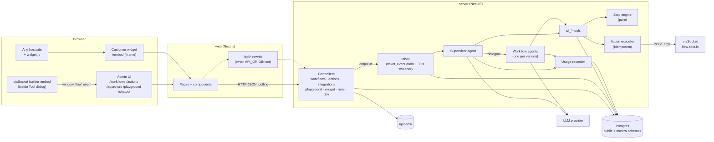
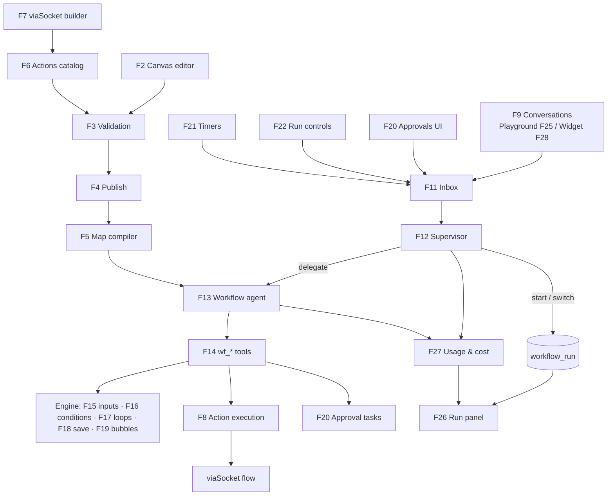
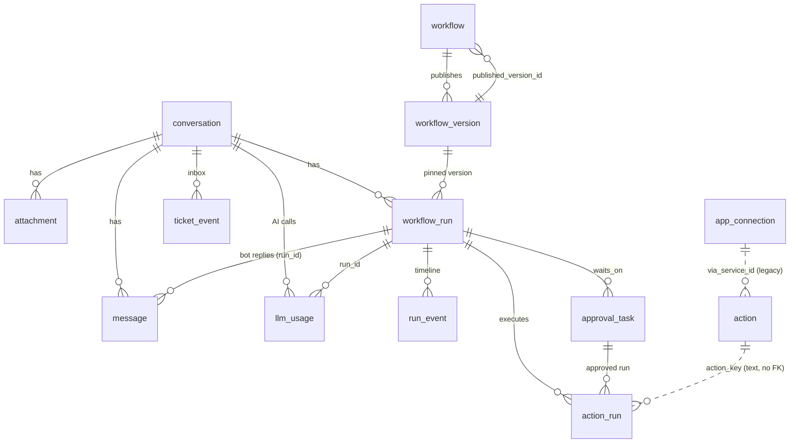
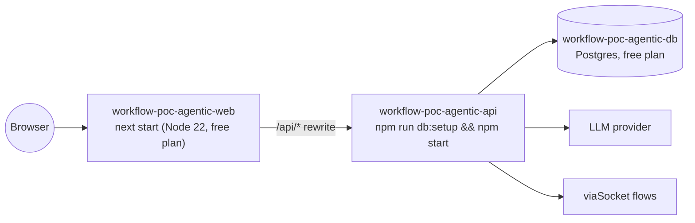
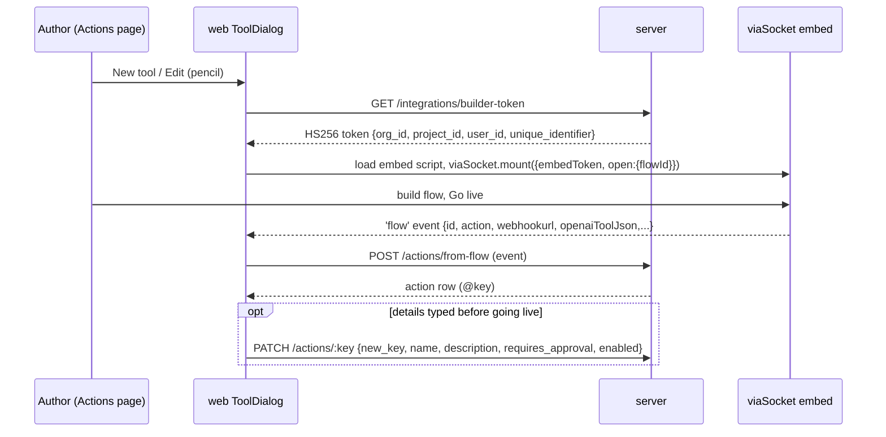
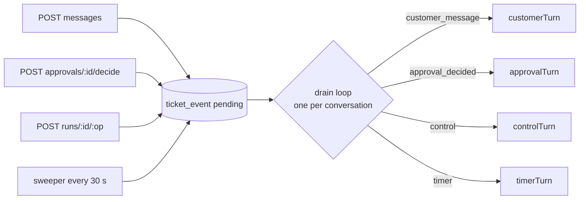
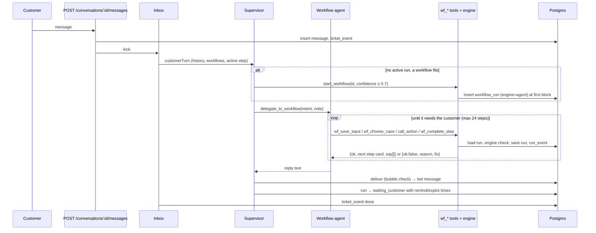
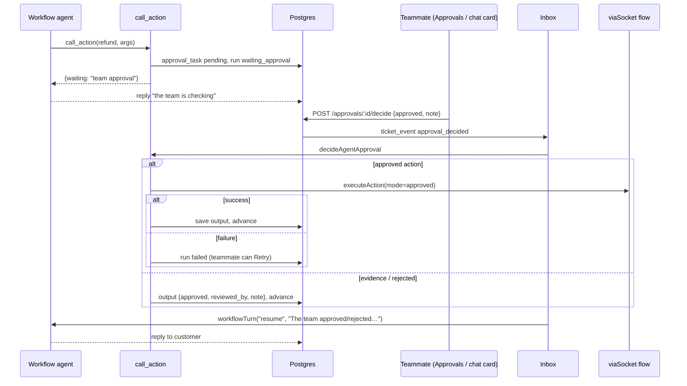
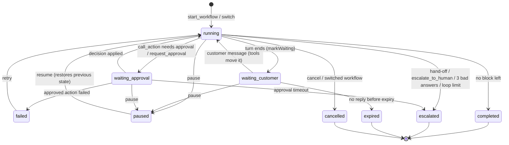

# Workflows POC (agentic): Functional Documentation

High-level functional documentation for `workflow-poc-agentic`, written from the source code as of 2026-10-13.
Low-level details (exact SQL, prompt wording, component props) are left to the code; this document explains **what** each
feature does, **how** the pieces fit together and **where** to look.

> **Conventions.** Paths are relative to the repository root. `⚠ Unverified` marks statements the code alone can't confirm.
> `⚠ Risk` marks architectural or behavioural risks supported by the code. Status values in the inventory:
> **Implemented**, **Partial**, **Legacy** (still in the code or schema but no longer reachable through the app),
> **Dev-only**, **Planned** (described in `docs/*.html` but not in code).

---

## Table of contents

1. [Project overview](#1-project-overview)
2. [Feature inventory](#2-feature-inventory)
3. [System architecture](#3-system-architecture)
4. [Repository structure](#4-repository-structure)
5. [Data model](#5-data-model)
6. [Configuration and environment](#6-configuration-and-environment)
7. [Deployment](#7-deployment)
8. [Feature documentation](#8-feature-documentation)
   - [F1 Workflow management](#f1-workflow-management)
   - [F2 Canvas workflow editor](#f2-canvas-workflow-editor)
   - [F3 Workflow validation](#f3-workflow-validation)
   - [F4 Publishing and versioning](#f4-publishing-and-versioning)
   - [F5 Workflow map compiler](#f5-workflow-map-compiler)
   - [F6 Actions (tool) catalog](#f6-actions-tool-catalog)
   - [F7 viaSocket tool builder integration](#f7-viasocket-tool-builder-integration)
   - [F8 Action execution and idempotency](#f8-action-execution-and-idempotency)
   - [F9 Conversations and messages](#f9-conversations-and-messages)
   - [F10 Attachments](#f10-attachments)
   - [F11 Per-conversation event inbox](#f11-per-conversation-event-inbox)
   - [F12 Supervisor agent (routing)](#f12-supervisor-agent-routing)
   - [F13 Workflow agent](#f13-workflow-agent)
   - [F14 Step engine and `wf_*` tools](#f14-step-engine-and-wf_-tools)
   - [F15 Input blocks](#f15-input-blocks)
   - [F16 Conditions (AI and rules)](#f16-conditions-ai-and-rules)
   - [F17 Loops (repeat limit, ask again)](#f17-loops-repeat-limit-ask-again)
   - [F18 Save response](#f18-save-response)
   - [F19 Text bubbles and the verbatim reply check](#f19-text-bubbles-and-the-verbatim-reply-check)
   - [F20 Approvals](#f20-approvals)
   - [F21 Timers: reminders, expiry, approval timeout](#f21-timers-reminders-expiry-approval-timeout)
   - [F22 Run controls (pause, resume, cancel, retry)](#f22-run-controls-pause-resume-cancel-retry)
   - [F23 Hand-off to a human and workflow switching](#f23-hand-off-to-a-human-and-workflow-switching)
   - [F24 Stale-reply protection and message merging](#f24-stale-reply-protection-and-message-merging)
   - [F25 Playground](#f25-playground)
   - [F26 Run panel and timeline](#f26-run-panel-and-timeline)
   - [F27 AI usage, cost and call traces](#f27-ai-usage-cost-and-call-traces)
   - [F28 Embeddable chat widget](#f28-embeddable-chat-widget)
   - [F29 Model provider configuration](#f29-model-provider-configuration)
   - [F30 Dev endpoints](#f30-dev-endpoints)
   - [F31 Database setup and migrations](#f31-database-setup-and-migrations)
   - [F32 API client and server wake-up handling](#f32-api-client-and-server-wake-up-handling)
   - [F33 Unit tests](#f33-unit-tests)
   - [F34 Legacy viaSocket app actions](#f34-legacy-viasocket-app-actions)
9. [API reference (summary)](#9-api-reference-summary)
10. [Run lifecycle](#10-run-lifecycle)
11. [Architectural risks, duplication and coupling](#11-architectural-risks-duplication-and-coupling)
12. [Verification against the repository](#12-verification-against-the-repository)

---

## 1. Project overview

**What it is.** A proof of concept for "Ticket0 workflows": support playbooks drawn on a canvas and carried out in a
customer chat by AI agents. It started as a copy of a sibling baseline (`../workflows-poc`, a DBOS-runner version) and
replaces the deterministic runner with agents (`README.md`).

**Core idea.** Two kinds of [Mastra](https://mastra.ai) agents talk to the customer:

- a **supervisor** reads every customer message and decides who handles it;
- one **workflow agent per published workflow version** walks the canvas block by block.

Agents never change run state directly. Every move goes through a `wf_*` tool, which checks it with a **pure step engine**
(`server/src/engine/engine.ts`, no DB and no AI). The engine stops the agent from skipping steps, taking a wrong branch,
running an action twice or bypassing an approval.

**Primary use cases**

| Who | Use case |
|---|---|
| Workflow author | Build a workflow on a canvas (AI steps, text bubbles, inputs, conditions, loops), publish it, enable it. |
| Workflow author | Create tools (actions) in viaSocket's embedded builder; mention them in steps as `@key`. |
| Teammate | Watch chats in the Playground, read each run's steps, timeline and AI cost, approve or reject actions, pause/resume/cancel/retry runs, write in the chat as "Team". |
| Customer | Chat in the Playground (as a persona) or through the embeddable widget on another site. |
| Developer | Drive the `wf_*` tools by hand through `/dev/*` routes, inspect the agent map, probe the model. |

**POC shortcuts stated in `README.md`** (confirmed in code): single tenant (no `org_id`), no authentication, playground
conversations stand in for tickets, run timeline in Postgres `run_event`, files on local disk, replies sent automatically
(no draft mode), models called directly with `LLM_*` env vars.

---

## 2. Feature inventory

Every feature found in the code. Each row links to its section; the **Doc** column marks it as documented.

| ID | Feature | Status | Main code | Doc |
|---|---|---|---|---|
| F1 | Workflow management (list, create, save draft, enable, archive) | Implemented | `server/src/workflows/workflows.service.ts`, `web/src/app/workflows/` | ✅ |
| F2 | Canvas workflow editor (groups, blocks, arrows, palette, undo/redo, copy/paste, tidy, variables) | Implemented | `web/src/components/canvas/*`, `web/src/lib/graph.ts`, `web/src/components/step-editor.tsx` | ✅ |
| F3 | Workflow validation | Implemented | `server/src/workflows/graph.ts` | ✅ |
| F4 | Publishing and versioning | Implemented | `workflows.service.ts#publishWorkflow` | ✅ |
| F5 | Workflow map compiler (canvas → agent map) | Implemented | `server/src/engine/map.ts` | ✅ |
| F6 | Actions catalog (list, enable, needs approval, rename, delete) | Implemented | `server/src/actions/actions.controller.ts`, `web/src/app/actions/page.tsx` | ✅ |
| F7 | viaSocket tool builder integration | Implemented | `web/src/components/viasocket-panel.tsx`, `server/src/integrations/*`, `POST /actions/from-flow` | ✅ |
| F8 | Action execution with idempotency | Implemented | `server/src/actions/execute.ts` | ✅ |
| F9 | Conversations and messages (customer, bot, team, system) | Implemented | `server/src/playground/*` | ✅ |
| F10 | Attachments (image upload, serve) | Implemented | `playground.controller.ts` | ✅ |
| F11 | Per-conversation event inbox + sweeper | Implemented | `server/src/agents/inbox.ts` | ✅ |
| F12 | Supervisor agent (start / switch / delegate / hand off / reply) | Implemented | `server/src/agents/agents.ts`, `prompts.ts` | ✅ |
| F13 | Workflow agent (one per published version) | Implemented | `agents.ts#workflowAgent`, `#workflowTurn` | ✅ |
| F14 | Step engine and `wf_*` tools | Implemented | `engine/engine.ts`, `agents/wf-tools.ts`, `agents/tools.ts` | ✅ |
| F15 | Input blocks (text, email, number, phone; retries; answer ahead) | Implemented | `engine.ts#checkAnswer`, `wf-tools.ts#wfSaveInput` | ✅ |
| F16 | Conditions (AI-judged and rules) | Implemented | `engine.ts#chooseByRules`, `wf-tools.ts#wfChooseCase` | ✅ |
| F17 | Loops with repeat limit and "ask again" | Implemented | `engine.ts#follow`, `#rerun`; `graph.ts#cycles` | ✅ |
| F18 | Save response (action output → variables) | Implemented | `engine.ts#saveResponse`, `web/.../save-response.tsx`, `GET /actions/:key/sample` | ✅ |
| F19 | Text bubbles + verbatim reply check | Implemented | `wf-tools.ts#wfCompleteStep`, `agents.ts#deliver` | ✅ |
| F20 | Approvals (action approval, evidence review) | Implemented / Partial (evidence attachments) | `runner/tasks.ts`, `runner/runs.controller.ts`, `wf-tools.ts#decideAgentApproval` | ✅ |
| F21 | Timers: reminder, expiry, approval timeout | Implemented | `inbox.ts#sweep`, `#timerTurn`, `agents.ts#markWaiting` | ✅ |
| F22 | Run controls: pause, resume, cancel, retry | Implemented | `runs.controller.ts`, `wf-tools.ts#controlAgentRun` | ✅ |
| F23 | Hand-off to a human, workflow switching, yield | Implemented | `wf-tools.ts#wfHandoff`, `#wfSwitchWorkflow`; `agents.ts` | ✅ |
| F24 | Stale-reply protection, quick-message merging | Implemented | `inbox.ts#drain`, `agents.ts#newerMessage` | ✅ |
| F25 | Playground (personas, chat as customer/team) | Implemented | `web/src/app/playground/page.tsx` | ✅ |
| F26 | Run panel (steps view, timeline, controls) | Implemented | `web/src/components/run-panel.tsx`, `run-timeline.tsx`, `tool-call.tsx` | ✅ |
| F27 | AI usage, cost and full call traces | Implemented | `agents/usage.ts`, `prices.ts`, `GET /ai-calls/:id`, `web/.../ai-call.tsx` | ✅ |
| F28 | Embeddable chat widget (loader, iframe, config page, demo host) | Implemented | `web/public/widget.js`, `web/src/app/embed*`, `chatbot/`, `widget.controller.ts` | ✅ |
| F29 | Model provider configuration (OpenAI, Anthropic, OpenAI-compatible) | Implemented | `server/src/agents/mastra.ts`, `config.ts` | ✅ |
| F30 | Dev endpoints (`/dev/*`) and model probe | Dev-only | `server/src/dev/dev.controller.ts` | ✅ |
| F31 | Database setup and migrations | Implemented | `server/scripts/setup-db.js`, `server/migrations/*` | ✅ |
| F32 | API client with server wake-up handling | Implemented | `web/src/lib/api.ts`, `web/src/components/server-status.tsx` | ✅ |
| F33 | Unit tests (engine, map) | Implemented | `server/test/*` | ✅ |
| F34 | viaSocket app actions via stored connection (`source = 'viasocket'`) | Legacy | `integrations/viasocket.ts#runAppAction`, `execute.ts#runViaSocket`, `app_connection` table | ✅ |
| — | Old DBOS runner runs (`workflow_run.engine = 'runner'`) | Legacy | `types.ts#RunRow.engine`, guarded in `wf-tools.ts#active` | ✅ (§11) |
| — | List-form workflows (`workflow.steps`) | Legacy | `workflow.steps` column, stays `[]` | ✅ (§11) |
| — | Mock shop (`shop_order`, `lookup_order`, `refund_order`) | Removed by migration 0009 | `migrations/0009_remove_mock_shop.sql` | ✅ (§5) |
| — | Canvas read-only / run highlight mode | Partial (props exist, no caller) | `canvas.tsx` props `readOnly`, `highlight` | ✅ (§11) |
| — | Evals harness, `ticket_timer` table, Langfuse, GTWY pass-through endpoint, spending limits, draft-reply mode, auth / multi-tenant | Planned | `docs/agent-workflows-full-plan.html`, `README.md` | ✅ (§12) |

---

## 3. System architecture

### 3.1 Components

| Component | Tech | Responsibility |
|---|---|---|
| **web** | Next.js 16, React 19, Tailwind 4, React Flow (`@xyflow/react`), TipTap 3 | Admin UI (workflows, canvas, actions, approvals, playground, chatbot embed) and the customer widget (`/embed`). Talks to the API over HTTP JSON; polls for updates. |
| **server** | NestJS 12 (Express), `pg`, Mastra 1.75, AI SDK providers, zod | REST API; the per-conversation inbox; supervisor and workflow agents; step engine; action execution; timers sweeper. |
| **Postgres** | — | All app data (public schema) and Mastra storage (`mastra` schema). |
| **LLM provider** | OpenAI / Anthropic / OpenAI-compatible | Called by Mastra agents. |
| **viaSocket** | Embed script `embed.viasocket.com`, flow run URLs `flow.sokt.io/func/<id>`, `viasocket-apps` SDK | Tools are built in viaSocket's builder; at runtime the server POSTs args to the flow's run URL. |
| **Local disk** | `UPLOADS_DIR` (default `server/uploads`) | Attachment bytes. |

### 3.2 System architecture diagram



### 3.3 Communication patterns

- **Browser → API**: plain JSON over HTTP (`web/src/lib/api.ts#api`). No websockets: screens **poll**
  (Playground every 1.5 s, widget every 1.5 s, approvals page and nav badge every 3 s).
- **API → agents**: never inline. Every trigger (customer message, approval decision, run control, timer) becomes a
  `ticket_event` row; the inbox handles a conversation's events **one at a time, in insert order** (`inbox.ts#drain`).
- **Agents → state**: only via `wf_*` tools (`wf-tools.ts`), which load the run, ask the engine, save the run and append
  `run_event` rows. The run id comes from the Mastra `RequestContext`, never from the model (`tools.ts#runIdOf`).
- **Server → viaSocket**: HTTP POST to the flow URL with the agent's arguments (`viasocket.ts#runFlow`).
- **viaSocket → app**: the embedded builder emits a `flow` event in the browser; the web app forwards it to
  `POST /actions/from-flow`.
- **Widget ↔ host page**: `postMessage({ t0: 'close' })` from the iframe; the loader checks the origin.

### 3.4 Feature interaction diagram



### 3.5 Shared utilities and cross-cutting services

| Utility | File | Used by |
|---|---|---|
| `q`, `one`, `tx` (pg pool helpers, pool size 10) | `server/src/db.ts` | Every server module |
| `config` (env reads; throws if `DATABASE_URL` missing) | `server/src/config.ts` | Everything |
| `addEvent` (append to `run_event`) | `server/src/runner/events.ts` | Tools, agents, inbox, tasks |
| `loadRun`, `saveRun`, `baseVars`, `loadTranscript` | `server/src/runner/context.ts` | Tools, agents |
| `openTask` (approval task, one pending per run+node) | `server/src/runner/tasks.ts` | `wf_*` tools |
| `renderInline`, `stepActions` (Inline[] → text / action keys) | `server/src/workflows/inline.ts` | Engine, map, validation |
| `trackedGenerate`, `recordUsage`, `priceOf` | `server/src/agents/usage.ts` | Every agent call |
| `api`, `ApiError`, `usd`, `money` | `web/src/lib/api.ts` | Every web page |
| Graph edit helpers (immutable) | `web/src/lib/graph.ts` | Canvas, run panel |
| UI primitives (`Button`, `Card`, `Toggle`, `StatusChip`, `AttentionDot`) | `web/src/components/ui.tsx` | All pages |

There is **no middleware** (no auth guard, no interceptors, no global exception filter). NestJS defaults turn thrown
`HttpException`s into JSON error responses; the body parser accepts JSON up to 8 MB (`main.ts`).

---

## 4. Repository structure

```
workflow-poc-agentic/
├─ README.md                    How it works, how to run, POC shortcuts
├─ render.yaml                  Render blueprint: Postgres + API + web
├─ .claude/launch.json          Dev server entries (agentic-server :4011, agentic-web :4010)
├─ docs/
│  ├─ agent-run-workflows-plan.html   Options study: letting an agent run workflows (Mastra vs GTWY)
│  ├─ agent-workflows-full-plan.html  The plan this POC implements (stages, tool contract, risks)
│  └─ FUNCTIONAL_DOCUMENTATION.md     This file
├─ server/                      NestJS API + agents
│  ├─ src/
│  │  ├─ main.ts                Boot: Nest app, body limit, CORS, listen, startInbox()
│  │  ├─ app.module.ts          Registers all 7 controllers (no providers/modules)
│  │  ├─ config.ts              Env config + limits (maxVisits 100, maxGraphSteps 50)
│  │  ├─ db.ts                  pg Pool + q/one/tx
│  │  ├─ types.ts               Shared domain types: graph, actions, run, facts, waiting_for, built-in variables
│  │  ├─ engine/
│  │  │  ├─ engine.ts           ★ Pure step engine: flow, inputs, rules, loops, save response, action plans, step cards
│  │  │  └─ map.ts              ★ Canvas → read-only workflow map (+ prompt text)
│  │  ├─ agents/
│  │  │  ├─ agents.ts           ★ Supervisor, workflow agents, turns, reply delivery, waiting
│  │  │  ├─ inbox.ts            ★ ticket_event queue, drain loop, timers, sweeper
│  │  │  ├─ wf-tools.ts         ★ wf_* moves, run start, approvals, controls
│  │  │  ├─ tools.ts            wf_* as Mastra tools (zod schemas)
│  │  │  ├─ prompts.ts          Base, supervisor, workflow and per-turn prompt text
│  │  │  ├─ mastra.ts           Model factory, Mastra storage/memory, dev probe agent
│  │  │  ├─ usage.ts            llm_usage rows, cost, request/response trace
│  │  │  └─ prices.ts           $/1M-token price table
│  │  ├─ workflows/             Controller, service (CRUD/publish), graph validation, inline text helpers
│  │  ├─ actions/               Actions controller (CRUD, from-flow, sample) + executor
│  │  ├─ integrations/          viaSocket builder token, flow runner, legacy app actions, template filler
│  │  ├─ playground/            Conversations, messages, attachments, AI call detail, widget API
│  │  ├─ runner/                Run context load/save, run_event writer, approval tasks, runs/approvals controller
│  │  └─ dev/                   /dev/* routes (DEV_ENDPOINTS=1)
│  ├─ migrations/0001…0015.sql  Schema history (0008 is absent)
│  ├─ scripts/setup-db.js       Create DB if missing, apply migrations once each
│  ├─ test/                     node:test unit tests for engine + map (fixtures: "Item return" graph)
│  └─ dist/, dist-test/         Build outputs (git-ignored)
└─ web/                         Next.js app
   ├─ public/widget.js          Embeddable loader (bubble + iframe, window.Ticket0Chat)
   ├─ next.config.ts            /api/* → API_ORIGIN rewrite
   └─ src/
      ├─ app/                   Routes: / → /workflows, workflows, workflows/[id], actions, approvals,
      │                         playground, chatbot, embed, embed-demo
      ├─ components/
      │  ├─ canvas/             ★ React Flow canvas, group cards, arrows, save-response, variable picker
      │  ├─ step-editor.tsx     TipTap editor with @action and {{variable}} mentions
      │  ├─ run-panel.tsx       ★ Teammate view of a run: cost, controls, steps, approvals card
      │  ├─ run-timeline.tsx    Plain-language timeline from run_event
      │  ├─ viasocket-panel.tsx Tool dialog with embedded viaSocket builder
      │  └─ ai-call.tsx, tool-call.tsx, json-view.tsx, inline-text.tsx, nav.tsx, server-status.tsx, ui.tsx
      └─ lib/                   api client, graph types + edit helpers, inline text type
```

★ = the files that hold most of the business logic.

---

## 5. Data model

All tables live in the `public` schema; Mastra keeps its own tables in schema `mastra` (`mastra.ts#storage`).
The schema is the result of applying `server/migrations/*.sql` in order.

### 5.1 Entity relationship diagram



### 5.2 Tables

| Table | Purpose | Key columns / rules |
|---|---|---|
| `workflow` | Editable draft + live settings | `name` unique among non-archived; `when_to_use`; `graph` (canvas JSON); `action_keys[]`; `step_count`; `enabled`; `published_version_id`; `has_unpublished_changes`; `row_version` (optimistic lock); `archived_at` (soft delete). `steps`, `template` are legacy/unused. |
| `workflow_version` | Frozen published snapshot | `(workflow_id, version)` unique; `graph`; `action_keys`; `agent_map` (built at publish). |
| `action` | Tools a workflow can mention as `@key` | `key` matches `^[a-z][a-z0-9_]{1,47}$`; `input_schema` (JSON schema subset); `requires_approval`; `enabled`; `source` ∈ builtin / mock / viasocket / viasocket_flow; `via_flow_id` (unique), `via_flow_url`; `details_edited`; `subject_field`, `amount_field` (used for approval summaries). Built-ins seeded: `request_approval`, `escalate_to_human`. |
| `conversation` | Stand-in for a ticket | `customer_name`, `customer_email`, `channel` ∈ playground / widget. |
| `message` | Chat transcript | `role` ∈ customer / bot / team / system; `attachment_ids[]`; `run_id`. System messages are notes for teammates and are hidden from agents and the widget. |
| `attachment` | Uploaded file metadata | `sha256`, `size_bytes`, `path` on disk. |
| `workflow_run` | One execution of a version on a conversation | `status` (see §10); `current_node_id`; `facts` (JSON state); `waiting_for`; `outbox` (pending bubbles); `paused_from`; `engine` ∈ runner / agent. **Unique partial index**: at most one active run per conversation. |
| `run_event` | Append-only timeline | `actor` (system / ai / customer / `user:<name>`), `type`, `data`. |
| `approval_task` | Human decision a run waits on | `kind` ∈ evidence / action; `action_key`, `action_args`, `amount_minor`, `summary`, `evidence`; `status` ∈ pending / approved / rejected / expired / cancelled; `due_at`. **Unique partial index**: one pending task per (run, node). |
| `action_run` | Every action execution | `idempotency_key` **unique** (`<run>:<node>:<visit>`); `mode` ∈ auto / approved / test; `status` ∈ running / succeeded / failed; `args`, `result`, `error`, `visit`. |
| `ticket_event` | Per-conversation inbox | `kind` ∈ customer_message / approval_decided / timer / control; `status` ∈ pending / working / done / failed; `error` also records why an event was skipped. |
| `llm_usage` | One row per model call | `agent`, `model`, tokens, `cost_usd`, `started_at`, `trace` (full request/response per round). |
| `app_connection` | Legacy viaSocket app connection | `script_id_enc` (AES-256-GCM). No code in this repo creates rows. |
| `app_setting` | Key/value settings | Created in 0001; **not referenced by any code**. |
| `schema_migrations` | Applied migration names | Created by `setup-db.js`. |

### 5.3 Run state (`workflow_run.facts`)

Defined in `server/src/types.ts#Facts`. The engine mutates it in place; tools save it.

| Field | Meaning |
|---|---|
| `vars` | The workflow's own variables (input answers, saved responses). |
| `varsBy` | Block id → variables it filled ("ask again" clears them). |
| `outputs` | Block id → its result (input answer, action output, approval decision, or `{ approval_task_id }` while waiting). |
| `cases` | Condition id → chosen case and reason. |
| `attempts` | Block id → invalid input count. |
| `visits` | Loop edge id → visit number (also feeds the idempotency visit). |
| `trail` | Finished block ids in order (detects loops). |
| `since`, `previous`, `asked` | Loop bookkeeping: when a block was re-entered, its result before re-entry, when an input last asked. |
| `collected`, `collectedBy` | Older form of values (seeded with `customer_name`, `email` at run start). |

---

## 6. Configuration and environment

### 6.1 Server (`server/.env`, see `server/.env.example`, read in `server/src/config.ts`)

| Variable | Default | Required | Effect |
|---|---|---|---|
| `DATABASE_URL` | — | **Yes** (boot fails without it) | Postgres connection. |
| `PORT` | 4011 | No | API port. |
| `CORS_ORIGINS` | `http://localhost:4010` | No | Comma list for `enableCors`. |
| `LLM_PROVIDER` | `openai` | For agents | `openai` · `anthropic` · `openai-compatible`. |
| `LLM_MODEL`, `LLM_API_KEY` | — | For agents | Missing → agent calls throw "Set LLM_MODEL and LLM_API_KEY". |
| `LLM_BASE_URL` | — | Only for `openai-compatible` | Gateway base URL. |
| `REMIND_AFTER_SEC` / `EXPIRE_AFTER_SEC` / `APPROVAL_TIMEOUT_SEC` | 120 / 600 / 1800 | No | Customer reminder, chat expiry, approval timeout. |
| `VIASOCKET_ORG_ID`, `VIASOCKET_PROJECT_ID`, `VIASOCKET_EMBED_SECRET` | — | For tools | Builder token signing; SDK client. |
| `VIASOCKET_UID` | `workflow-poc-agentic` | No | viaSocket end-user id (the POC is one end user). |
| `POC_ENCRYPTION_KEY` | — | Legacy only | 32-byte hex key to decrypt `app_connection.script_id_enc` (F34). |
| `DEV_ENDPOINTS` | unset | No | `1` enables `/dev/*`. |
| `UPLOADS_DIR` | `<cwd>/uploads` | No | Attachment folder (read in `playground.controller.ts`, not in `config.ts`). |

Hard-coded limits (`config.ts`): `maxVisits = 100` (loop repeat limit range), `maxGraphSteps = 50`.
Engine constants: `MAX_ASKS = 3` (`engine.ts`), `START_CONFIDENCE = 0.7`, `SWITCH_CONFIDENCE = 0.8` (`wf-tools.ts`),
supervisor `maxSteps: 6`, workflow agent `maxSteps: 24`, history window 20 messages (`agents.ts`).

### 6.2 Web (`web/.env.example`, `next.config.ts`)

| Variable | Effect |
|---|---|
| `NEXT_PUBLIC_API_URL` | API base used by the browser (default `http://localhost:4011`; `/api` in Render). |
| `API_ORIGIN` | When set, Next rewrites `/api/:path*` to this origin, so the browser needs no CORS. |

---

## 7. Deployment

Supported by `render.yaml` (Render Blueprint):



- **API**: builds with `nest build`; on every start runs migrations (`db:setup`) then `node dist/main.js`. Health check
  `GET /actions`. Secrets (`LLM_API_KEY`, `VIASOCKET_*`, `POC_ENCRYPTION_KEY`) are entered in Render (`sync: false`).
  Model set to `openai` / `gpt-6-luna`.
- **Web**: `next build`, `next start -p $PORT`; `NEXT_PUBLIC_API_URL=/api`, `API_ORIGIN` points to the API service.
- **Free-plan sleep**: the web client waits for the API to wake (F32).
- **Local**: `.claude/launch.json` starts `npm --prefix server run dev` (4011) and `npm --prefix web run dev` (4010).
- ⚠ Risk: attachments go to the API's local disk. ⚠ Unverified: whether the Render free plan keeps that disk across
  restarts and deploys; if not, uploaded files are lost while their DB rows remain.

---

## 8. Feature documentation

### F1 Workflow management

1. **Purpose.** Let authors keep a list of workflows, each a playbook for one kind of customer request.
2. **Business logic.** A workflow has a name, a "when to use" description (the supervisor routes on it), a canvas graph,
   an enabled switch and a published version. Deleting **archives** it: running conversations finish on their pinned
   version; new ones can't start it.
3. **Flow.**
   1. `/workflows` lists non-archived workflows with step count, live version and an "unpublished changes" hint.
   2. **New workflow** → `POST /workflows` creates "Untitled workflow" (or "… N" if taken) with an empty Start group, then opens the editor.
   3. The editor saves drafts with `PUT /workflows/:id` (sends `row_version`).
   4. The toggle calls `PATCH /workflows/:id { enabled }`; enabling requires a published version.
   5. Delete calls `DELETE /workflows/:id` (sets `archived_at`, `enabled = false`).
4. **Components.** `web/src/app/workflows/page.tsx`, `web/src/app/workflows/[id]/page.tsx`; `server/src/workflows/workflows.controller.ts`, `workflows.service.ts`.
5. **APIs.** `GET/POST /workflows`, `GET/PUT/PATCH/DELETE /workflows/:id`, `GET /variables`.
6. **Data.** `workflow`; `workflow_version` (join for `published_version`).
7. **Dependencies.** F3 (every read/save returns `validation`), F4.
8. **Failures.** Concurrent edit → `409 "This workflow changed elsewhere — reload…"` (optimistic lock on `row_version`).
   Missing name → 400. Unknown/archived id → 404. Enabling unpublished → 400. The editor warns before leaving with unsaved changes.
9. **Security.** None (no auth; any caller can edit or archive).

### F2 Canvas workflow editor

1. **Purpose.** Draw a workflow as groups of blocks joined by arrows (Typebot-style, per code comments).
2. **Business logic.** Block types (`web/src/lib/graph.ts#BLOCKS`):

   | Palette section | Block | Stored as | Runtime meaning |
   |---|---|---|---|
   | Bubbles | Text | `bubble` | Fixed message sent word for word (F19). |
   | Inputs | Text / Email / Number / Phone | `input` (`saveAs`, `format`, optional `retry` text) | Ask and save the answer in a variable (F15). |
   | Logic | Condition | `condition` with `mode: 'rules'` | Branch by rules (F16). |
   | Logic | AI condition | `condition` (mode `ai`) | The AI picks a case (F16). |
   | AI | AI step | `step` (`content`, optional `save`) | AI instruction; may mention `@actions` and save their response (F18). |

   Text uses rich inline content: plain text, `@action` mentions and `{{variable}}` chips (`types.ts#Inline`).
   A group's last block leads out through **one** arrow; each condition case has its own output. Arrows that close a loop
   show a repeat limit and an "ask again" checkbox (F17).
3. **Flow / interactions** (`canvas.tsx`, `group-card.tsx`, `edge.tsx`):
   - Drag a palette item onto a card (insert at the drop line) or onto empty canvas (new group).
   - Drag a block by its grip to reorder, move to another group, or make a new group; a group left empty is removed (not the Start group).
   - Drag from an output dot to a handle, card or block; dropping on empty canvas creates a new group with an AI step and connects it.
   - Drag either end of an arrow to re-point it; dropping it on nothing deletes it. One arrow per output (new replaces old).
   - Delete/Backspace removes selected groups/arrows; Shift-drag box-selects; Ctrl+C/V/D/A copy, paste, duplicate, select all (fresh ids).
   - Undo/redo (Ctrl+Z / Ctrl+Shift+Z) at page level; text fields keep their own undo.
   - Zoom, fit, minimap, and **Tidy up** (columns by distance from Start).
   - **Variables** panel: declare the workflow's own variables (lowercase, digits, `_`); inputs fill them, rules compare them, any text can show them.
   - Step counter "N of 50 steps" (conditions don't count).
4. **Components.** `web/src/components/canvas/{canvas,group-card,edge,context,save-response,var-select}.tsx`, `web/src/components/step-editor.tsx` (TipTap with `@` and `{{` suggestion menus), `web/src/lib/graph.ts` (pure edit helpers), `web/src/lib/inline.ts`.
5. **APIs.** Loads `GET /workflows/:id`, `GET /actions` (for `@` menu), `GET /variables` (built-ins); `GET /actions/:key/sample` for Save response.
6. **Data.** `workflow.graph` (`WorkflowGraph`: `start`, `groups[{id,title,x,y,items}]`, `edges[{from,to,maxVisits,fresh}]`, `variables[]`).
7. **Dependencies.** F6 (action list), F3 (server re-validates on save).
8. **Failures.** Editing is local until Save/Publish; validation issues appear after save (F3).
9. **Security.** None.

### F3 Workflow validation

1. **Purpose.** Stop a workflow that can't run correctly from being published.
2. **Business logic** (`server/src/workflows/graph.ts#validateGraph`). Issues are human-readable strings. Checks:
   - at least one group; every group has a block; unique item ids;
   - AI steps not empty; Save response needs an `@action` in the step, a path and a variable for each field, no variable saved twice;
   - bubbles not empty and can't contain `@actions`;
   - inputs have a variable and a known format;
   - conditions start with If, Else is last; AI cases need text; rule cases need at least one rule with a variable, a known operator, and a chosen compare variable if `ref` is used;
   - start group exists; arrows point to existing groups/blocks/cases; one arrow per output; repeat limit 1–100;
   - every group reachable from Start;
   - every cycle (Tarjan SCC, `cycles()`) has at least one arrow with a repeat limit;
   - at most 50 non-condition blocks;
   - every `@action` exists and is enabled; every `{{variable}}` is built-in (`customer.name`, `customer.email`, `today`) or declared; declared names are lowercase/digits/`_`.
3. **Flow.** Run on every `GET`, `POST`, `PUT` of a workflow; the result (`validation.issues`, `action_keys`, `step_count`) is returned and the counts are stored. Publish refuses if issues exist.
4. **Components.** `graph.ts`, called from `workflows.service.ts#check`.
5. **APIs.** Embedded in workflow responses; publish failure returns `400 { message: 'Fix these before publishing', issues }`.
6. **Data.** Reads `action.enabled`.
7. **Dependencies.** F6.
8. **Failures.** Validation never blocks saving a draft, only publishing.
9. **Security.** N/A.

### F4 Publishing and versioning

1. **Purpose.** Freeze a tested draft so live conversations use a fixed version while authors keep editing.
2. **Business logic.** Publish creates `workflow_version` N+1 with the name, when-to-use, graph, action keys and the
   built **agent map** (F5); sets it as `published_version_id`, clears `has_unpublished_changes` and **enables** the
   workflow. Runs pin `workflow_version_id`, so running conversations keep their version.
3. **Flow.** Editor **Publish** → saves the draft first if dirty → `POST /workflows/:id/publish` → transaction inserts the version and updates the workflow.
4. **Components.** `workflows.service.ts#publishWorkflow`, `engine/map.ts#buildMap`.
5. **APIs.** `POST /workflows/:id/publish`.
6. **Data.** `workflow_version` (`agent_map`), `workflow`.
7. **Dependencies.** F3, F5, F6 (`needsApproval()` marks tools that need approval in the map).
8. **Failures.** Validation issues → 400 with `issues`. Version number is computed inside the transaction; ⚠ Unverified: two simultaneous publishes could race on `max(version)+1` (the unique `(workflow_id, version)` constraint would reject one).
9. **Security.** None.

### F5 Workflow map compiler

1. **Purpose.** Give each workflow agent a compact, read-only plan of the whole workflow.
2. **Business logic** (`engine/map.ts#buildMap`). Numbers groups in run order (breadth-first from Start; unreachable groups last, flagged), numbers items `group.item` (e.g. `2.1`), lists each block's type, text, collected variable/format, tools (with "needs approval"), save mappings, condition cases and where each goes, group exits and loops (max visits, "ask again"/"keep answers"). Also renders it as prompt text (`mapText`).
3. **Flow.** Built at publish (stored in `workflow_version.agent_map`) **and** rebuilt from the graph when a workflow agent is first created for a version (`agents.ts#workflowAgent`), so format changes reach older versions.
4. **Components.** `engine/map.ts`; `agents.ts`; `dev.controller.ts` (`GET /dev/workflows/:id/map`).
5. **APIs.** Dev only: `GET /dev/workflows/:id/map`.
6. **Data.** `workflow_version.graph`, `workflow_version.agent_map`, `action.requires_approval`.
7. **Dependencies.** F4, F13.
8. **Failures.** A version with no graph gets a placeholder map ("follow the current step card").
9. **Security.** N/A. ⚠ Risk: the stored `agent_map` is only read by the dev endpoint; the runtime uses a rebuilt map — two sources of the same data (§11).

### F6 Actions (tool) catalog

1. **Purpose.** Manage the tools workflows can call with `@key`.
2. **Business logic.**
   - Sources shown: `builtin` (`request_approval` → opens an evidence review; `escalate_to_human` → ends the run as escalated), `viasocket_flow` (built in viaSocket), `viasocket` (legacy, F34).
   - **Enabled** switch: disabled actions fail validation and are rejected at run time.
   - **Needs approval** switch (non-built-ins): the action waits for a teammate before it runs (F20). New viaSocket tools start with it **on**.
   - Rename (`new_key`) only if no workflow or published version mentions the key; key format enforced.
   - Name/description edits set `details_edited`, so later viaSocket updates don't overwrite them.
   - Delete only for viaSocket sources, and only if no active workflow uses the key.
3. **Flow.** `/actions` lists all actions; toggles call `PATCH /actions/:key`; pencil opens the Tool dialog (F7); trash calls `DELETE /actions/:key`.
4. **Components.** `server/src/actions/actions.controller.ts`; `web/src/app/actions/page.tsx`; `web/src/components/viasocket-panel.tsx`.
5. **APIs.** `GET /actions`, `GET /actions/:key`, `PATCH /actions/:key`, `DELETE /actions/:key`, `GET /actions/:key/sample`, `POST /actions/from-flow`.
6. **Data.** `action`; `action_run` (sample).
7. **Dependencies.** F7, F3, F14.
8. **Failures.** Bad key format, duplicate key, key in use, empty name/description → 400 with a readable message. Unknown key → 404.
9. **Security.** None. ⚠ Risk: `via_flow_url` is treated "like a credential" (migration 0005 comment) but `GET /actions` returns full rows, including it, to any caller.

### F7 viaSocket tool builder integration

1. **Purpose.** Build tools (app integrations, HTTP flows) in viaSocket's own builder instead of in this app.
2. **Business logic.** The app keeps no app connections of its own; connections are made inside the builder. When a tool
   is published/updated/paused/deleted in the builder, its `openaiToolJson` (or `mcpToolJson`, or sample payload keys)
   becomes the action's input schema and its run URL is stored.
   - **published/updated** → upsert action (new key derived from the tool name and made unique; `requires_approval = true`, `kind = 'write'`).
   - **paused** → disable.
   - **deleted** → delete the action, or only disable it if an active workflow uses it.
3. **Flow.**



4. **Components.** `web/src/components/viasocket-panel.tsx#ToolDialog`; `server/src/integrations/integrations.controller.ts`, `viasocket.ts#builderToken`; `actions.controller.ts#fromFlow`.
5. **APIs / integrations.** `GET /integrations/builder-token`; `POST /actions/from-flow`; external: `https://embed.viasocket.com/prod-embedcomponent.js`, flow URLs `https://flow.sokt.io/func/<id>`.
6. **Data.** `action.via_flow_id`, `via_flow_url`, `input_schema`, `details_edited`.
7. **Dependencies.** `VIASOCKET_*` env vars; F6.
8. **Failures.** Missing viaSocket env → 400 "viaSocket is not configured". Event without a valid flow URL → 400 "not a viaSocket flow event". Script load failure shown in the dialog. Draft events are ignored.
9. **Security.** Token signed server-side with `VIASOCKET_EMBED_SECRET`. ⚠ Risk: `POST /actions/from-flow` is unauthenticated: anyone can create/overwrite an action pointing to any `flow.sokt.io` URL (the URL pattern is the only check).

### F8 Action execution and idempotency

1. **Purpose.** Run a tool exactly once per step visit, even across retries and restarts.
2. **Business logic** (`actions/execute.ts#executeAction`).
   - Idempotency key = `<runId>:<nodeId>:<visit>`; `visit` grows each time a loop jumps back (`engine.ts#visitOf`), so a re-run in a loop runs again, but a repeat within one visit doesn't.
   - Inserts `action_run` (`on conflict do nothing`); a stored success is returned without calling the tool; a stored failure is retried with possibly corrected args.
   - The call happens inside a transaction holding a `FOR UPDATE` lock on the `action_run` row.
   - Runner by source: `viasocket_flow` → `runFlow` (POST JSON, 60 s timeout); `viasocket` → legacy `runViaSocket`; anything else → error "has no runner".
   - **Failure detection** (`viasocket.ts#flowError`): HTTP ≥ 400, or HTTP 200 with `success: false`, `status/statusCode ≥ 400`, or a truthy `error`.
   - Records `subject_ref` and `amount_minor` from the action's `subject_field` / `amount_field`.
3. **Flow.** Called by `call_action` (mode `auto`) and by an approved decision or retry (mode `approved`, with `approval_task_id`).
4. **Components.** `execute.ts`, `integrations/viasocket.ts`, `integrations/template.ts`.
5. **APIs / integrations.** viaSocket flow URLs.
6. **Data.** `action_run`.
7. **Dependencies.** F6/F7 (action row), F14, F20.
8. **Failures.** Errors are stored on `action_run.error` and returned as `{ ok:false }`; the tool tells the agent to fix args or hand off (auto mode) or marks the run `failed` (approved mode).
9. **Security.** Flow URL format re-checked before POST. ⚠ Risk: the HTTP call (up to 60 s) runs while a pooled DB connection holds a transaction and row lock; the pool has 10 connections.

### F9 Conversations and messages

1. **Purpose.** Hold the chat that a workflow runs in; stands in for a Ticket0 ticket.
2. **Business logic.** Message roles: `customer` (wakes the agents), `bot` (agent reply), `team` (teammate; visible to the customer and to agents as `[Teammate] …`, but **does not** wake the run), `system` (notes for teammates; hidden from agents and widget). Channel: `playground` or `widget`.
3. **Flow.** Customer message → stored → `enqueue(conversation, 'customer_message')` (F11). Team message → stored only.
4. **Components.** `server/src/playground/conversations.ts#postCustomerMessage`, `playground.controller.ts`, `widget.controller.ts`.
5. **APIs.** `GET/POST /conversations`, `GET /conversations/:id` (one poll returns conversation, messages, runs, events (latest 500), approvals, action runs of the latest run, AI usage), `POST /conversations/:id/messages`, `POST /conversations/:id/team-messages`.
6. **Data.** `conversation`, `message`, `attachment`, plus joined run data.
7. **Dependencies.** F11.
8. **Failures.** Empty message → 400. If enqueuing fails, a system message "Error: …" is added.
9. **Security.** None; any caller can read any conversation by id.

### F10 Attachments

1. **Purpose.** Let customers send images (e.g., proof of damage).
2. **Business logic.** Upload as base64 JSON (1 byte – 5 MB), SHA-256 recorded, bytes written to `UPLOADS_DIR/<attachment id>`; served with its stored MIME type. Agents only see "[N attachment(s)]" in the transcript, not the image.
3. **Flow.** Web reads the file → `POST /attachments` → id → message with `attachment_ids`.
4. **Components.** `playground.controller.ts#upload`, `#file`; Playground and widget composers (image picker, `accept="image/*"`).
5. **APIs.** `POST /attachments`, `GET /attachments/:id`.
6. **Data.** `attachment`, `message.attachment_ids`.
7. **Dependencies.** Local disk.
8. **Failures.** Size out of range → 400; unknown id → 404.
9. **Security.** ⚠ Risk: no auth, no check that the uploader owns the conversation, and the MIME type is client-supplied and echoed back as `Content-Type`.

### F11 Per-conversation event inbox

1. **Purpose.** Serialize everything that can make an agent act on a conversation, so turns never overlap.
2. **Business logic** (`agents/inbox.ts`).
   - Event kinds: `customer_message`, `approval_decided`, `control`, `timer`.
   - `enqueue` inserts a row and "kicks" a drain loop for that conversation; only one loop per conversation per process (`draining` set).
   - `drain` claims the oldest pending event (`FOR UPDATE SKIP LOCKED`), dispatches it, marks it `done` or `failed` (a failure also adds a system message "Error: …").
   - Merging and skipping (F24).
   - **Boot recovery** (`startInbox`): events left `working` go back to `pending`, and every conversation with pending events is kicked. Then the sweeper starts (every 30 s, F21).
3. **Flow.**



4. **Components.** `inbox.ts`; dispatch targets in `agents.ts`.
5. **APIs.** Indirect (all producers above).
6. **Data.** `ticket_event`.
7. **Dependencies.** F12, F20, F21, F22.
8. **Failures.** Exceptions are caught per event. A crash mid-turn leaves `working` rows that are retried at next boot (the turn may then run twice; tools are idempotent but replies could be duplicated — ⚠ Unverified in practice).
9. **Security.** N/A. ⚠ Risk: "one drain per conversation" is an in-memory `Set`; with more than one API instance, two instances could process different events of the same conversation at once (§11).

### F12 Supervisor agent (routing)

1. **Purpose.** Read every customer message first and decide who handles it.
2. **Business logic** (`agents.ts#customerTurn`, `prompts.ts#supervisorPrompt`). The supervisor gets the published
   enabled workflows (id · name · when to use), the active run's current step and progress, and the last 20 messages.
   It decides:

   | Situation | Tool | Rule enforced in code |
   |---|---|---|
   | Message belongs to the active workflow / is not an answer / short off-topic question | `delegate_to_workflow` with intent `answer` · `not_an_answer` · `off_topic` (+ optional note) | Needs an active run; once per turn |
   | No active workflow and one fits | `start_workflow` then delegate | Confidence ≥ 0.7; no active run; workflow published, enabled, not archived |
   | Clearly different request covered by another workflow | `switch_workflow` then delegate | Confidence ≥ 0.8; target ≠ current |
   | Customer asks for a person | `hand_off` | Ends the active run as escalated (if any) |
   | Unsure (0.4–0.7) or nothing fits | Replies itself | (prompt rule) |

   Before calling the model: if the conversation has **no active run and the last run was escalated**, the bot stays
   silent (system note). If the active run is **paused**, the message is logged and a note says the bot replies after resume.
3. **Flow.**



4. **Components.** `agents.ts` (`supervisor`, `supervisorTools`, `customerTurn`), `prompts.ts`, `wf-tools.ts#wfStart`, `#wfSwitchWorkflow`, `#wfHandoff`.
5. **APIs / integrations.** LLM via Mastra.
6. **Data.** `workflow`, `workflow_run`, `message`, `run_event` (`customer_message`, `supervisor_delegated`, `supervisor_replied`), `llm_usage` (agent `supervisor`).
7. **Dependencies.** F13, F11, F27, F29.
8. **Failures.** Tool rejections return `{ ok:false, reason, fix }` for the model to follow. If the supervisor replies itself but the customer wrote again meanwhile, the reply is dropped (F24). Model/config errors bubble to the inbox → event `failed` + system "Error" message.
9. **Security.** No auth. Confidence thresholds are self-reported by the model.

### F13 Workflow agent

1. **Purpose.** Carry one conversation through one workflow, block by block.
2. **Business logic** (`agents.ts#workflowAgent`, `#workflowTurn`, `prompts.ts#workflowPrompt`, `#turnContext`).
   - One Mastra `Agent` per published version, cached in memory; instructions = base voice rules + workflow rules + the map text.
   - Each turn adds: intent (+ supervisor note), the **current step card** (JSON), progress (collected variables), action argument specs for the current step, and bubbles not yet sent.
   - Tools: `wf_save_input`, `wf_choose_case`, `wf_complete_step`, `call_action`, `wf_handoff`, `wf_yield`.
   - Keeps moving through blocks while it has what it needs; stops when it needs the customer. Its final text is the reply.
   - `wf_yield` hands the turn back to the supervisor (once per turn) when the customer wants something the workflow doesn't cover.
   - Turns with no new customer message (after an approval, a retry) get a synthetic user line asking it to continue and tell the customer what happened.
   - After the turn: deliver the reply (F19/F24), then set the run to `waiting_customer` with reminder/expiry times (F21).
3. **Flow.** See the sequence in F12.
4. **Components.** `agents.ts`, `prompts.ts`, `tools.ts`, `wf-tools.ts`.
5. **APIs.** LLM via Mastra.
6. **Data.** `workflow_version`, `workflow_run`, `run_event` (`agent_turn`, `agent_replied`, `yielded`, `message_sent`), `llm_usage` (agent `workflow: <name>`).
7. **Dependencies.** F5, F14, F27.
8. **Failures.** Invalid moves are rejected and logged as `move_rejected` (for evals). ⚠ Risk: the per-version agent cache is never invalidated; flipping an action's "Needs approval" after the agent was built leaves the map text stale until restart (enforcement itself reads the live action row, so behaviour stays correct).
9. **Security.** The model never supplies the run id.

### F14 Step engine and `wf_*` tools

1. **Purpose.** Make the server, not the model, decide what is allowed and what comes next.
2. **Business logic.**
   - **Engine** (`engine/engine.ts`, pure): turns the canvas into a `Flow` (`graphFlow`: `first`, `node`, `next`, `afterCase`); unconnected cases fall through to the next block. Provides input checks, rules, loop bookkeeping, save response, argument validation (`validateArgs`: required fields, integer coercion), action planning (`planCall` → reject / run / approval / evidence / escalate), "already ran" (`ranOutput`), completion guard (`completeError`), approval summary (`approvalTask`), step cards (`stepCard`), and `settle` (nothing runs on its own: the run waits at the next block or completes when none is left).
   - **Tools** (`agents/wf-tools.ts`): each tool is `logged` (rejections → `move_rejected` event) and `serial` (one move at a time per run, in-memory promise chain). Shared guard `active()`: must be an agent run, not ended, not waiting for approval.

   | Tool | Allowed when | Effect |
   |---|---|---|
   | `wf_save_input(input_id, value)` | Input is current, or a later input reachable through only bubbles/inputs | Validates format; saves to variable; advances if current; 3 bad tries → escalate |
   | `wf_choose_case(condition_id, case_id, reason)` | Condition is current | Rules mode: server re-computes and rejects a wrong pick; records case; follows its arrow |
   | `wf_complete_step(step_id, summary)` | Block is current | Bubble → queued to outbox; input → must be saved; AI step → its action must have run |
   | `call_action(action_key, args)` | Current block is an AI step that mentions the key | Validates args; returns stored output if already ran; escalate / open approval / run |
   | `wf_handoff(reason)` | Agent run not ended | Ends run `escalated` |
   | `wf_switch_workflow` | (dev / supervisor path only) | Cancels run, starts another (confidence ≥ 0.8) |

   Every success returns `{ ok, run_id, status, progress, next (step card), actions (arg specs), say (pending bubbles), result }`.
3. **Flow.** load run → guard → engine check → mutate `facts` → `commit` (save run, log events, on end cancel pending approvals and log `run_<status>`) → result.
4. **Components.** `engine.ts`, `wf-tools.ts`, `tools.ts`, `runner/context.ts`.
5. **APIs.** Via agents; directly via `/dev/agent-runs/:id/tools/:tool` (F30).
6. **Data.** `workflow_run`, `run_event`, `approval_task`, `action_run`.
7. **Dependencies.** F8, F20.
8. **Failures.** Every rejection carries a `reason` and a `fix` the agent is told to follow.
9. **Security.** ⚠ Risk: `serial()` is an in-process map; it only serializes moves inside one server process (the inbox already serializes per conversation).

### F15 Input blocks

1. **Purpose.** Collect a specific value from the customer into a variable.
2. **Business logic** (`engine.ts#checkAnswer`, `#saveAnswer`, `#countAsk`, `#RETRY`). Formats: `text` (any non-empty), `email` (first email-looking token, lower-cased), `number` (first number, commas removed), `phone` (7–15 digits, optional `+`). Bad answer → reject with retry text (block's own `retry`, else the default per format). More than 3 bad answers → run escalates ("no valid answer after 3 tries"). An answer given early can be saved for a later input if only bubbles/inputs sit between (`reachableInput`); when the run reaches it, the step card shows `answered` and the agent just completes it.
3. **Flow.** Agent reads card `type: input` → asks or saves → `wf_save_input` → advance.
4. **Components.** `engine.ts`, `wf-tools.ts#wfSaveInput`, `group-card.tsx` (input UI with retry text).
5. **APIs.** Via tools.
6. **Data.** `facts.vars`, `facts.outputs`, `facts.attempts`; events `input_received`, `input_invalid`.
7. **Dependencies.** F14.
8. **Failures.** As above.
9. **Security.** N/A.

### F16 Conditions (AI and rules)

1. **Purpose.** Branch the workflow.
2. **Business logic.**
   - **AI condition**: each case has a natural-language "when"; the agent picks one with a reason.
   - **Rules condition**: each case has rules (`variable op value-or-{{other variable}}`) joined by AND/OR; ops `=`, `!=`, `contains` (case-insensitive), `>`, `<` (numeric), `empty`, `not_empty`. The first matching case wins; Else catches the rest. The **agent still picks**, and the server rejects a pick that disagrees with `chooseByRules`, telling it the right case.
   - Values come from built-in variables, older `collected` values and the workflow's own `vars` (`ruleValues`).
3. **Flow.** Card `ai_condition` / `rules_condition` → `wf_choose_case` → `afterCase` follows the case arrow (or falls through).
4. **Components.** `engine.ts`, `wf-tools.ts#wfChooseCase`, `group-card.tsx` (case editor, rule rows, AND/OR switch).
5. **APIs.** Via tools.
6. **Data.** `facts.cases`; event `case_chosen`.
7. **Dependencies.** F14, F15, F18.
8. **Failures.** Unknown case id or wrong rules pick → rejection with fix.
9. **Security.** N/A.

### F17 Loops (repeat limit, ask again)

1. **Purpose.** Allow "try again" paths without infinite loops.
2. **Business logic** (`engine.ts#follow`, `#rerun`). The run keeps a `trail` of finished blocks; following an arrow to a block already on the trail is a loop back. Each loop back counts a visit on that edge; exceeding `maxVisits` ends the run `escalated` (`loop_limit`). Re-run blocks have their outputs, cases and attempts cleared (kept in `previous`). With **ask again** (`fresh`), variables those blocks filled are cleared so the customer is asked again; otherwise earlier answers are kept. Each visit gives actions a new idempotency key (F8). Validation requires a repeat limit on every cycle (F3).
3. **Flow.** Automatic inside every advancing tool.
4. **Components.** `engine.ts`, `graph.ts#cycles`, `edge.tsx` (loop badge and settings), `graph.ts#loopEdges` (web).
5. **APIs.** —
6. **Data.** `facts.visits`, `trail`, `since`, `previous`; events `goto_jumped`, `goto_limit`.
7. **Dependencies.** F14.
8. **Failures.** Limit reached → escalation.
9. **Security.** N/A.

### F18 Save response

1. **Purpose.** Use parts of an action's response later (in text, rules, other steps).
2. **Business logic** (`engine.ts#getPath`, `#saveResponse`). Each mapping is `path → variable`; paths like `status`, `items[0].name`, `items.0.name`, `items.length`, or `$` for the whole response. Missing paths are reported, not fatal. Runs after a successful action (auto or approved).
3. **Flow.** In the editor, "Save response" under an AI step offers a tree of the action's **last successful real response** (`GET /actions/:key/sample`) to pick fields; at runtime `keep()` saves and logs `response_saved`.
4. **Components.** `engine.ts`, `wf-tools.ts#keep`, `web/src/components/canvas/save-response.tsx`, `var-select.tsx`.
5. **APIs.** `GET /actions/:key/sample`.
6. **Data.** `facts.vars`, `facts.varsBy`; `action_run.result`.
7. **Dependencies.** F8.
8. **Failures.** Missing paths shown in the timeline and Steps view ("not in response").
9. **Security.** ⚠ Risk: the sample endpoint returns real customer data from past runs to any caller.

### F19 Text bubbles and the verbatim reply check

1. **Purpose.** Guarantee fixed wording (policies, confirmations) reaches the customer exactly.
2. **Business logic.** Completing a bubble queues its rendered text in `workflow_run.outbox`. When the turn's reply is
   delivered (`agents.ts#deliver`), each pending bubble must appear **word for word**. If any is missing: one rewrite call
   (`bubble-fix`, no tools); if still missing, the server appends the missing lines. Then the outbox is cleared.
   Unset `{{variables}}` render as empty text.
3. **Flow.** `wf_complete_step` (bubble) → `say[]` in results → agent reply → `deliver`.
4. **Components.** `wf-tools.ts#wfCompleteStep`, `agents.ts#deliver`, `engine.ts#bubbleText`, `#shownVars`.
5. **APIs.** —
6. **Data.** `workflow_run.outbox`; events `bubble_fixed`, `message_sent`; `llm_usage` (agent `bubble-fix`).
7. **Dependencies.** F13, F27.
8. **Failures.** Covered by the two fallbacks. If the reply is dropped as stale (F24), bubbles stay pending for the next turn.
9. **Security.** N/A.

### F20 Approvals

1. **Purpose.** Keep a person in the loop for risky actions and evidence reviews.
2. **Business logic.**
   - `call_action` on an action with **Needs approval** opens an `action` task (summary like "Refund order: $79.99 for 4512" from `subject_field`/`amount_field`); built-in `request_approval` opens an `evidence` task with the agent's summary. The run moves to `waiting_approval`; the agent tells the customer the team is checking. One pending task per (run, block).
   - While waiting, every move is rejected ("tell the customer the team is checking").
   - Decision (`POST /approvals/:id/decide`) updates the task, then the inbox runs `approvalTurn`:
     - **approved action** → run it in `approved` mode (same idempotency key); on success save response and advance; on failure the run becomes **`failed`** at that step for a teammate to retry (F22);
     - **evidence** (either decision) and **rejected action** → store `{ approved, reviewed_by, reviewer_note }` as the block's output and advance;
     - then the workflow agent tells the customer.
   - Approvals time out after `APPROVAL_TIMEOUT_SEC` (F21).
3. **Flow.**



4. **Components.** `runner/tasks.ts#openTask`, `runner/runs.controller.ts` (`approvals`, `decide`), `wf-tools.ts` (`wfCallAction`, `decideAgentApproval`, `runApproved`), `agents.ts#approvalTurn`, `web/src/app/approvals/page.tsx`, `run-panel.tsx#ApprovalCard`, nav badge (`nav.tsx`).
5. **APIs.** `GET /approvals?status=pending|all|…`, `POST /approvals/:id/decide`.
6. **Data.** `approval_task`, `action_run`, `workflow_run.waiting_for`; events `approval_requested`, `waiting`, `approval_decided`.
7. **Dependencies.** F8, F11, F13, F21.
8. **Failures.** Deciding a non-pending task → 404. If the decision doesn't match the run's wait, the customer gets "Sorry, I hit a problem on my side…". Ending a run cancels its pending tasks.
9. **Security.** ⚠ Risk: anyone can decide; `by` is free text from the client ("You (team)").
   ⚠ Partial: the Approvals UI shows evidence images from `evidence.attachment_ids` and a reason from `evidence.reason`,
   but the agent path stores only `evidence: { facts: outputs }`, so **customer photos never appear on approval cards**.
   ⚠ Business rule to confirm: a **rejected** action still completes its AI step and the workflow continues to the next block.

### F21 Timers: reminders, expiry, approval timeout

1. **Purpose.** Nudge silent customers, close abandoned chats, and stop approvals waiting forever.
2. **Business logic.**
   - After each workflow turn, an active run becomes `waiting_customer` with `remind_at = now + REMIND_AFTER_SEC` and `expires_at = now + EXPIRE_AFTER_SEC` (`agents.ts#markWaiting`).
   - Every 30 s the sweeper (`inbox.ts#sweep`) finds agent runs with a due reminder, expiry or approval `due_at`, and enqueues **one** `timer` event per conversation.
   - `timerTurn` (no AI, fixed texts): reminder once ("Just checking in: I still need …"); expiry → run `expired` + closing message; approval timeout → run `escalated`, tasks `expired`, message that a teammate will follow up.
3. **Flow.** Sweeper → `ticket_event timer` → drain → `timerTurn`.
4. **Components.** `inbox.ts`, `agents.ts#markWaiting`.
5. **APIs.** —
6. **Data.** `workflow_run.waiting_for`, `approval_task`; events `reminder_sent`, `run_expired`, `run_escalated`.
7. **Dependencies.** F11.
8. **Failures.** Sweep errors are logged. A customer message moves the run back through a turn, which resets the timers.
9. **Security.** N/A. Note: `timerTurn` writes run status directly with SQL instead of through `saveRun`/`commit` (§11).

### F22 Run controls (pause, resume, cancel, retry)

1. **Purpose.** Let a teammate take control of a run.
2. **Business logic.** Allowed states (`runs.controller.ts#ALLOWED`): pause from running / waiting_customer / waiting_approval; resume from paused; retry from failed; cancel from any active state. The request is checked immediately, then applied by the inbox in order with agent turns.
   - **pause**: remembers `status` and `waiting_for` in `paused_from`; timers stop (sweeper ignores `paused`).
   - **resume**: restores them; **no** agent turn.
   - **cancel**: ends run `cancelled`, cancels pending approvals.
   - **retry**: if the failed step has an approved action, re-run it (same key); otherwise set the run back to `running`; then the workflow agent speaks.
3. **Flow.** Run panel button → `POST /runs/:id/:op {by}` → `ticket_event control` → `controlTurn` → `controlAgentRun`.
4. **Components.** `runs.controller.ts`, `agents.ts#controlTurn`, `wf-tools.ts#controlAgentRun`, `run-panel.tsx`.
5. **APIs.** `POST /runs/:id/pause|resume|cancel|retry`.
6. **Data.** `workflow_run.status`, `paused_from`; event `signal`.
7. **Dependencies.** F11, F13, F20.
8. **Failures.** Wrong state → 400 at request time; if state changed before the inbox applies it, a system note "`<op>` failed: …".
9. **Security.** No auth; `by` is client-supplied.
   ⚠ Behaviour to confirm: while paused, a customer message is recorded with the note "the bot will reply after a
   teammate resumes it", but resume returns `turn: false`, so no reply is generated until the customer writes again.

### F23 Hand-off to a human and workflow switching

1. **Purpose.** Escalate cleanly, and follow the customer when they change topic.
2. **Business logic.**
   - **Hand-off**: workflow agent `wf_handoff` or supervisor `hand_off` ends the active run `escalated`. Other escalation paths: `@escalate_to_human` in a step, 3 bad input answers, loop limit, approval timeout. After an escalated run, the bot **stays silent** on that conversation (`customerTurn`).
   - **Switch**: supervisor `switch_workflow` (confidence ≥ 0.8) cancels the current run ("switched to X") and starts the new workflow's run on the same conversation; the timeline shows both runs.
   - **Yield**: the workflow agent's `wf_yield` returns the turn so the supervisor can switch or reply.
3. **Flow.** See F12 table.
4. **Components.** `wf-tools.ts` (`wfHandoff`, `wfSwitchWorkflow`, `startAgentRun`), `agents.ts` (`hand_off`, `switch_workflow`, `wf_yield`).
5. **APIs.** Via agents.
6. **Data.** `workflow_run`, `message` (system notes), events `handoff`, `workflow_switched`, `yielded`, `run_escalated`, `run_cancelled`.
7. **Dependencies.** F12, F13.
8. **Failures.** Low confidence, same workflow, unpublished target → rejection with fix.
9. **Security.** N/A. ⚠ Edge case: `hand_off` with **no** active run only writes a system note; since there is no escalated run, the bot keeps answering later messages.

### F24 Stale-reply protection and message merging

1. **Purpose.** Avoid answering an outdated chat when the customer sends several messages quickly.
2. **Business logic.**
   - **Merge**: when the next customer-message event is claimed and a newer one is pending, the older is marked done ("merged into a later message"); agents read the whole chat anyway.
   - **Seen marker**: each turn records the newest customer message it read (`turn.seenId`); after the turn, pending customer events whose messages are not newer are closed ("answered in an earlier turn").
   - **Drop stale reply**: if a newer customer message arrived during the turn, the reply is not sent (`reply_dropped` event or system note), and pending bubbles wait for the next turn.
3. **Components.** `inbox.ts#drain`, `agents.ts#history`, `#newerMessage`, `#deliver`.
4. **APIs / Data.** `ticket_event`, `message`, `run_event`.
5. **Dependencies.** F11.
6. **Failures / security.** N/A.

### F25 Playground

1. **Purpose.** A test bench that plays both customer and teammate.
2. **Business logic.** Pick a persona (Alex Kim, Sam Rivera, Jo Patel), start a conversation, chat as **Customer** (with image attachments) or **Team**. The list shows each chat's latest run status, last message, a widget badge, and a red dot when an approval is pending. Approval cards appear inline in the chat. A "working…" hint shows while the last message is from the customer and the run is running (or not started).
3. **Flow.** Polls `GET /conversations` and `GET /conversations/:id` every 1.5 s.
4. **Components.** `web/src/app/playground/page.tsx`, `run-panel.tsx`.
5. **APIs.** `/conversations*`, `/attachments`, `/approvals/:id/decide`, `/runs/:id/:op`.
6. **Data.** As F9.
7. **Dependencies.** F9–F27.
8. **Failures.** API errors surface via `ApiError` (send button simply stops being busy).
9. **Security.** Admin surface; no auth.

### F26 Run panel and timeline

1. **Purpose.** The teammate's view of what the agents did and why.
2. **Business logic.**
   - **Header**: workflow name and version, status chip, waiting line (customer: expected values and reminder/expiry time; approval: due time), end reason, control buttons (F22).
   - **Steps**: every group/block of the run's version; current block highlighted; done blocks ticked; unreachable blocks marked **Skipped** (`lib/graph.ts#reachableFrom`); input values, saved variables (JSON trees), chosen case, tool calls with input/response, duration, approved mode and retry number (`tool-call.tsx`).
   - **Timeline**: one plain sentence per meaningful event, grouped by block, one section per run (older runs collapsed), click a line for raw JSON; supervisor and agent lines show the cost of that model call.
3. **Components.** `run-panel.tsx`, `run-timeline.tsx`, `tool-call.tsx`, `json-view.tsx`, `inline-text.tsx`.
4. **APIs.** Data from `GET /conversations/:id`.
5. **Data.** `workflow_run`, `run_event`, `action_run`, `approval_task`, `llm_usage`.
6. **Dependencies.** F27.
7. **Failures.** — 
8. **Security.** —
   Note: the timeline maps some event types that the agent engine never emits (`waiting` for a customer, `error`,
   `input_invalid` with a "not an answer" reason); they are leftovers from the runner era (§11).

### F27 AI usage, cost and call traces

1. **Purpose.** Know what each conversation costs and see exactly what the model was sent.
2. **Business logic** (`agents/usage.ts`). Every agent call goes through `trackedGenerate`, which records an `llm_usage`
   row: agent name, `provider/model`, input/output tokens, cost (from `prices.ts`, $ per 1M tokens; `null` if the model
   has no price), start time, and a **trace** (per model round: the provider request body, text, tool calls, tool results,
   finish reason, usage). The conversation view sums calls and lists models without a price.
3. **Flow.** Run panel "AI cost for this conversation" → click a call → `GET /ai-calls/:id` → dialog with rounds (copyable JSON).
4. **Components.** `usage.ts`, `prices.ts`, `playground.controller.ts` (`aiCall`, `ai_usage`), `web/src/components/ai-call.tsx`, `run-panel.tsx#AiCost`.
5. **APIs.** `GET /ai-calls/:id`; `ai_usage` in `GET /conversations/:id`.
6. **Data.** `llm_usage`.
7. **Dependencies.** F29.
8. **Failures.** Unpriced models count as $0 with a warning in the UI.
9. **Security.** ⚠ Risk: traces contain full prompts and customer messages and are readable by any caller with the id.

### F28 Embeddable chat widget

1. **Purpose.** Put the same agents and workflows inside another product with one script tag.
2. **Business logic.**
   - **Loader** `web/public/widget.js`: reads `data-title`, `data-color`, optional `data-name`/`data-email` (the host's signed-in user); adds a floating button and an iframe to `/embed`; exposes `window.Ticket0Chat.open()/close()`; closes on a `postMessage` from the same origin.
   - **Widget** `/embed`: customer-only view; stores the conversation id in `localStorage` (`t0_widget_conversation`); asks for name/email if the host didn't pass them; supports image attachments; shows "typing…" while a reply is owed and "A teammate is reviewing your request" during approvals; hides system messages, runs, events and approvals.
   - **Config page** `/chatbot`: pick title/colour, toggle "pass the signed-in user", copy the snippet, live preview iframe, open a demo host.
   - **Demo host** `/embed-demo`: fake store page that injects the loader.
   - Widget chats appear in the Playground with a "widget" badge.
3. **Flow.** First send → `POST /widget/conversations {name, email}` → `POST /widget/conversations/:id/messages` → poll `GET /widget/conversations/:id`.
4. **Components.** `widget.js`, `web/src/app/{embed,embed-demo,chatbot}/page.tsx`, `server/src/playground/widget.controller.ts`; `nav.tsx` hides the admin shell on `/embed*`.
5. **APIs.** `POST /widget/conversations`, `GET /widget/conversations/:id`, `POST /widget/conversations/:id/messages`, `POST /attachments`, `GET /attachments/:id`.
6. **Data.** `conversation (channel = 'widget')`, `message`.
7. **Dependencies.** F9, F11.
8. **Failures.** Invalid email → 400; an unknown/non-widget conversation id → 404 and the widget forgets it.
9. **Security.** ⚠ Risk: the customer identity comes from page data or a form and is not verified (any page can claim any email); the conversation id in `localStorage` is the only access key; uploads go through the unauthenticated `/attachments` route.

### F29 Model provider configuration

1. **Purpose.** Choose which model every agent uses.
2. **Business logic** (`agents/mastra.ts#model`). `openai` (optional base URL), `anthropic` (optional base URL), or `openai-compatible` (requires `LLM_BASE_URL`; uses chat completions) — intended for a future GTWY pass-through endpoint (README). Mastra storage uses `PostgresStore` in schema `mastra`; a `Memory` (last 20 messages) exists but only the dev probe agent uses it — supervisor and workflow agents get history from the `message` table instead.
3. **Components.** `mastra.ts`, `config.ts`.
4. **APIs / integrations.** `@ai-sdk/openai`, `@ai-sdk/anthropic`, `@mastra/core`, `@mastra/pg`, `@mastra/memory`.
5. **Data.** `mastra.*` tables (created by Mastra; ⚠ Unverified which tables).
6. **Dependencies.** Env vars.
7. **Failures.** Missing model/key → error at first agent call (the server still boots).
8. **Security.** API key from env only.

### F30 Dev endpoints

1. **Purpose.** Exercise the engine and tools without a model.
2. **Business logic.** Enabled only with `DEV_ENDPOINTS=1` (otherwise 404). Routes: start a test conversation + agent run on a published workflow; read run state (step card, facts, events); call any `wfTools` tool by name with zod-validated args; decide the pending approval; read a workflow's agent map; probe the model (checks key, Mastra memory, usage row).
3. **Components.** `server/src/dev/dev.controller.ts`.
4. **APIs.** `POST /dev/agent-runs`, `GET /dev/agent-runs/:id`, `POST /dev/agent-runs/:id/tools/:tool`, `POST /dev/agent-runs/:id/approval`, `GET /dev/workflows/:id/map`, `POST /dev/llm/probe`.
5. **Data / dependencies.** As F14, F20, F5, F29.
6. **Failures.** Unknown tool or bad args → 400 listing valid tools / zod issues.
7. **Security.** Must stay off in deployed environments (`.env.example` comment; `render.yaml` doesn't set it).

### F31 Database setup and migrations

1. **Purpose.** Create and evolve the schema.
2. **Business logic** (`server/scripts/setup-db.js`). Creates the database through the `postgres` maintenance DB if missing (skipped on managed hosts that forbid it), creates `schema_migrations`, applies each `migrations/*.sql` once, in name order, each in its own transaction. Runs on every Render start.
3. **Migration history (summary).** 0001 base schema + mock shop seed; 0002 viaSocket app actions + `app_connection`; 0003 name unique among non-archived; 0004 single "requires approval" flag, `waiting_approval`, `team` role, `channel`, `visit`; 0005 viaSocket flows; 0006 `details_edited`; 0007 canvas `graph`; **0008 missing** (⚠ Unverified why); 0009 removes mock shop and archives workflows using it; 0010 agents (`engine`, `agent_map`, `llm_usage`); 0011 `ticket_event`; 0012 `control` events; 0013 `cost_usd`; 0014 `started_at` (backfilled from events); 0015 `trace`.
4. **Failures.** Any SQL error aborts with exit code 1. The script never calls `rollback`; the process exits with the
   transaction open, so Postgres discards it when the connection drops and the migration is not recorded.

### F32 API client and server wake-up handling

1. **Purpose.** Make the UI survive the API sleeping on Render's free plan.
2. **Business logic** (`web/src/lib/api.ts`). On network errors, 502/503/504 or non-JSON responses, requests share one wake-up loop polling `GET /variables` with backoff (1 s → 8 s, up to 90 s). Reads are retried once; writes only when the request clearly never reached the API (network error, 502/503). Error messages come from Nest's `message` (with `issues` for publish validation). `ServerStatus` shows a banner while waking.
3. **Components.** `api.ts`, `server-status.tsx`.

### F33 Unit tests

1. **Purpose.** Pin the engine's and map's rules without DB or AI.
2. **Coverage** (`server/test/engine.test.ts`, `map.test.ts`, fixture `fixtures.ts` "Item return" graph): input formats, asks limit, retry texts; rules (first match, `ref`, or / contains / empty / not_empty); loops (visits, fresh vs keep, limit); save response paths; action planning (not allowed, disabled, bad args, approval, escalate, evidence, never twice); settle, answer-ahead reachability, step cards; map numbering, unreachable groups, tools/saves, branches/loops, prompt text.
3. **Run.** `cd server && npm test` (compiles with `tsconfig.test.json`, runs `node --test`).
4. **Gaps.** No tests for `wf-tools.ts`, agents, inbox, controllers, validation (`graph.ts`), executor, or the web app.

### F34 Legacy viaSocket app actions

1. **Purpose (historic).** Actions backed by a viaSocket app action run through a stored, encrypted connection.
2. **Status.** **Legacy.** `source = 'viasocket'` actions still execute (`execute.ts#runViaSocket` → `viasocket.ts#runAppAction`, decrypting `app_connection.script_id_enc` with `POC_ENCRYPTION_KEY`, filling `input_template` via `template.ts#renderTemplate`), and the Actions page can list/delete them, but **nothing in this repository creates** such actions or connections.

---

## 9. API reference (summary)

All routes are unauthenticated JSON unless noted.

| Method | Path | Feature | Purpose |
|---|---|---|---|
| GET | `/workflows` | F1 | List non-archived workflows |
| POST | `/workflows` | F1 | Create (empty Start group) |
| GET | `/workflows/:id` | F1/F3 | Draft + validation |
| PUT | `/workflows/:id` | F1 | Save draft (`row_version`) |
| PATCH | `/workflows/:id` | F1 | Enable/disable |
| DELETE | `/workflows/:id` | F1 | Archive |
| POST | `/workflows/:id/publish` | F4 | Publish new version |
| GET | `/variables` | F2 | Built-in variables (also the web wake-up probe) |
| GET | `/actions` | F6 | List actions (also Render health check) |
| GET | `/actions/:key` | F6 | One action |
| GET | `/actions/:key/sample` | F18 | Last successful response |
| PATCH | `/actions/:key` | F6 | Enable, approval, rename, details |
| DELETE | `/actions/:key` | F6 | Delete viaSocket action |
| POST | `/actions/from-flow` | F7 | viaSocket flow event → action |
| GET | `/integrations/builder-token` | F7 | Builder embed token |
| GET/POST | `/conversations` | F9 | List / create |
| GET | `/conversations/:id` | F9/F26/F27 | Full chat state (poll) |
| POST | `/conversations/:id/messages` | F9 | Customer message → inbox |
| POST | `/conversations/:id/team-messages` | F9 | Team message |
| POST | `/attachments` | F10 | Upload (base64) |
| GET | `/attachments/:id` | F10 | Download (binary) |
| GET | `/ai-calls/:id` | F27 | One model call with trace |
| POST | `/runs/:id/:op` | F22 | pause / resume / cancel / retry |
| GET | `/approvals?status=` | F20 | Tasks with customer and workflow names |
| POST | `/approvals/:id/decide` | F20 | Approve / reject |
| POST | `/widget/conversations` | F28 | Start widget chat |
| GET | `/widget/conversations/:id` | F28 | Customer-safe chat view |
| POST | `/widget/conversations/:id/messages` | F28 | Widget customer message |
| * | `/dev/*` | F30 | Dev only (`DEV_ENDPOINTS=1`) |

---

## 10. Run lifecycle

Statuses (`types.ts#RunStatus`); active = running, waiting_customer, waiting_approval, paused, failed (one per conversation).



Note: during a turn the tools leave the run `running`; `markWaiting` flips it to `waiting_customer` afterwards. The
diagram omits that the tools also accept moves while the run is `waiting_customer` (only ended and `waiting_approval`
runs are refused by `active()`; ⚠ paused runs are not refused by `active()`, but `customerTurn` never delegates while paused).

---

## 11. Architectural risks, duplication and coupling

### 11.1 Security (POC by design, but worth listing)

- **No authentication or authorization** on any route; CORS is the only browser-side restriction (README: "no auth").
- Unverified identities: approvals and controls take `by` from the client; widget customers self-declare their email.
- Sensitive data readable by id or in bulk: conversations, attachments, AI traces (`/ai-calls/:id`), action samples, `via_flow_url` (a credential) in `GET /actions`.
- `POST /actions/from-flow` lets any caller register or overwrite tools.

### 11.2 Single-process assumptions

- `inbox.ts#draining` (one drain per conversation), `wf-tools.ts#serial` (one move per run) and `agents.ts#agents` (agent cache) are in-memory. Running more than one API instance breaks per-conversation ordering and cache freshness. The DB guards that remain: `FOR UPDATE SKIP LOCKED` on event claim, unique active-run index, unique idempotency key, unique pending-approval index.

### 11.3 Reliability

- Long external call inside a DB transaction (F8) with a pool of 10.
- Crash mid-turn → event retried at boot; tool moves are idempotent, but a reply may be sent twice (⚠ Unverified).
- Agent cache never invalidated (F13).
- Local-disk attachments on an ephemeral host (§7).

### 11.4 Duplicated functionality

| Duplicated logic | Places |
|---|---|
| Graph types, `RULE_OPS`, `INPUT_FORMATS`, `MAX_VISITS`, step limit, `graphStepCount` | `server/src/types.ts`, `server/src/config.ts`, `server/src/workflows/graph.ts` ↔ `web/src/lib/graph.ts` |
| Inline text type and rendering | `server/src/types.ts`, `workflows/inline.ts` ↔ `web/src/lib/inline.ts`, `inline-text.tsx` |
| Loop detection | `graph.ts#cycles` (Tarjan, groups) ↔ `web/src/lib/graph.ts#loopEdges` (BFS, edges) |
| Active-status list | `types.ts#ACTIVE`, literal list in `wf-tools.ts#wfStart`, `runs.controller.ts#ALLOWED`, `web/src/components/run-panel.tsx#ACTIVE`, migration index |
| Rule/case text | `engine.ts#stepCard`, `map.ts#ruleText`, `web/src/lib/graph.ts#ruleText` |
| Run-ending logic | `wf-tools.ts#commit` vs direct SQL in `inbox.ts#timerTurn` (different approval-task handling: `cancelled` vs `expired`) |
| Agent map | stored `workflow_version.agent_map` (only read by `/dev`) vs rebuilt in `agents.ts#workflowAgent` |
| Message + attachments query | `playground.controller.ts#get`, `widget.controller.ts#get`, `runner/context.ts#loadTranscript` |
| Money formatting | `engine.ts#money`, `web/src/lib/api.ts#money` |

### 11.5 Tight coupling

- `agents.ts` imports `wf-tools.ts` and vice versa via shared types; `inbox.ts` ↔ `agents.ts` import each other (`inbox` calls turns; `agents` exports `send` used by `inbox`).
- `run-timeline.tsx` hard-codes the server's `run_event.type` strings and `data` shapes; there is no shared contract.
- The approvals UI expects `evidence.attachment_ids` / `evidence.reason` that the agent path doesn't write (F20).

### 11.6 Legacy and dead code

| Item | Evidence |
|---|---|
| `workflow.steps`, `workflow_version.steps` (list form) | Always `[]`; comment in `workflows.service.ts` |
| `workflow.template`, `app_setting` table, `action_run.mode = 'test'` | Never referenced by code |
| `action.kind` | Written (`'write'`) for new viaSocket tools, never read |
| `engine = 'runner'` runs | Rejected by `active()`; sweeper only looks at `engine = 'agent'` |
| `facts.collected` / `collectedBy` | Seeded with name/email; read as fallback only |
| `source = 'viasocket'`, `app_connection`, `POC_ENCRYPTION_KEY` | F34 |
| `source = 'mock'` in check constraint | Mock rows deleted in 0009 |
| Mastra `Memory` | Only the dev probe agent uses it |
| Canvas `readOnly` / `highlight` props | No page passes them |
| Timeline cases for `error`, customer `waiting`, `input_invalid` "not an answer" | Not emitted by agent code |
| Comment "Stage 2 replaces this with the per-ticket inbox lock" in `wf-tools.ts#serial` | Both mechanisms exist |
| Root layout metadata "Workflow builder + durable runner + playground" | Describes the runner baseline |

---

## 12. Verification against the repository

**Method.** Every server source file (`server/src/**`), every migration, the setup script, tests, `render.yaml`,
`README.md`, `.env.example` files and every web route and component were read before writing; the feature inventory
was then cross-checked against the controller list in `app.module.ts`, the routes under `web/src/app`, and the tables
created by the migrations.

**Coverage check**

| Source of truth | Items | Covered by |
|---|---|---|
| Nest controllers (`app.module.ts`) | Workflows, Actions, Integrations, Playground, Widget, Runs, Dev | F1–F4, F6–F7, F9–F10, F20, F22, F27–F28, F30 |
| Web routes (`web/src/app`) | `/`, `/workflows`, `/workflows/[id]`, `/actions`, `/approvals`, `/playground`, `/chatbot`, `/embed`, `/embed-demo` | F1, F2, F6, F20, F25, F28 (`/` redirects to `/workflows`) |
| Tables | All 14 app tables + `schema_migrations` | §5 |
| `ticket_event.kind` values | customer_message, approval_decided, timer, control | F11, F20–F22 |
| Agent tools | start_workflow, switch_workflow, delegate_to_workflow, hand_off, wf_save_input, wf_choose_case, wf_complete_step, call_action, wf_handoff, wf_yield, wf_switch_workflow | F12–F16, F23 |
| Block types | step, bubble, input (4 formats), condition (ai, rules) | F2, F15–F19 |

**Not verifiable from the code alone**

- Exact behaviour of viaSocket's embed events and payload shapes (taken from how the code consumes them).
- Tables Mastra creates in the `mastra` schema.
- Why migration `0008` is absent.
- Whether Render's free plan keeps the uploads folder.
- Whether duplicated replies occur after a crash mid-turn.
- Model pricing accuracy (`prices.ts` cites the OpenAI pricing page, checked 2026-10-13).

**Planned, not implemented** (from `docs/agent-workflows-full-plan.html` and `README.md`)

- Evals harness (scripted chats, pass^5, invalid-move counts). Only `move_rejected` logging exists.
- `ticket_timer` table (timers are derived from `workflow_run.waiting_for` instead).
- Langfuse or other tracing beyond `llm_usage.trace`.
- GTWY pass-through model endpoint (the `openai-compatible` provider is ready for it).
- Spending limits per conversation.
- Draft-reply mode, multi-tenant (`org_id`), authentication, Mongo `run_events`.

**Insufficiently documented areas (by design of this document)**

- Prompt wording (`prompts.ts`) and exact step-card JSON: read the source.
- Canvas UI micro-interactions (handle placement, drop lines): `canvas.tsx`, `group-card.tsx`.
